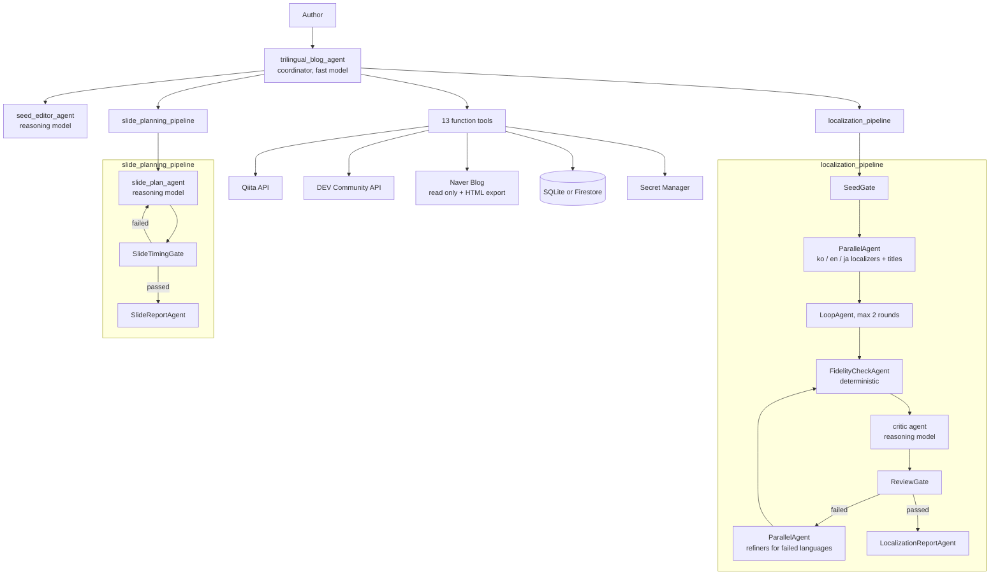

# trilingual-blog-agent

An ADK multi-agent that takes one technical article and carries it through the
rest of a writer's workflow: localize it into the other two of Korean, English
and Japanese, prepare a draft on each language's platform, and plan a talk with
a timed speaker script.

Built with [Agent Development Kit](https://google.github.io/adk-docs/) and
scaffolded with `agents-cli` (Agent Runtime target).

## Problem and solution

Writing a technical post once is work enough. Reaching Korean, English and
Japanese readers means translating it twice without breaking code blocks or
links, re-formatting it for three platforms, and then turning it into slides
when a talk is requested. Most of that is mechanical, and the mechanical parts
are where mistakes creep in: a dropped code block, a changed URL, a slide
script that runs three minutes.

The agent does the mechanical work and leaves every decision that leaves the
machine to a human:

| Stage | What the agent does | Human checkpoint |
| :--- | :--- | :--- |
| 1. Seed | Loads a Markdown draft, or fetches an already published post from Qiita, DEV Community or Naver Blog. Revises it with the author. | Author finalizes the seed |
| 2. Localize | Writes the two missing languages and their titles in parallel, checks structure against the seed in code, has a critic model review meaning, fixes only what failed. | Author reviews the files and titles |
| 3. Publish | Creates a private draft on Qiita (ja) and an unpublished draft on DEV Community (en); exports paste-ready HTML for Naver Blog (ko). Verifies the resulting URLs. | Approval prompt before every write |
| 4. Present | Plans one slide per minute with a speaker script, checks estimated speaking time, re-plans once if it fails. Writes the plan and an artifact manifest. | Author reviews the plan |

Language to platform mapping: Korean → Naver Blog, English → DEV Community,
Japanese → Qiita. A post that was fetched from a platform is never written back
to that platform.

## Architecture



Control flow is decided in code, not by a model: the gate agents in
`app/workflow_agents.py` decide which languages run, whether a review passed
and whether a slide plan meets the timing rule.

## Quick start

Requirements: [uv](https://docs.astral.sh/uv/), the Google Cloud SDK with
Application Default Credentials, and `agents-cli`.

```bash
uv tool install google-agents-cli
agents-cli install            # creates .venv and installs dependencies
cp .env.example .env          # set GOOGLE_CLOUD_PROJECT
```

Platform credentials are read from Secret Manager (never from the repository):

```bash
read -rs TOKEN && printf '%s' "$TOKEN" | gcloud secrets create QIITA_ACCESS_TOKEN --data-file=- && unset TOKEN
read -rs TOKEN && printf '%s' "$TOKEN" | gcloud secrets create DEVTO_API_KEY --data-file=- && unset TOKEN
```

Stages 1, 2 and 4 work without any platform credential.

Run it:

```bash
agents-cli playground                                  # web UI
agents-cli run "Hello, what can you help me with?"     # one-shot from the terminal
```

A typical conversation:

1. "Save this draft as the seed article" followed by the Markdown, or "Use this post: https://qiita.com/...".
2. "It is final." then "Localize it."
3. "Export the Naver HTML and create the Qiita draft." The agent pauses for approval before the Qiita call.
4. "Plan a 5 minute talk in English for backend developers."
5. "Give me the artifact manifest."

Files are written under `workspace/<project-id>/` (`BLOG_AGENT_WORKSPACE_DIR`).

## `agents-cli` commands used in this project

| Command | Purpose |
| :--- | :--- |
| `agents-cli scaffold create ... --agent adk_python --deployment-target agent_runtime` | Generated the project, Terraform and test layout |
| `agents-cli install` | Install dependencies |
| `agents-cli playground` / `agents-cli run "<prompt>"` | Local runs |
| `agents-cli lint` | Ruff check |
| `agents-cli eval run` | Run the agent over `tests/eval/datasets/basic-dataset.json` and grade the traces |
| `agents-cli infra single-project` | Apply `deployment/terraform/single-project` |
| `agents-cli deploy` | Deploy to Agent Runtime |

## Tests and evaluation

```bash
uv run pytest tests/unit          # deterministic, no model or network
uv run pytest tests/integration   # calls the model; needs credentials
agents-cli eval run               # golden dataset, two metrics, thresholds in tests/eval/eval_config.yaml
```

The structure check (`check_fidelity`) treats code blocks by kind: program code
must match the source apart from comments; Mermaid diagrams must keep node ids,
edges and keywords while label text is translated; plain-text blocks may
translate Korean or Japanese lines only, so an English plain-text block stays
as written.

- `tests/unit` covers the tools, the structure and timing checks, redaction,
  secret lookup, the policy plugin and the gate agents. Platform HTTP calls are
  replaced with fakes; nothing is posted.
- `tests/eval` has six single-turn cases (scope, off-topic, unsupported URL,
  publish with no article, prompt injection inside a draft, saving a Korean
  draft). `custom_response_quality` is an LLM judge scored against a written
  reference per case. `publish_requires_approval` is deterministic: it fails
  the run if any publishing tool succeeded, since no case contains an approval.

## Where each capability lives

| Capability | Where to look |
| :--- | :--- |
| Tool docstrings and naming | `app/tools/articles.py`, `app/tools/publish.py`, `app/tools/slides.py` |
| Explicit schemas | `app/schemas.py` (Pydantic input and output models; `ReviewVerdict` and `SlideDeckPlan` used as `output_schema`) |
| Guided error handling | `tool_error`, `validation_error` in `app/schemas.py`: every failure returns `error_code` and `recovery_instruction` |
| System instructions | `app/prompts.py` |
| History compaction and context caching | `EventsCompactionConfig`, `ContextCacheConfig` in `app/agent.py` |
| Persistent state | Sessions: `app/app_utils/services.py` (SQLite locally, Agent Runtime sessions when deployed). Articles: `app/persistence.py` (`SqliteArticleStore`, `FirestoreArticleStore`) |
| Asynchronous memory | `schedule_memory_consolidation` in `app/memory.py`, `PreloadMemoryTool` in `app/agent.py` |
| Multi-agent patterns | Coordinator with sub-agents, `ParallelAgent`, `LoopAgent`, `SequentialAgent` in `app/agent.py`; custom `BaseAgent` gates in `app/workflow_agents.py` |
| Model routing | `MODEL_ROUTES`, `model_for` in `app/models.py` |
| Guardrails and policy | `ContentPolicyPlugin` in `app/plugins.py` (URL allowlist on every tool call, credential scrub on model output); `check_fidelity` in `app/markdown_checks.py`; critic and gates in the review loops |
| Human in the loop | `_approval` in `app/tools/publish.py` (`request_confirmation`), `ResumabilityConfig` in `app/agent.py` |
| Structured logging | `get_logger`, `log_event` in `app/observability.py` (JSON, redaction filter) |
| Intent and outcome logging | `ObservabilityPlugin` in `app/observability.py` |
| Tracing | `traced_span` in `app/observability.py`; OpenTelemetry export set up in `app/fast_api_app.py` |
| PII and credential redaction | `app/redaction.py` (regex always; Cloud DLP when `BLOG_AGENT_ENABLE_DLP=true`) |
| Automated evaluation | `tests/eval/`, `tests/unit/` |
| Infrastructure as code | `deployment/terraform/single-project/` (scaffold) plus `blog_agent.tf` (Firestore, secret containers, least-privilege IAM) |
| Secret management | `get_secret` in `app/secrets.py`: environment → Secret Manager → a file outside the repository |

## Status and known limits

What has been run for real, and what has not:

| Item | Status |
| :--- | :--- |
| Draft → localize → Naver HTML → Qiita private draft → DEV unpublished draft → slide plan → manifest | Run end to end locally against the real model and the real Qiita and DEV APIs |
| Published Qiita post → localize into Korean and English | Run locally |
| Approval pause and resume for publishing | Run locally |
| Firestore article store | Read/write/cleanup exercised against a real database |
| Deployment to Agent Runtime, Memory Bank in the cloud | Not deployed. Memory wiring is in place; it has only run locally where the default memory service is in-memory |
| Terraform | Written, never applied or validated with `terraform validate` |
| Cloud DLP path | Implemented behind a flag, not exercised |
| Refinement branch of the localization loop | Covered by unit tests of the gates. It ran in one real run (two review rounds, both languages refined); most runs pass on the first round |
| Translated Mermaid diagrams | The structure check confirms node ids and edges are unchanged; the diagrams have not been rendered to confirm they still draw |
| Google Slides deck, speaker notes, PDF export | Not implemented. Stage 4 produces a Markdown slide plan with scripts |
| Naver Blog publishing | Manual by design: Naver has no public write API. The agent exports HTML to paste and then verifies the URL the author gives it |
| Naver Blog reading | Best effort from the public mobile page; heading levels are not recovered |
| Speaking-time check | Estimated from script length with assumed rates (140 words/min English, 300 characters/min Korean, 330 characters/min Japanese), not measured |
| CI/CD pipeline | Not set up |

`ParallelAgent`, `SequentialAgent` and `LoopAgent` print deprecation warnings in
ADK 2.x in favour of `Workflow`. They are kept because a `Workflow` cannot yet
be used as a sub-agent of an `LlmAgent`.

## Project layout

```
app/
  agent.py              agent composition and App configuration
  workflow_agents.py    deterministic gate, check and report agents
  prompts.py            instructions
  models.py             model routing
  schemas.py            Pydantic schemas and tool error helpers
  tools/                function tools (articles, publish, slides)
  platforms.py          Qiita, DEV Community and Naver HTTP clients
  markdown_checks.py    structure fidelity and speaking-time checks
  plugins.py            content policy plugin
  observability.py      JSON logging, intent/outcome plugin, spans
  redaction.py          PII and credential redaction
  secrets.py            secret lookup
  persistence.py        article store (SQLite / Firestore)
  memory.py             background memory consolidation
  app_utils/            scaffolded service wiring, A2A, telemetry
deployment/terraform/   infrastructure
tests/                  unit, integration, eval
```

## License

Apache-2.0 (file headers from the scaffold).
