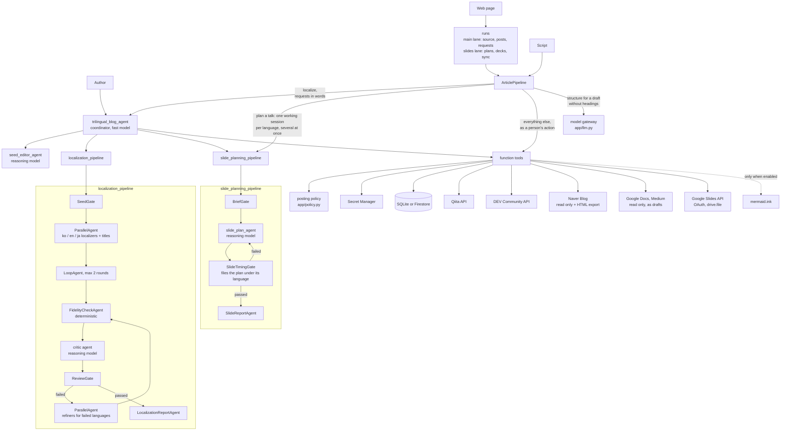

# trilingual-blog-agent

An ADK multi-agent that takes one technical article and carries it through the
rest of a writer's workflow: localize it into the other two of Korean, English
and Japanese, prepare a draft on each language's platform, and plan a talk with
a timed speaker script.

Built with [Agent Development Kit](https://google.github.io/adk-docs/) and
scaffolded with `agents-cli` (Agent Runtime target).

What the system does is written down in [docs/SPEC.md](docs/SPEC.md)
(Korean companion: [docs/kr-SPEC.md](docs/kr-SPEC.md)): invariants, numbered
requirements, and for each requirement the unit tests that check it. A test
fails when the two drift apart. This README is the guide; the specification is
the reference.

## Where each capability lives

Where the code for each criterion of the course rubric is. Every path and
every name in the table is checked by a unit test (`tests/unit/test_spec.py`).

| # | Area | Criterion | Open this first | Also |
| :--- | :--- | :--- | :--- | :--- |
| 1 | Tool & Interface Design | Comprehensive Tool Docstrings | `app/tools/publish.py`: `publish_qiita_article_draft` (purpose, every argument, what is returned, what a failure returns) | The other tools in `app/tools/articles.py` and `app/tools/slides.py`; every tool's docstring is checked by `tests/unit/test_tool_contract.py` |
| 2 | Tool & Interface Design | Descriptive Naming | `app/agent.py`: the `tools` list of `root_agent` | Names say the action and its object, for example `export_naver_blog_paste_ready_html` and `create_google_slides_deck_with_speaker_notes` |
| 3 | Tool & Interface Design | Explicit JSON Schemas | `app/schemas.py`: `SaveSeedInput`, `ReviewVerdict` | `LanguageCode`, `PlatformName` and `CodeMode` show the model the allowed values; `output_schema` of the agents in `app/agent.py` |
| 4 | Tool & Interface Design | Guided Error Handling | `app/schemas.py`: `ToolError`, `tool_error` | Every failure returns `error_code` and `recovery_instruction`; `validation_error` does the same for a wrong argument |
| 5 | Context & Memory | Robust System Instructions | `app/prompts.py`: `COORDINATOR_INSTRUCTION` | The instructions of the other agents are in the same file; article text is passed between random-token markers (`fenced`); `tests/unit/test_prompts.py` |
| 6 | Context & Memory | History Compaction | `app/agent.py`: `EventsCompactionConfig`, `ContextCacheConfig` | `LlmEventSummarizer` summarizes older events with the model routed for `summarize_history` in `app/models.py` |
| 7 | Context & Memory | Persistent Session State | `app/app_utils/services.py`: `get_session_service`; `app/persistence.py`: `FirestoreArticleStore` | `SqliteArticleStore` locally; runs of the web page: `Job.save` and `reopen` in `app/runs.py`; the state keys are constants in `app/state.py` |
| 8 | Context & Memory | Async Memory Operations | `app/memory.py`: `schedule_memory_consolidation` | Registered as `after_agent_callback` of `root_agent` in `app/agent.py`, next to `PreloadMemoryTool` |
| 9 | Orchestration & Logic | Multi-Agent Patterns | `app/agent.py`: `ParallelAgent`, `LoopAgent`, `SequentialAgent` | A coordinator with `sub_agents`; `build_slide_planning_pipeline`; custom `BaseAgent` gates in `app/workflow_agents.py` |
| 10 | Orchestration & Logic | Strategic Model Routing | `app/models.py`: `MODEL_ROUTES` | `model_for` gives each agent its model; the one model call outside the agents, `generate_text` in `app/llm.py`, reads the same table |
| 11 | Orchestration & Logic | Guardrails & Policy Plugins | `app/plugins.py`: `ContentPolicyPlugin` | Posting rules in `app/policy.py`; `check_fidelity` in `app/markdown_checks.py`; `sanitize_html` in `app/tools/publish.py`; `SOURCE_KINDS` in `app/sources.py` |
| 12 | Orchestration & Logic | Human-in-the-Loop Hooks | `app/tools/publish.py`: `_approval`, `request_confirmation` | `ResumabilityConfig` in `app/agent.py`; `request_approval_to_create_slide_decks` in `app/tools/slides.py`; `tests/unit/test_approvals.py` |
| 13 | Observability & Tracing | Structured JSON Logging | `app/observability.py`: `get_logger`, `log_event` | `StructuredLogHandler` writes one JSON record per line after `_RedactionFilter`; `log_activity` for the lines of a run |
| 14 | Observability & Tracing | Intent vs. Outcome Capture | `app/observability.py`: `ObservabilityPlugin` | `before_tool_callback` logs the intent, `after_tool_callback` the outcome, joined by `function_call_id`; a person's actions: `ArticlePipeline.act` in `app/pipeline.py` |
| 15 | Observability & Tracing | Distributed Tracing | `app/observability.py`: `root_span`, `traced_span` | `setup_tracing`; export with `BLOG_AGENT_TRACE_EXPORT=cloud`; a span for every outbound call in `app/platforms.py`, `app/google_slides.py` and `app/llm.py` |
| 16 | Observability & Tracing | PII Redaction | `app/redaction.py`: `redact_text`, `_redact_with_cloud_dlp` | Regular expressions always, Cloud DLP when `BLOG_AGENT_ENABLE_DLP=true`; applied to every log record by `_RedactionFilter` in `app/observability.py` |
| 17 | Infrastructure & CI/CD | Automated Evaluation Suites | `tests/eval/eval_config.yaml`, `tests/eval/datasets/basic-dataset.json` | Metrics: `tests/eval/response_quality.py`, `tests/eval/publish_safety.py`; unit tests in `tests/unit/`, run on every push by `.github/workflows/ci.yml` |
| 18 | Infrastructure & CI/CD | Infrastructure as Code | `deployment/terraform/single-project/blog_agent.tf` (Firestore, secret containers, least-privilege IAM); see the agents-cli commands below | The scaffolded files in `deployment/terraform/single-project/`; formatted and validated on every push by `.github/workflows/ci.yml` |
| 19 | Infrastructure & CI/CD | Secure Secret Management | `app/secrets.py`: `get_secret` | Environment, then Secret Manager, then a file outside the repository; `MissingSecretError` otherwise; `google_secret_manager_secret` in `deployment/terraform/single-project/blog_agent.tf` |

The specification and its traceability: [docs/SPEC.md](docs/SPEC.md) names the
unit tests for every requirement, and `tests/unit/test_spec.py` keeps the two
in step.

## Problem and solution

Writing a technical post once is work enough. Reaching Korean, English and
Japanese readers means translating it twice without breaking code blocks or
links, re-formatting it for three platforms, and then turning it into slides
when a talk is requested. Most of that is mechanical, and the mechanical parts
are where mistakes creep in: a dropped code block, a changed URL, a slide
script that runs three minutes.

The agent does the mechanical work and leaves every decision that leaves the
machine to a human:

| Stage | What the agent does | Human checkpoint |
| :--- | :--- | :--- |
| 1. Source document | Keeps the text exactly as handed in (`source.original.md`) and stores it as the seed. A draft can be pasted, attached as a file, or given as the address of a Google Docs document or of a Medium post that is still in its author's feed; a post already published on Qiita, DEV Community or Naver Blog is read from there, and that platform is then never written to. A draft without headings, and text read from a Naver page, is given Markdown structure by a model; the structured copy is used only when code confirms that its letters and digits are those of the original, and a notice says which text went on. In a chat the agent can also revise a draft with the author. | Author hands in the document (in a chat: says when it is final) |
| 2. Localize | Writes the two missing languages and their titles in parallel, checks structure against the seed in code, has a critic model review meaning, fixes only what failed. | Author reviews the files and titles |
| 3. Publish | Exports paste-ready HTML for Naver Blog (ko). Sends a post to Qiita (ja) or DEV Community (en) through the API. Verifies the resulting URLs. | Author reviews, edits and finalizes each post (title and text). Approval before every write; the post is a non-public draft unless the person approving asks for a public post in that approval. The model can choose neither the title nor the visibility |
| 4. Present | Plans one slide per minute with a speaker script, checks estimated speaking time, re-plans once if it fails. The deck opens with a title slide (greeting, title and what it means, in its speaker notes), follows with an agenda, ends with a conclusion, next steps on their own slide when the article names any, and a thank-you slide. Writes the plan and an artifact manifest. | Author reviews the plan |

Language to platform mapping: Korean → Naver Blog, English → DEV Community,
Japanese → Qiita. A post that was fetched from a platform is never written back
to that platform. Medium and Google Docs are read from only.

Whether a post may be finalized or sent is decided in one place,
`app/policy.py`, which the tools call. The rule is therefore the same on the
web page, in the command-line script and in a chat with the agent.

## Architecture



Control flow is decided in code, not by a model: the gate agents in
`app/workflow_agents.py` decide which languages run, whether a review passed,
which language a slide plan belongs to and whether it meets the timing rule.
The web page and the script ask a model only for what needs judgement:
localizing and a change asked for in words go to the coordinator; a talk is
planned by the slide planning pipeline in a working session per language, so
several languages are planned at once and the record of the run is not written
to meanwhile; the structure of a draft without headings goes through one
gateway (`app/llm.py`). Storing the source document, exporting, editing,
finalizing, creating a deck, posting and the manifest are calls to the same
tool functions, made directly, and each step is checked before the next one
starts.

On the page a run has two lanes (`app/runs.py`). The main lane holds the
source document, the localization, the posts and requests to the agent; the
slides lane holds plans, decks and deck text sync. One action runs
at a time in a lane and the two lanes run at the same time, so posts can be
reviewed, finalized and posted while slides are made. Every action ends as
done or as a notice on the page.

## Quick start

Requirements: [uv](https://docs.astral.sh/uv/), the Google Cloud SDK with
Application Default Credentials, and `agents-cli`. For a step-by-step walkthrough of issuing platform tokens and Google Slides OAuth credentials, see the setup guide ([English](docs/SETUP.md) · [한국어](docs/kr-SETUP.md) · [日本語](docs/ja-SETUP.md)).

```bash
uv tool install google-agents-cli
agents-cli install            # creates .venv and installs dependencies
cp .env.example .env          # set GOOGLE_CLOUD_PROJECT
```

Platform credentials are read from Secret Manager (never from the repository):

```bash
read -rs TOKEN && printf '%s' "$TOKEN" | gcloud secrets create QIITA_ACCESS_TOKEN --data-file=- && unset TOKEN
read -rs TOKEN && printf '%s' "$TOKEN" | gcloud secrets create DEVTO_API_KEY --data-file=- && unset TOKEN
```

Stages 1, 2 and 4 work without any platform credential.

Run it:

```bash
agents-cli playground                                  # web UI
agents-cli run "Hello, what can you help me with?"     # one-shot from the terminal
```

Or use the web front end: hand in a URL or a draft, press one button, and get a
table with each language's title, files, slides and next step. The next step
follows the order of the work: review the post (Mermaid diagrams are shown as
drawings in the preview when `BLOG_AGENT_RENDER_MERMAID` is on; their source is
then sent to mermaid.ink), edit it in the full-page editor if needed, press
Finalize, then approve the post and choose in that approval whether it is a
draft or public. Changing the title or the text of a post after it was
finalized makes it unfinished again. A Naver Blog URL is registered after you
post by hand. Choosing a slide length and languages before a run approves, in
advance, one new Slides file per language in your own Drive. The speaker notes
can be edited too; their text is carried into the existing deck, or pulled
back from it, only after an approval that lists the slides that change.

```bash
uv run python -m app.web_ui                 # http://127.0.0.1:8502
```

The front end has no login, so it listens on localhost, and answers only
requests addressed to localhost, unless `--host` is given; with `--host` for
another address every route requires an access token (`BLOG_AGENT_UI_TOKEN`, or
one made at start), and the address to open, with the token in it, is shown once
in the terminal. A run survives a restart of the server: its session is in a local
SQLite file (`.adk/sessions.sqlite3`) and its record and activity log are under
`workspace/.jobs/`. Opening the run's address again, or just the page in the
same browser, shows it as it was; a run that was working when the server
stopped says which lane was interrupted and offers to make the slides that
are missing.

More of the page:

- The Slides column offers, per language, what its state allows: "Create
  slides…", "Speaker notes", "Create deck…", "Google Slides" and "Update
  deck…"; while the slides of a language are made, its cell says so. There
  is no button to make existing slides again: that is asked of the agent in
  words, behind the same approval, and the suggestions under the request box
  offer that request for each language. Nothing exports a deck as PDF. Creating a
  deck again makes a new file and keeps the address of the earlier one. `BLOG_AGENT_SLIDE_PARALLELISM` (3 unless set) is how many languages
  are planned at once.
- "Ask the agent for a change" sends one line to the agent. The agent changes
  a title, or replaces a passage it quotes from a post. A request for slides
  typed there creates nothing by itself: the agent calls
  `request_approval_to_create_slide_decks`, the page shows the request with
  Approve and Decline, and the slides lane makes the slides once approved.
  The suggestions under the box come from the page's own texts: three are
  shown, the most used first, and "More prompts…" lists all six, among them
  "Re-create the English slides and Google Slides deck" and the same for
  Korean and Japanese. A suggestion only fills the box. What you typed is
  kept in the browser as typed.
- The page, the editor and the previews are shown in English, Korean or
  Japanese (Settings). Every text of the page comes from one catalog per
  language (`app/static/i18n/`), and notices from the server carry a code so
  that they are shown in that language too. Article text, what you typed, the
  agent's replies and what a platform returned are not translated.
- "Recent sources…" lists the runs on this server, from their records.
- Every action is one trace, and structured log records carry its ids. With
  `BLOG_AGENT_TRACE_EXPORT=cloud` the spans are exported to Cloud Trace;
  without it nothing is exported.

Or run every stage for one article with a single command:

```bash
uv run python scripts/run_pipeline.py --url https://qiita.com/<user>/items/<id>
uv run python scripts/run_pipeline.py --draft post.md \
    --talk-minutes 10 --talk-language en --talk-language ko \
    --publish devto --tags ai,agents
```

The script goes through the same steps as the page and stops if the structure
check fails. The language of a draft is detected from its text. Without
`--publish` nothing is posted; with it, the terminal asks you to finalize each
post, to approve it, and whether it is a draft or public. Logs go to stderr
(`2>/dev/null` hides them).

A typical conversation:

1. "Save this draft as the seed article" followed by the Markdown, or "Use this post: https://qiita.com/...".
2. "It is final." then "Localize it."
3. "The Japanese post is ready." The agent asks you to confirm that it is final. Then "Export the Naver HTML and create the Qiita draft with the tags AI and LLM." The agent pauses for approval before the Qiita call.
4. "Plan a 5 minute talk in English for backend developers."
5. "Give me the artifact manifest."

Files are written under `workspace/<project-id>/` (`BLOG_AGENT_WORKSPACE_DIR`).

## `agents-cli` commands used in this project

| Command | Purpose |
| :--- | :--- |
| `agents-cli scaffold create ... --agent adk_python --deployment-target agent_runtime` | Generated the project, Terraform and test layout |
| `agents-cli install` | Install dependencies |
| `agents-cli playground` / `agents-cli run "<prompt>"` | Local runs |
| `agents-cli lint` | Ruff check |
| `agents-cli eval run` | Run the agent over `tests/eval/datasets/basic-dataset.json` and grade the traces |
| `agents-cli infra single-project` | Apply `deployment/terraform/single-project` |
| `agents-cli deploy` | Deploy to Agent Runtime |

### Google Slides (optional)

To let the agent create a Google Slides deck with speaker notes, grant access
once. Enable the Slides API, create an OAuth client of type "Desktop app" in
the console, then:

```bash
uv run python scripts/authorize_google_slides.py \
    --client-file ~/client_secret.json --account you@example.com
```

Cautions:

- Use a personal or dedicated Google account, not a work or school account.
  The OAuth app is your own unverified app, and every deck is created in the
  granting account's Drive.
- "Access blocked ... 403 access_denied" during sign-in means the signed-in
  account is not a test user of your consent screen. Switch accounts; do not
  add a work account as a test user to get past it.
- The script names the account that granted access and stores nothing until
  it is confirmed (or matches `--account`); a refused grant is revoked. The
  approval request for a single deck names the account again, and Settings
  on the web page shows it.
- The grant covers only files the agent created (`drive.file`).
- Images already in the article are placed on slides. Mermaid diagrams are
  placed only when `BLOG_AGENT_RENDER_MERMAID=true`: the diagram source is
  then sent to mermaid.ink, a third-party service, to be drawn. Leave it off
  for drafts whose diagrams must not leave your machine.
- Never paste the client file, the redirected address or a screenshot of the
  client secret into a chat or an issue. If that happens, delete the OAuth
  client, create a new one and authorize again.

## Tests and evaluation

```bash
uv run pytest tests/unit          # deterministic, no model or network
uv run pytest tests/integration   # calls the model; needs credentials
agents-cli eval run               # golden dataset, two metrics, thresholds in tests/eval/eval_config.yaml
```

The structure check (`check_fidelity`) treats code blocks by kind: program code
must match the source apart from comments; Mermaid diagrams must keep node ids,
edges and keywords while label text is translated; plain-text blocks may
translate Korean or Japanese lines only, so an English plain-text block stays
as written.

- `tests/unit` covers the posting policy, the tools, the structure and timing
  checks, the pipeline's steps and what it reports when a step fails, the web
  routes, redaction, secret lookup, redirects and error handling of the
  platform clients, the policy plugin, memory, the gate agents and the
  wording of the instructions, the lanes and the record session, slide
  planning in working sessions, the contract of the tools, the catalogs of
  the page, tracing and the access token. Platform HTTP calls are replaced
  with fakes; nothing is posted. A fixture (`tests/unit/conftest.py`)
  refuses network connections and model calls, and `.env` is not read.
- `tests/unit/test_approvals.py` runs the real ADK `Runner` with the real
  posting tools and the real pause-and-resume machinery; only the model is
  scripted. It shows that an approval reaches the one request it was given
  for, with its draft-or-public choice, and no other.
- `tests/unit/test_spec.py` reads `docs/SPEC.md` and fails when a requirement
  has no test, a named test does not exist, or the Korean companion lists
  different requirements. It also checks the table "Where each capability
  lives" above: every path in it exists, and every name it gives as code is
  found in a file its row names.
- CI (`.github/workflows/ci.yml`) runs the linter, the format check, the unit
  tests and `terraform fmt -check` and `terraform validate` on every push,
  without credentials. It installs from PyPI within the version ranges of
  `pyproject.toml`; the repository carries no lock file.
- `tests/eval` has eight single-turn cases (scope, off-topic, an address on a
  site that is not a source, publish with no article, slides with no article,
  a public post asked for without the draft step, prompt injection inside a
  draft, saving a Korean draft). `custom_response_quality` is an LLM judge
  scored against a written reference per case; the judge is the fast model
  (`FAST_MODEL_NAME`). `publish_requires_approval` is deterministic: it fails
  the run if any tool that pauses for a person succeeded, since no case
  contains an approval.

## Status and known limits

What has been run for real, and what has not, is kept item by item in
[docs/STATUS.md](docs/STATUS.md). The most important facts:

- On 2026-11-12 one run on the page with the version 1.0 code read a Medium
  post, localized it into Korean and Japanese with the real models, planned
  slides for three languages at the same time and created three decks through
  the real Slides API, posted the Japanese post publicly on Qiita through the
  real API and registered a Naver URL.
- `agents-cli eval run` passed against the real model with the eight cases on
  the same day.
- Not deployed to Agent Runtime. The Terraform files are formatted and
  validated in CI on every push and were never planned or applied. Cloud DLP
  and the export to Cloud Trace are written and were not run against the
  services.
- CI runs the linter, the format check and the unit tests on every push,
  without credentials.

`ParallelAgent`, `SequentialAgent` and `LoopAgent` print deprecation warnings in
ADK 2.x in favour of `Workflow`. They are kept because a `Workflow` cannot yet
be used as a sub-agent of an `LlmAgent`.

## Project layout

```
app/
  agent.py              agent composition and App configuration
  workflow_agents.py    deterministic gate, check and report agents
  prompts.py            instructions
  models.py             model routing
  llm.py                the one gateway for model calls outside the agents
  schemas.py            Pydantic schemas and tool error helpers
  state.py              names of the session-state keys
  settings.py           settings read from the environment
  env_file.py           reading .env, in one place
  tools/                function tools (articles, publish, slides)
  policy.py             when a post may be finalized and sent
  sources.py            the table of source kinds and the hosts they are read from
  structurer.py         Markdown structure for a draft, and the check of the copy
  platforms.py          Qiita, DEV Community, Naver, Google Docs and Medium HTTP clients
  google_slides.py      Google Slides deck creation, image placement, text updates
  deck_sync.py          text kept in step between a deck and its Markdown plan
  markdown_checks.py    structure fidelity and speaking-time checks
  plugins.py            content policy plugin
  observability.py      JSON logging, intent/outcome plugin, traces and spans
  redaction.py          PII and credential redaction
  secrets.py            secret lookup
  persistence.py        article store (SQLite / Firestore)
  pipeline.py           runs the steps for the script and the web UI, and checks each
  runs.py               runs of the web page: lanes, records, starting actions
  notices.py            the sentences the server makes for the page, each with a code
  web_ui.py             web front end: routes, access token, previews
  static/               index.html, app.css, app.js (the page); edit.html, edit.css,
                        edit.js (the editor); i18n.js and i18n/en.json, ko.json,
                        ja.json (the texts of the page, one catalog per language)
  fast_api_app.py       the agent's API server
  memory.py             background memory consolidation
  app_utils/            scaffolded service wiring, A2A, Agent Runtime adapter
deployment/terraform/   infrastructure
docs/                   SPEC.md (specification, version 1.0), kr-SPEC.md (Korean
                        companion); STATUS.md (what was run for real); SETUP.md, kr-SETUP.md, ja-SETUP.md (setup
                        guides). The record of the code before version 1 and
                        the plan of version 1.0 (both in Korean, closed) are
                        kept under the tag v1.0-full
scripts/                run_pipeline.py: all stages in one command;
                        authorize_google_slides.py: one-time Slides grant
tests/                  unit, integration, eval
.github/workflows/      ci.yml: linter, unit tests, Terraform validation on every push
LICENSE                 Apache License 2.0
```

## License

Apache License 2.0; the text is in [LICENSE](LICENSE). The files that the
scaffold generated carry a licence header; the files written for this project
do not (item 1 of section 8 of the specification).
