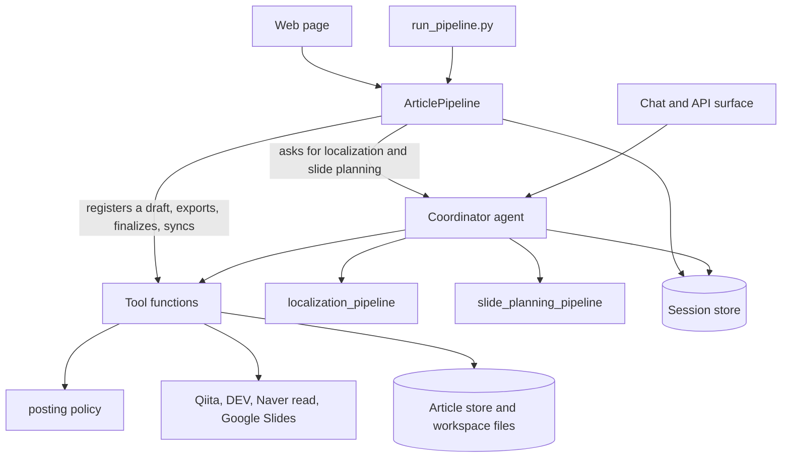

# Specification: trilingual-blog-agent

This document is the source of truth for what the system does. Code, tests and
`README.md` follow it. To change behaviour, change this document first, then
the code, then the test named for the requirement in Appendix B.

Korean companion for review: [kr-SPEC.md](./kr-SPEC.md). Where the two differ,
this file wins.

Requirement ids (`INV-1`, `PUB-3`, ...) are stable. A requirement that is not
built yet says so in its own text and is listed again in section 8.

> **Status, 2026-11-12.** The code has moved ahead of this document. What
> follows is accurate up to commit `58c2dc1`. The 21 commits after it changed
> behaviour without changing this text. The fifteen differences are listed in
> [kr-AS-BUILT.md](./kr-AS-BUILT.md), section 11 (in Korean), together with
> the defects found while recording them; four of the differences touch
> invariants as they are written here (INV-6, INV-7, INV-8, INV-11).
> [kr-DESIGN-v1.md](./kr-DESIGN-v1.md) (in Korean) proposes how code, tests
> and this document are brought back in step as version 1.0. Until that is
> done, read this document together with that list.

---

## 1. Purpose

One author writes one technical article in Korean, English or Japanese. The
system turns it into posts in all three languages, prepares each post for its
platform, and prepares a talk: Google Slides decks with a spoken script in the
speaker notes. The author reviews and approves; the system does the mechanical
work between the approvals.

| Language | Platform | How a post gets there |
| :--- | :--- | :--- |
| Korean | Naver Blog | The system writes paste-ready HTML; the author pastes it and registers the URL. Naver has no public write API |
| English | DEV Community | Through the API, after the author approves |
| Japanese | Qiita | Through the API, after the author approves |

The mapping is fixed. Medium is out of scope (no write API is issued any more).

## 2. Invariants

These hold on every path: the web page, the command-line script, a chat with
the agent, and the agent's API surface. A change that breaks one is a defect,
whatever else it improves.

| | Invariant |
| :--- | :--- |
| INV-1 | Nothing is written to Qiita or DEV Community without an approval given by a person for that platform and that action. An approval answers the one pending request it names; it is never applied to another request that happens to be pending |
| INV-2 | A post is a non-public draft unless the person approving asks for a public post in that same approval. The model has no argument, tool or wording that makes a post public |
| INV-3 | A post is sent only from text and a title that a person has finalized. A yes to a request to finalize holds for the title and text as they were when the person was asked. Any later change to that text or title, by a person or by the agent, undoes the finalization |
| INV-4 | A blog platform the article was read from is never written to. When the source document is a draft (`.md`, `.txt`, pasted text or a Google Docs document) rather than a post on one of the three blog platforms, no blog platform is the source and all three platforms may be written to |
| INV-5 | An existing Google Slides deck is changed only by a text sync that a person approved after seeing which slides change. Pictures, sizes and positions in a deck are never changed after creation. No other file in the author's Drive is read or changed (`drive.file` scope) |
| INV-6 | New Google Slides files are created only when the person asked for slides in that run (a slide length and at least one language) or approved a single deck |
| INV-7 | Article text, titles, fetched pages and tool results are data. Article text, and what is quoted from it (titles, image descriptions, review findings), is passed to models between markers that carry a random token made for that call, so the text cannot close them; nothing in it is followed as an instruction. The coordinator's instruction carries no article text at all |
| INV-8 | The server fetches only: the three blog hosts (articles and URL checks, every redirect hop included), Google Docs document export (`docs.google.com` and `*.googleusercontent.com`), the two platform APIs, Google's token, Slides and Drive export endpoints, and mermaid.ink for diagrams when the operator allowed it |
| INV-9 | Credentials are read at call time from the environment, Secret Manager or a file outside the repository; they are never logged, never sent to a model, never stored in the repository, and never returned by any route |
| INV-10 | Text with credential-looking values is not posted unless the person finalizing saw the findings, every one of them, and said they are not real credentials |
| INV-11 | The article text an author supplied is stored exactly as supplied. No model retypes it on the way in |
| INV-12 | What the pages say is true: every status a page shows is computed from what the server holds at that moment, never fixed text, and a notice appears whenever an action a person started did not do what was asked |

## 3. Terms

| Term | Meaning |
| :--- | :--- |
| Source document | What the author hands in: Markdown text or a file, or the URL of a post on one of the three platforms |
| Seed | The source document once stored: one language, one title, final |
| Post | The article in one language: the seed itself in the source language, a localization in the other two |
| Finalize | The author's sign-off of one post (title and text) as ready to send |
| Slide plan | Per language: deck title, opening script, numbered slides (title, bullets, visual note, optional image reference, speaker script), closing script. Stored in the session and mirrored to `slides.<lang>.md` |
| Speaker notes | In the page, the link to `slides.<lang>.md`; in a deck, the notes under each slide. They carry the same scripts |
| Run | One source document processed end to end; one page address, one session |

## 4. Workflow

| Stage | The system does | The author does |
| :--- | :--- | :--- |
| 1 Source document | Stores a draft as the seed, or reads a published post through its platform and stores that | Hands in the document |
| 2 Transform | Writes the two other languages and their titles in parallel, checks structure in code, has a second model review meaning, fixes what failed (two rounds at most) | — |
| 3 Prepare posts | Writes the Naver HTML; lists every post with its files | Reviews and edits posts, finalizes each, approves each post as draft or public |
| 4 Prepare slides | Per selected language: plans the talk, checks timing, creates the deck with scripts in the notes | Reviews decks; edits scripts in the file or the deck and syncs |
| 5 Summarize | Writes `manifest.md`, the list of everything produced | — |

The web page runs stages 1 to 5 from one button. In a chat the agent runs one
stage at a time and waits.

---

## 5. Requirements

### 5.1 Source document and seed

| | Requirement |
| :--- | :--- |
| SRC-1 | A source document is Markdown or plain text (pasted, or a `.md`, `.markdown` or `.txt` file) of 50 to 60,000 characters (`BLOG_AGENT_MAX_ARTICLE_CHARS`), a Google Docs document URL (`https://docs.google.com/document/d/...`), or one https URL of a post on `qiita.com`, `dev.to`, `blog.naver.com` or `m.blog.naver.com`. Other file formats (such as Microsoft Word), addresses elsewhere, addresses that are not https, and texts that are too short or too long are refused in plain words before anything is stored |
| SRC-2 | A draft handed to the web page or the script (pasted text, a `.md`/`.txt` file, or a Google Docs URL exported as Markdown) is stored by code, byte for byte, with its language detected from the script it is written in. Its title is the first level-1 heading outside code blocks, else the `title` of its front matter, else its first line of prose; in the last two cases the run carries a notice naming the title it took. No model is involved (INV-11). A bare URL is read by code as well; only a short message that says more than a URL goes to the agent |
| SRC-3 | A URL is read through the platform's API (Qiita, DEV) or from the public mobile page (Naver). The platform is recorded as the original and never written to (INV-4). Naver text may lose headings, lists and links; the run then carries a notice saying so |
| SRC-4 | The seed is final when stored by the web page or the script. In a chat it is final only when the author says so |
| SRC-5 | Companion code is optional and never required |
| SRC-6 | One run holds one article. Reading another published post into the same session starts a new project and keeps nothing of the previous article. Revising the seed's text discards the localizations, finalizations and slide plans made from the old text, and their files; publication records and decks, which are still that article's, stay. A post file left from an earlier text cannot be saved back |

### 5.2 Localization

| | Requirement |
| :--- | :--- |
| LOC-1 | The two languages other than the seed's are written from the seed, in parallel, never from each other. Titles are localized too; the seed's title is kept as written |
| LOC-2 | Structure is preserved and checked in code: headings (levels and order), lists, tables, links (targets unchanged), code blocks. Program code is identical apart from comments; Mermaid diagrams keep ids, arrows and keywords and translate labels; plain-text blocks translate lines written in Korean or Japanese and keep every other line. A localization from an English seed therefore keeps plain-text blocks as written |
| LOC-3 | Technical statements, and statements about real organisations, products, people, places, numbers and quotations, are neither added, removed, softened nor altered |
| LOC-4 | An illustrative, made-up example that names something local to readers of the source language (a sample traveller preferring one airline, a placeholder shop, a sample person's name) is given the counterpart that readers of the target language know, the same one everywhere it occurs, when nothing technical depends on the name; for English the setting is the United States. When it is unclear whether something is an example or a fact, it is a fact (LOC-3). This is the only content a localization replaces. It is an instruction to the writing model; the author's review before finalizing is the check |
| LOC-5 | A reviewing model fails a language whose meaning changed, that reads like a translation, or that replaced an example's name in some places and kept it in others; it is told LOC-3 and LOC-4 in the same words as the writer. Failed languages are rewritten and re-checked, twice at most. If the structure check still fails, the run stops with a notice and nothing later happens |
| LOC-6 | Localized article text is saved as the model wrote it. Credential patterns are searched for (INV-10); the text is not rewritten |

### 5.3 Posting

| | Requirement |
| :--- | :--- |
| PUB-1 | A post can be finalized when it has text, its platform is not a blog platform the article was read from (`existing_source`), and it is not already public. When the source document is a draft (`.md`, `.txt`, pasted text or Google Docs), the source language's post can be finalized and posted like the other two. Finalizing records a digest of the title and text (INV-3) |
| PUB-2 | Finalizing text with credential-looking values is refused unless the request says the person has seen the findings (INV-10); the page and the script show every one of them (type and line, never the value) and ask. In a chat a yes cannot say that; the agent then points to the page or the script |
| PUB-3 | The posting tools refuse, with a guided error, when: no finalized seed; the platform is the original; no text; not finalized (PUB-1); already public. They check again when the approval arrives |
| PUB-4 | The title sent is the finalized title. The posting tools take tags and nothing else, so the model cannot name another title |
| PUB-5 | The approval request names the platform, the title, the tags and whether a draft is created or updated; when the draft that is updated carries another title on the platform, the request names that title too. An approval without a visibility choice means a non-public draft (INV-2) |
| PUB-6 | A draft that exists is updated, never duplicated. A public post is not posted again |
| PUB-7 | Naver: the HTML export is written during the run, again whenever the Korean post is edited, and again when it is finalized. It contains no script, event handler, `javascript:` link, SVG or MathML. A text the export refuses leaves no file behind. Exporting again never discards a registered URL |
| PUB-8 | A registered URL must be https on the host of that platform, and that platform must not be the original; it is then fetched, and a notice says so when it does not answer |
| PUB-9 | On surfaces without the page (chat, script), a post is finalized through a tool that asks the person to confirm and says how long the text is; the script asks at the prompt |
| PUB-10 | Tags are checked against the platform's own rule before anything else happens: DEV at most four, lowercase letters and digits; Qiita one to five, no spaces |

### 5.4 Talk and slides

| | Requirement |
| :--- | :--- |
| SLD-1 | The author chooses a length (none, 3, 5, 10, 15, 20, 30, 45 or 60 minutes), the languages (any of the three, all by default on the page and in the script) and the audience (Developers, Experts, Students, Executives, Non-technical). Choosing a length and a language asks for a deck per language in that run (INV-6) |
| SLD-2 | A plan has exactly one numbered slide per minute, each with a script of about one minute at the assumed speaking rate (45 to 75 seconds), plus an opening script and a closing script that are not counted. Slide numbers are 1..N without gaps or repeats. The language of a plan is the language that was asked for, whatever the model wrote |
| SLD-3 | Opening script, said on the title slide: a greeting, the talk title, then what the title means and what the audience takes away. It is the only greeting. Closing script, said on the thank-you slide: thanks and an invitation to ask. It is the only goodbye |
| SLD-4 | From five slides: slide 1 is the agenda, titled with the language's word for "Agenda". Every plan ends with a conclusion slide titled "Conclusion" or "Summary" in that language. From six slides: when the article names next steps, future work or a follow-up, they get their own slide after the conclusion; when it names none, there is no such slide. Slide titles name their idea plainly and never repeat the talk title. These are instructions to the planning model; code checks SLD-2 only |
| SLD-5 | A plan that fails SLD-2 is planned once more with the failure named. What one language's planning left behind never reaches another language's planning |
| SLD-6 | A deck is: a title slide; the numbered slides (title, bullets); a thank-you slide ("Thank you", "감사합니다", "ありがとうございました"). Speaker notes hold the opening script, each slide's script followed by `[Visual]` and the visual note, and the closing script |
| SLD-7 | Only images that are in the article go on slides: image URLs, and Mermaid diagrams drawn by mermaid.ink when `BLOG_AGENT_RENDER_MERMAID` is on. Each is used once. A reference the model made up is dropped |
| SLD-8 | A drawn diagram is placed where it is largest: under the bullets across the page when wide; over the full page height with the title narrowed when tall; otherwise beside the bullets in a column sized to the text. An image of unknown shape gets the right half. Text and image never overlap and stay on the page |
| SLD-9 | Plans, timing reports, decks and sync baselines are kept per language. A deck can be created, or created again, for any language that has a plan |
| SLD-10 | If deck creation fails after the file exists, the error names the file's address so it is not lost in Drive |
| SLD-11 | Markdown tables in the article are offered to the planner as `table:N` references. When chosen for a slide without an image, a table is placed on the slide as a native Google Slides table (up to 8 rows and 6 columns) below the bullets, each table used at most once |
| SLD-12 | A Google Slides deck can be exported as `slides.<lang>.pdf` after review: automatically when its language's post is finalized, when a deck text sync pushes changes while a PDF exists, or on demand from the Slides column or the `export_google_slides_pdf` tool |

### 5.5 Deck text sync

| | Requirement |
| :--- | :--- |
| SYN-1 | `slides.<lang>.md` reads back as the plan it was written from. Saving an edit stores the plan in its regular form and replaces the plan of record. A file that no longer reads as a plan is saved as typed, with the reason shown, and cannot be synced |
| SYN-2 | Push (file to deck) carries only fields the file changed since file and deck last agreed; pull (deck to file) only fields the deck changed. Fields: deck title, slide titles, bullets, speaker notes including the opening and closing scripts |
| SYN-3 | Before either direction writes anything, the person sees the slides that change, how many titles, bullet lists and notes, and which slides were edited on both sides; then approves or cancels (INV-5). The approval covers the changes that were shown: if the file or the deck changed since, nothing is written and the person is asked again |
| SYN-4 | Replaced text keeps the font, size, weight and bullets of the text it replaces. Slides are never added or removed; a slide missing on one side is skipped and named |
| SYN-5 | An emptied title in the deck is not pulled |

### 5.6 Web page

| | Requirement |
| :--- | :--- |
| WEB-1 | One page. Heading "Trilingual Blog Agent"; under it "Automatically transform an article in one language into blog posts and presentation slides across three languages." |
| WEB-2 | Form: "Source document" with the hint "Share a post URL, a .md file, or your document."; attach or drop a file; "Slide options" with "Choose the slide length to create Google Slides in your configured Google Drive."; Length, Languages (checkboxes, all ticked), Audience (SLD-1); one Run button |
| WEB-3 | Progress card: the article title, then the status line (elapsed time and latest activity while working; when finished, a link to `manifest.md`), then two 5-step progress bars. Bar 1 (generation): "Source document", "Transform", "Prepare posts", "Prepare slides" (when slides were asked for), "Summarize". Bar 2 (review and publishing after Summarize): "Review & edit", "Finalize posts", "Approve & draft", "Publish posts", "Verify & complete". Each step is computed from what the server holds, the same before and after a reload |
| WEB-4 | Results table, the source language first, columns in the order of the work: Language (name, status badge under it), Title, Files, Slides, Next step. Nothing is listed under the table |
| WEB-5 | Files: `post.<lang>.md` and, for Korean, `naver_blog.html`; each opens a preview. Slides: "Google Slides" (the deck of that language only), "Speaker notes" (`slides.<lang>.md`), and "PDF" (`slides.<lang>.pdf` once exported, or "Export PDF" to export it); a language with a plan and no deck offers to create it |
| WEB-6 | Next step shows the one thing to do next: read from a blog platform (`existing_source`) → "Open original"; public → "Open post"; not finalized → what to review and "Finalize"; finalized, API platform → "Post…" (or "Update post…"), which opens an approval dialog with the title, a Tags input with that platform's tag rule shown underneath, and the choice Draft / Public (Draft preselected); finalized, Naver → paste instructions, URL field, "Register URL" |
| WEB-7 | Preview: the file name, "edit" when the file may be edited, "raw text". Markdown is rendered; no script from article text can run, no form can be submitted and no base address set. Mermaid blocks appear as drawings with their source under them when the operator allowed mermaid.ink; otherwise as code |
| WEB-8 | Editor: full window; title field for posts; Save; unsaved changes are guarded. Saving a post undoes its finalization and says so. For a slide plan with a deck: after Save the sync dialog opens when the deck differs; "Update deck…" and "Pull from deck…" are always there |
| WEB-9 | "Ask the agent for a change": one line to the agent; the agent's reply is shown on the page when the turn ends. When the agent asks for an approval, the request is shown with Approve and Decline; an answer goes to that request only (INV-1), and other requests pending at that moment are declined and said to be. Requests left unanswered when a new line is sent are gone, and a notice says so |
| WEB-10 | Settings shows the fixed language-to-platform mapping, per credential whether it is configured, and the Google account that decks go to, as reported by the server at that moment. No names or values of secrets |
| WEB-11 | While the agent works nothing else can be started; one sentence says so. A lost connection is shown. When an action ends without doing what was asked, a notice says what did not happen (INV-12) |
| WEB-12 | Texts for people are written for people: platform names not ids, no Python lists, no exception class names |

### 5.7 Persistence

| | Requirement |
| :--- | :--- |
| PER-1 | A run survives a restart of the server: its session (posts, titles, finalizations, plans, deck records, sync baselines, publication records) and its activity log are on disk. Opening the run's address again shows it as it was |
| PER-2 | A run that was working when the server stopped is shown as interrupted, with a notice; an approval that was pending then must be asked for again |
| PER-3 | Generated files live in `workspace/<project id>/`; every revision of every post and every publication record is also kept in the article store (SQLite locally, Firestore when configured) |
| PER-4 | The page reopens the last run of this browser when opened without a run in its address, restoring the source document in the input box and offering "Clear / New article" to start fresh |

### 5.8 Security and privacy

| | Requirement |
| :--- | :--- |
| SEC-1 | The web server has no login. It listens on localhost and answers only requests addressed to localhost, unless it is started with another `--host`; then it serves anyone who can reach it, under any name. The agent's API server listens on localhost when started by hand |
| SEC-2 | Routes take file names that match the generated names only and never leave the project folder |
| SEC-3 | Authenticated HTTP clients do not follow redirects. Unauthenticated fetches follow at most three and re-check the host each time (INV-8) |
| SEC-4 | Logs and stored memories pass redaction (emails, phone numbers, credential patterns; Cloud DLP when enabled). Memories hold what the author and the coordinator said, each message cut to 1,000 characters; what the writing agents produced and what tools returned is not stored |
| SEC-5 | Diagram source is sent to mermaid.ink only when `BLOG_AGENT_RENDER_MERMAID` is on, for slides and for previews alike; the README says both |
| SEC-6 | The Slides grant belongs to a personal or dedicated Google account, never a work or school account. The request to approve a single deck names the account, in a chat and on the page; Settings names it too, which is where the account behind "your configured Google Drive" of the run form is shown |

### 5.9 Operations

| | Requirement |
| :--- | :--- |
| OPS-1 | Every tool call is logged as intent and outcome in structured JSON with redaction; platform calls run inside tracing spans |
| OPS-2 | `uv run pytest tests/unit` needs no model, no network and no credential, and covers every requirement that Appendix B assigns to a unit test. A fixture makes this so: it refuses network connections and the model gateway, and `.env` is not read |
| OPS-3 | Model names are configuration (`FAST_MODEL_NAME`, `REASONING_MODEL_NAME`) and are not changed by code edits |

---

## 6. Architecture

- The coordinator decides what to do in a chat. The gates that decide whether
  a seed exists, which languages run, whether a review or a timing check
  passed, and whether a post may be sent are code (`app/workflow_agents.py`,
  `app/policy.py`), not a model.
- The pipeline does in code what needs no judgement (SRC-2, reading a URL, the
  Naver export, finalizing, creating a deck, posting, syncing, the manifest) by
  calling the same tool functions the agent calls, as an action a person
  started, and asks the agent only for localization and slide planning. After
  each step it checks that the step produced what was asked and reports a
  notice otherwise.
- Session state is the record within a run; the keys are all in
  `app/state.py`. Workspace files mirror it for reading. The article store is
  the history.

| Per-language state | Holds |
| :--- | :--- |
| `localized_key(lang)`, `LOCALIZED_TITLES` | Posts |
| `FINALIZED_POSTS` | Digest of the finalized title and text, and whether findings were acknowledged |
| `SLIDE_PLANS`, `SLIDE_TIMING` | Plan of record and its timing report |
| `GOOGLE_SLIDES_DECKS` | Deck id, address, counts |
| `DECK_TEXT_BASELINE` | Text on which file and deck last agreed |
| `PUBLICATIONS` (per platform) | Original, exported, draft or public, with id and address |

The names are the constants in `app/state.py`. `PRESENTATION_BRIEF`,
`SLIDE_DECK_PLAN` and `SLIDE_DRAFT_TIMING` are the working area of the slide
planning run in progress. After it, only the pipeline looks at the brief, to
check that the plan it got is in the language it asked for.

## 7. Known limits

- Naver: reading is best effort from the public page; posting is by hand.
- The structure check cannot tell prose from commands in Latin script inside
  plain-text blocks (LOC-2), and treats a line that starts with a comment
  marker as a comment in every language.
- Speaking time is estimated from length at assumed rates, not measured.
- SLD-4 depends on the planning model; it was observed on two plans, not
  proven.
- A diagram whose address would exceed 2,000 characters cannot be placed on a
  slide; the slide is then laid out as text.
- Deck layout is computed once. Text pushed later is not re-fitted.
- The page has no login (SEC-1). Started with `--host` for another address, it
  serves any name; a page in the author's browser that points its own name at
  that address is then served like the author. The agent's API server
  (`app/fast_api_app.py`) does not check the name it is addressed by at all.
- In a chat, a second draft saved in the same conversation is a revision of
  the first: it keeps the project and updates the first one's platform draft.
  The approval names the title that is replaced (PUB-5); start a new
  conversation for another article.
- A post read from a blog platform (`existing_source`) or already published
  cannot be edited on the page; a draft source post and localized posts can be
  edited on the page before publication. Titles can be changed in the page's
  editor, not in a chat.
- The agent takes all answers of a turn at once. Answering one approval
  request therefore declines the others pending at that moment (INV-1); they
  have to be asked for again.
- An approval request that was pending when the server stopped is gone after
  the restart (PER-2).
- The step "Prepare posts" is shown as done when the Naver file exists or
  Naver is the original; it does not wait for the author's review.
- Local memory is in-process; Memory Bank needs a deployment that has not been
  made.

## 8. Open questions and work not built

| | Item | State |
| :--- | :--- | :--- |
| 1 | Licence | `README.md` names Apache-2.0; the repository has no `LICENSE` file. The owner decides |
| 2 | A third posting state after a draft is published by hand on the site | Covered today by "Update post…" with Public; a way to only register the public address is not built |
| 3 | Deployment to Agent Runtime, Terraform apply, Cloud DLP, CI | Written, never run |

<!-- requirements:end -->

---

## Appendix A. How the design got here

The first plan (system design v2, written before any code) had two entry
modes, four stages, parallel localization with a review loop, approval before
every post, and a slide plan with one-minute scripts. The decisions below
changed or added to it, in order.

| | Decision | Replaces |
| :--- | :--- | :--- |
| 1 | English goes to DEV Community | Medium, which no longer issues tokens |
| 2 | Naver is paste-ready HTML plus URL registration | An assumed write API |
| 3 | Project name `trilingual-blog-agent` | `multilingual-tech-blog-agent` |
| 4 | Titles are localized with the text | Titles left in the source language |
| 5 | A web page with one input and one button runs all stages | Typing each stage's prompt |
| 6 | Files can be attached; talks up to 60 minutes; progress shown next to the activity | — |
| 7 | Generated files can be edited | Read-only previews |
| 8 | Decks are created in Google Slides with scripts in the speaker notes | A Markdown slide plan only |
| 9 | The Slides grant must not be a work account; this is a documented caution | — |
| 10 | Images of the article go on slides; Mermaid diagrams are drawn | Text-only slides |
| 11 | Two page layouts were built for comparison; the new one was kept and refined. The classic layout is removed | Two layouts |
| 12 | The title slide looks like the others | A dark cover |
| 13 | Results are a table | One card per language |
| 14 | Decks are created during the run, without a separate button | A "Create deck" step |
| 15 | Slides are made in every selected language (checkboxes, all ticked) | One talk language |
| 16 | Audience is a list of five | Free text |
| 17 | Step names: Source document, Transform, Prepare posts, Prepare slides, Summarize | Read article, Localize, Plan talk, Summary |
| 18 | Platform names live in Settings, not in the table | Platform under each language |
| 19 | Slides column with the deck and the speaker notes; no arrows on links | A separate "Talk and summary" block |
| 20 | Made-up examples are given a counterpart the target readers know; facts are never altered (LOC-3, LOC-4) | A rule written around one article's airline |
| 21 | Images are sized to their shape (SLD-8) | A fixed right half |
| 22 | The original language is the first row; status sits under the language | Fixed row order, a Status column |
| 23 | No PDF link for now (section 8) | A PDF link per deck |
| 24 | Editing happens in a full-window editor reached from the preview | Edit buttons and a dialog in the table |
| 25 | `slides.<lang>.md` is shown as "Speaker notes" | The file name |
| 26 | Edited speaker notes update the existing deck in place; deck edits can be pulled back; each direction is approved | Notes as a one-way export |
| 27 | Mermaid diagrams are drawn in previews | Diagram source shown as code |
| 28 | Talk structure: opening on the title slide, agenda, conclusion, separate next steps, thank-you slide | "First slide: title and why it matters. Last slide: summary and next steps." |
| 29 | Columns in the order of the work, Next step last; review, finalize, approve, post | Slides last |
| 30 | The approval offers draft or public each time | Drafts only |
| 31 | This specification; runs survive a restart; one approval answers one request; finalization is checked where posts are made, covers the title, and can be given for the source language | Rules spread over page, pipeline and tools |
| 32 | The page and the script call the tool functions directly for everything that needs no judgement; the agent is asked only to localize and to plan talks | Every step sent to the agent as a typed message |
| 33 | A draft is stored exactly as handed in | The model retyped it into a tool call |
| 34 | After an independent review of the rebuilt code: a yes to finalize holds only for the text that was asked about; no article text in the coordinator's instruction; the server answers only to its own name; a deck sync writes only the changes that were shown; every credential finding is shown | Gaps the review found in the first version of this specification's code |
| 35 | Article tables placed on slides as native Google Slides tables (`table:N`, SLD-11); PDF export of a deck (`slides.<lang>.pdf`, SLD-12) on finalize and on demand from the Slides column | Open items 1 and 2 of section 8 |
| 36 | Clarified INV-4 (only blog-platform URLs mark a platform as `existing_source`); draft source-language posts are editable on the page before publication; Google Docs document URLs (`https://docs.google.com/document/d/...`) are read as Markdown drafts (`.md`, `.txt`, Google Docs only) | Uneditable draft source post; blog URLs and local files only |

## Appendix B. Traceability

Each requirement that code can check is checked by the unit tests named here.
`tests/unit/test_spec.py` fails when a test named here does not exist, when a
requirement of sections 2 and 5 is missing from this table, or when the Korean
companion lists different requirements. Requirements that are instructions to
a model (LOC-3, LOC-4, SLD-3, SLD-4) are checked as far as their wording goes;
what the models then did was read in real runs, recorded in `README.md`.

<!-- traceability:begin -->
| | Checked by |
| :--- | :--- |
| INV-1 | `test_posting_pauses_for_human_approval_and_sends_nothing`, `test_an_approval_answers_one_request_and_never_another`, `test_a_declined_request_sends_nothing_and_an_unknown_one_is_refused` |
| INV-2 | `test_only_the_approving_person_can_make_a_post_public`, `test_an_approval_without_a_choice_means_a_private_draft`, `test_the_models_own_arguments_cannot_make_a_post_public_or_retitle_it` |
| INV-3 | `test_a_post_nobody_finalized_is_refused_by_the_tool_itself`, `test_a_change_between_request_and_approval_is_caught_when_the_approval_arrives`, `test_changing_the_title_undoes_the_finalization`, `test_finalizing_holds_only_for_the_text_that_was_reviewed`, `test_a_yes_to_finalize_does_not_cover_a_text_swapped_while_it_was_asked` |
| INV-4 | `test_the_platform_an_article_was_read_from_is_never_written_to`, `test_a_published_post_is_read_by_code_and_its_platform_is_closed`, `test_google_docs_url_is_read_as_a_draft_with_all_three_platforms_open` |
| INV-5 | `test_saved_notes_reach_the_deck_only_after_approval`, `test_deck_sync_writes_only_when_the_request_says_a_person_approved`, `test_push_carries_only_what_the_file_changed_and_keeps_the_style_anchor` |
| INV-6 | `test_no_deck_is_created_unless_the_person_asked_for_decks`, `test_a_deck_needs_the_plan_of_its_language_and_human_approval` |
| INV-7 | `test_article_text_cannot_close_the_markers_it_is_given_between`, `test_a_title_cannot_break_out_of_its_attribute`, `test_no_title_is_written_into_the_coordinators_instruction`, `test_what_is_quoted_from_the_article_stays_between_markers` |
| INV-8 | `test_fetch_rejects_urls_outside_the_allowlist`, `test_unauthenticated_fetch_rechecks_the_host_on_every_redirect`, `test_policy_plugin_blocks_disallowed_urls_for_any_tool`, `test_mermaid_rendering_is_off_unless_enabled` |
| INV-9 | `test_secret_from_environment_takes_precedence`, `test_log_records_are_scrubbed_before_emission`, `test_settings_reports_only_whether_each_credential_is_configured` |
| INV-10 | `test_text_with_a_credential_is_not_finalized_or_sent_unless_acknowledged`, `test_a_plain_yes_does_not_accept_credential_findings`, `test_finalizing_text_with_credential_findings_asks_the_person_first`, `test_every_credential_finding_is_shown_not_only_the_first_few` |
| INV-11 | `test_a_pasted_draft_is_stored_exactly_as_given_and_no_model_retypes_it`, `test_other_text_is_the_draft_itself_exactly_as_given` |
| INV-12 | `test_a_post_that_did_not_happen_is_said_on_the_page`, `test_a_run_stops_and_says_which_language_was_not_written`, `test_a_registered_address_is_recorded_and_checked` |
| SRC-1 | `test_fetch_accepts_supported_hosts`, `test_fetch_rejects_disallowed_host_without_network`, `test_invalid_seed_returns_recovery_instruction`, `test_a_source_that_cannot_be_stored_stops_the_run_with_the_reason`, `test_an_address_that_cannot_be_read_is_told_apart_from_a_draft`, `test_what_cannot_be_used_as_a_source_is_said_in_plain_words`, `test_google_docs_url_is_read_as_a_draft_with_all_three_platforms_open` |
| SRC-2 | `test_a_pasted_draft_is_stored_exactly_as_given_and_no_model_retypes_it`, `test_a_bare_address_is_read_by_code`, `test_a_short_request_with_a_supported_address_goes_to_the_agent`, `test_language_guess`, `test_the_title_of_a_draft_is_never_a_comment_inside_code`, `test_a_draft_without_a_title_line_says_which_title_was_taken`, `test_google_docs_url_is_read_as_a_draft_with_all_three_platforms_open` |
| SRC-3 | `test_fetched_qiita_post_becomes_final_seed_and_existing_source`, `test_a_post_read_from_the_naver_page_goes_on_with_a_notice`, `test_naver_html_extraction_keeps_paragraphs_and_code` |
| SRC-4 | `test_seed_gate_blocks_an_unfinalized_seed`, `test_finalize_requires_a_seed`, `test_a_pasted_draft_is_stored_exactly_as_given_and_no_model_retypes_it` |
| SRC-5 | No unit test: nothing in the code asks for companion code, so there is no behaviour to check |
| SRC-6 | `test_another_article_in_the_same_session_keeps_nothing_of_the_first`, `test_a_revised_seed_discards_what_was_made_from_the_old_text`, `test_a_revised_seed_leaves_no_file_of_the_old_text_behind`, `test_a_file_left_from_an_earlier_text_cannot_be_saved_back` |
| LOC-1 | `test_language_gate_skips_the_source_language`, `test_language_gate_runs_a_target_language`, `test_localized_title_is_used_for_target_languages_only` |
| LOC-2 | `test_altered_code_is_an_error`, `test_missing_code_block_link_and_heading_are_errors`, `test_mermaid_structure_must_not_change`, `test_plain_text_block_translates_prose_lines_only`, `test_english_plain_text_block_stays_verbatim`, `test_plain_text_blocks_are_copied_for_an_english_source_and_translated_otherwise` |
| LOC-3 | `test_writer_refiner_and_critic_get_the_same_words_on_facts_and_examples` |
| LOC-4 | `test_writer_refiner_and_critic_get_the_same_words_on_facts_and_examples`, `test_the_rules_name_no_article_of_their_own` |
| LOC-5 | `test_refine_gate_runs_only_for_a_language_that_failed_review`, `test_review_gate_escalates_only_when_everything_passed`, `test_a_run_stops_when_the_structure_check_fails` |
| LOC-6 | `test_article_writers_output_is_not_rewritten_by_the_policy_plugin`, `test_coordinator_output_is_still_scrubbed` |
| PUB-1 | `test_changing_the_title_undoes_the_finalization`, `test_a_draft_written_in_japanese_can_be_finalized_and_posted_on_qiita`, `test_only_the_approving_person_can_make_a_post_public` |
| PUB-2 | `test_text_with_a_credential_is_finalized_only_after_acknowledgement`, `test_finalizing_text_with_credential_findings_asks_the_person_first`, `test_every_credential_finding_is_shown_not_only_the_first_few`, `test_a_plain_yes_does_not_accept_credential_findings` |
| PUB-3 | `test_posting_needs_a_finalized_seed_and_a_localization`, `test_a_post_nobody_finalized_is_refused_by_the_tool_itself`, `test_a_change_between_request_and_approval_is_caught_when_the_approval_arrives` |
| PUB-4 | `test_the_title_sent_is_the_finalized_one_and_the_model_has_no_say` |
| PUB-5 | `test_posting_pauses_for_human_approval_and_sends_nothing`, `test_an_approval_without_a_choice_means_a_private_draft`, `test_the_approval_names_the_draft_it_replaces` |
| PUB-6 | `test_an_approved_post_creates_a_draft_and_the_next_one_updates_it`, `test_only_the_approving_person_can_make_a_post_public` |
| PUB-7 | `test_the_naver_export_carries_nothing_that_can_run_code`, `test_exporting_again_never_forgets_a_registered_address`, `test_finalizing_korean_writes_the_naver_file_from_the_finalized_text`, `test_edit_replaces_what_the_agent_will_publish`, `test_svg_and_math_are_dropped_with_what_they_hold`, `test_an_embed_tag_does_not_swallow_the_rest_of_the_article`, `test_an_aligned_table_cell_keeps_one_style_attribute`, `test_an_edit_the_export_refuses_leaves_no_naver_file_to_paste` |
| PUB-8 | `test_a_registered_address_must_be_on_the_platforms_own_site`, `test_a_registered_address_is_recorded_and_checked` |
| PUB-9 | `test_the_finalize_tool_records_nothing_until_a_person_confirms`, `test_finalizing_in_a_chat_waits_for_the_person` |
| PUB-10 | `test_tags_follow_each_platforms_own_rule`, `test_tags_are_checked_against_the_platforms_rule_before_anything_runs` |
| SLD-1 | `test_each_language_asked_for_gets_its_own_plan_and_its_own_deck`, `test_the_page_carries_the_wording_and_the_column_order_that_were_agreed` |
| SLD-2 | `test_slide_timing_passes_for_one_minute_scripts`, `test_slide_timing_names_the_slides_to_fix`, `test_slide_timing_wants_words_for_the_title_and_thank_you_slides`, `test_slide_numbers_must_run_from_one_without_gaps_or_repeats`, `test_the_brief_decides_the_language_of_a_plan` |
| SLD-3 | `test_the_planner_is_told_what_is_said_on_the_title_and_thank_you_slides` |
| SLD-4 | `test_talk_structure_follows_the_length` |
| SLD-5 | `test_a_failed_draft_is_named_to_the_planner_only_within_the_same_run`, `test_a_new_brief_clears_what_the_last_planning_run_left` |
| SLD-6 | `test_slide_requests_build_a_cover_and_one_slide_per_plan_entry` |
| SLD-7 | `test_mermaid_diagrams_become_references_and_image_addresses`, `test_mermaid_rendering_is_off_unless_enabled`, `test_images_are_found_in_markdown_and_html_but_not_in_code` |
| SLD-8 | `test_a_wide_image_goes_under_the_bullets_and_spans_the_page`, `test_a_tall_image_takes_the_page_height_and_the_title_makes_room`, `test_image_layouts_stay_on_the_page_and_never_shrink_the_image`, `test_an_image_of_unknown_shape_keeps_the_right_half` |
| SLD-9 | `test_planning_one_language_keeps_the_plans_of_the_others`, `test_a_deck_needs_the_plan_of_its_language_and_human_approval`, `test_timing_export_and_manifest_work_per_language`, `test_a_deck_is_created_for_the_language_that_was_asked_for` |
| SLD-10 | `test_a_failure_after_the_file_exists_names_the_file` |
| SLD-11 | `test_markdown_tables_are_extracted_and_placed_as_native_slide_tables` |
| SLD-12 | `test_a_deck_is_exported_as_pdf_on_finalize_and_on_demand` |
| SYN-1 | `test_slide_plan_markdown_reads_back_as_the_same_plan`, `test_sync_needs_a_deck_and_a_readable_plan` |
| SYN-2 | `test_push_carries_only_what_the_file_changed_and_keeps_the_style_anchor`, `test_notes_edited_in_the_deck_are_pulled_into_the_file` |
| SYN-3 | `test_saved_notes_reach_the_deck_only_after_approval`, `test_a_field_edited_on_both_sides_is_reported_as_a_conflict`, `test_deck_sync_writes_only_when_the_request_says_a_person_approved` |
| SYN-4 | `test_push_carries_only_what_the_file_changed_and_keeps_the_style_anchor`, `test_slides_missing_on_one_side_are_left_alone_and_named` |
| SYN-5 | `test_a_title_emptied_in_the_deck_is_not_pulled` |
| WEB-1 | `test_the_page_carries_the_wording_and_the_column_order_that_were_agreed`, `test_there_is_one_page_and_the_classic_layout_is_gone` |
| WEB-2 | `test_the_page_carries_the_wording_and_the_column_order_that_were_agreed` |
| WEB-3 | `test_each_language_asked_for_gets_its_own_plan_and_its_own_deck`, `test_a_run_is_reopened_from_its_record_after_a_restart` |
| WEB-4 | `test_the_page_carries_the_wording_and_the_column_order_that_were_agreed` |
| WEB-5 | `test_overview_lists_titles_files_and_next_steps`, `test_a_deck_is_created_for_the_language_that_was_asked_for` |
| WEB-6 | `test_overview_lists_titles_files_and_next_steps`, `test_posting_from_the_page_needs_a_finalized_post_and_carries_the_persons_choice` |
| WEB-7 | `test_preview_links_to_the_editor_only_for_files_a_person_may_change`, `test_mermaid_blocks_are_shown_as_images_drawn_once` |
| WEB-8 | `test_editor_page_is_served_and_saves_through_the_file_api`, `test_changing_only_the_title_makes_a_post_unfinished_again`, `test_draft_source_language_post_can_be_edited_before_finalizing` |
| WEB-9 | `test_the_agents_reply_to_a_request_in_words_is_shown`, `test_an_approval_answers_one_request_and_never_another`, `test_requests_left_unanswered_by_a_new_message_are_said_to_be_gone` |
| WEB-10 | `test_settings_reports_only_whether_each_credential_is_configured`, `test_settings_names_the_account_that_decks_go_to` |
| WEB-11 | `test_while_the_agent_works_nothing_else_starts_and_one_sentence_says_so`, `test_a_post_that_did_not_happen_is_said_on_the_page`, `test_reading_the_status_never_creates_the_session` |
| WEB-12 | `test_a_post_that_did_not_happen_is_said_on_the_page`, `test_tags_are_checked_against_the_platforms_rule_before_anything_runs` |
| PER-1 | `test_a_session_is_read_back_by_a_new_process`, `test_a_run_is_reopened_from_its_record_after_a_restart` |
| PER-2 | `test_a_run_is_reopened_from_its_record_after_a_restart` |
| PER-3 | `test_sqlite_store_survives_reopening`, `test_seed_revisions_are_numbered_and_persisted` |
| PER-4 | No unit test: behaviour of the page in a browser (the last run is kept in local storage); checked by hand in a headless browser |
| SEC-1 | `test_api_server_listens_on_localhost_by_default`, `test_the_server_answers_only_to_its_own_name` |
| SEC-2 | `test_project_file_stays_inside_the_project_folder`, `test_source_and_unknown_files_cannot_be_edited` |
| SEC-3 | `test_authenticated_clients_do_not_follow_redirects`, `test_unauthenticated_fetch_stops_after_three_redirects`, `test_unauthenticated_fetch_rechecks_the_host_on_every_redirect` |
| SEC-4 | `test_pii_and_credentials_are_redacted_for_logs`, `test_memories_keep_only_what_author_and_coordinator_said`, `test_a_draft_pasted_into_the_chat_is_cut_before_it_is_remembered` |
| SEC-5 | `test_mermaid_rendering_is_off_unless_enabled`, `test_mermaid_blocks_are_shown_as_images_drawn_once` |
| SEC-6 | `test_a_deck_needs_the_plan_of_its_language_and_human_approval`, `test_settings_names_the_account_that_decks_go_to` |
| OPS-1 | `test_log_records_are_scrubbed_before_emission` |
| OPS-2 | `test_requirement_ids_are_unique_and_every_one_is_traced`, `test_every_test_named_in_the_specification_exists`, `test_unit_tests_cannot_reach_the_network_or_a_model` |
| OPS-3 | No unit test: a rule for people who edit the code; the defaults are in `app/models.py` and are read from the environment |
<!-- traceability:end -->
