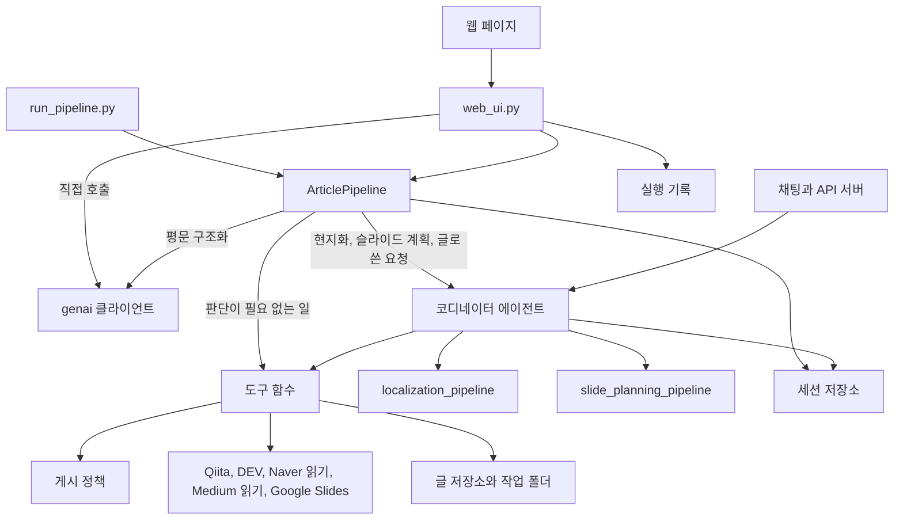

# 현재 설계와 구현 기록 (v0 기준선)

v1 설계를 시작하기 전에, 지금 저장소에 있는 것을 있는 그대로 적어 둔 문서입니다.
무엇을 바꿀지는 여기 적지 않습니다. 그 내용은 [kr-DESIGN-v1.md](./kr-DESIGN-v1.md)에 있습니다.

| 항목 | 값 |
| :--- | :--- |
| 기준 커밋 | `b5e1793` (2026-11-12, `main`, 68번째 커밋) |
| 요구사항 문서 | [SPEC.md](./SPEC.md). 본문은 커밋 `58c2dc1`까지만 반영되어 있고, 그 뒤 21개 커밋은 반영되지 않았습니다 (11절) |
| 규모 | `app/` Python 약 10,060줄, 페이지 2개(`index.html` 1,625줄, `edit.html` 265줄), 단위 테스트 13개 파일 |
| 확인 방법 | 코드 열람, 단위 테스트 전체 실행, 모델을 쓰지 않는 재현 스크립트 3건, 프롬프트 번역 경로 1회 호출, 실제 실행 1건의 활동 로그 |
| 읽은 범위 | `58c2dc1` 이후 바뀐 코드는 차이 전체를 읽었습니다. `web_ui.py`, `pipeline.py`, `index.html`, `state.py`, `policy.py`, `agent.py`, `structurer.py`는 파일 전체를 읽었습니다. 그 밖의 모듈(`google_slides.py`, `deck_sync.py`, `tools/publish.py`, `markdown_checks.py`, `prompts.py`, `edit.html` 등)은 바뀐 부분과 이 문서에 인용한 부분만 읽었고, 나머지는 SPEC.md와 통과한 단위 테스트를 근거로 적었습니다. 통합 테스트는 돌리지 않았습니다 |
| 추가 확인 | 2026-11-12 오후에 같은 코드를 역량별로 다시 대조했습니다. `observability.py`, `redaction.py`, `secrets.py`, `plugins.py`, `memory.py`, `schemas.py`, `fast_api_app.py`, 평가 설정과 지표 파일, `blog_agent.tf`를 전체로 읽고 `tools/`의 세 파일을 대부분 읽었습니다. 도구 18개의 기계 검사, 모델에 전달되는 도구 선언 출력, 개발 서버 구조화 로그 710건의 필드 집계, 린터, 평가 1회 실행을 더했습니다. 결과는 10절과 12절의 B-15 ~ B-20에 있습니다 |

각 항목의 근거는 아래 표기로 구분합니다.

| 표기 | 뜻 |
| :--- | :--- |
| 코드 | 코드에서 읽어 확인했습니다. 실행해 보지는 않았습니다 |
| 실행 | 이 기록을 쓰면서 직접 실행해 확인했습니다 |
| 관측 | 2026-11-12 사용 중 남은 활동 로그에서 확인했습니다 |

---

## 1. 한눈에 보기

글 하나(한국어, 영어, 일본어 중 하나)를 받아 세 언어의 블로그 글로 만들고, 언어별 플랫폼에 올릴 준비를 하고, 발표용 Google Slides 덱과 발표자 노트를 만듭니다. 사람은 검토하고 승인하며, 그 사이의 기계적인 일은 시스템이 합니다.

| 언어 | 플랫폼 | 올리는 방법 |
| :--- | :--- | :--- |
| 한국어 | Naver Blog | 붙여넣기용 HTML을 만들고, 사람이 붙여넣은 뒤 URL을 등록합니다 |
| 영어 | DEV Community | 사람이 승인하면 API로 올립니다 |
| 일본어 | Qiita | 사람이 승인하면 API로 올립니다 |

이 매핑은 고정입니다. 12개 불변 조건(INV-1 ~ INV-12)과 요구사항 전문은 SPEC.md 2절과 5절에 있습니다.

## 2. 구성 요소



SPEC.md 6절의 그림과 다른 곳은 두 군데입니다. `web_ui.py`와 `pipeline.py`가 에이전트를 거치지 않고 모델을 직접 부르는 경로가 생겼고, Medium 읽기가 추가되었습니다.

| 파일 | 줄 수 | 역할 |
| :--- | ---: | :--- |
| `app/agent.py` | 289 | 에이전트 구성과 `App` 설정 |
| `app/workflow_agents.py` | 359 | 코드로 판정하는 게이트와 보고 에이전트 8개 |
| `app/prompts.py` | 505 | 지시문. 글 본문은 호출마다 새로 만든 표식 사이에 넣습니다 |
| `app/models.py` | 57 | 작업 종류별 모델 지정 |
| `app/pipeline.py` | 1,120 | 페이지와 스크립트용 실행기. 단계마다 결과를 검사합니다 |
| `app/web_ui.py` | 969 | 웹 서버, 실행 기록, 경로 18개 |
| `app/static/` | 1,890 | 페이지(`index.html`)와 편집기(`edit.html`). 스타일, 스크립트, 화면 문구가 모두 파일 안에 있습니다 |
| `app/tools/articles.py` | 533 | 원본 저장과 확정, 글 읽기와 수정 |
| `app/tools/publish.py` | 736 | 확정, Naver HTML, Qiita와 DEV 게시, URL 등록과 확인 |
| `app/tools/slides.py` | 635 | 발표 개요, 타이밍 검사, 계획 파일, 덱, PDF, 매니페스트 |
| `app/policy.py` | 234 | 확정과 게시 가능 여부를 정하는 유일한 곳 |
| `app/platforms.py` | 934 | Qiita, DEV, Naver, Google Docs, Medium HTTP 클라이언트 |
| `app/google_slides.py` | 1,104 | 덱 생성, 이미지와 표 배치, 읽기, 텍스트 갱신, PDF |
| `app/deck_sync.py` | 291 | 덱과 계획 파일의 텍스트 비교와 병합 |
| `app/markdown_checks.py` | 367 | 구조 검사, 발표 시간 추정 |
| `app/structurer.py` | 90 | 제목 줄이 없는 평문을 모델로 Markdown 구조화 |
| `app/state.py` | 84 | 세션 상태 키 이름 |
| `app/persistence.py` | 221 | 글 저장소 (SQLite, 설정 시 Firestore) |
| `app/plugins.py`, `observability.py`, `redaction.py`, `secrets.py`, `memory.py` | 680 | 내용 정책 플러그인, 로그와 추적, 가림 처리, 시크릿 조회, 기억 정리 |
| `app/fast_api_app.py`, `app/app_utils/` | 490 | 에이전트 API 서버와 배포용 배선 |
| `scripts/` | – | `run_pipeline.py`(전 단계 실행), `authorize_google_slides.py`(Slides 권한 부여) |

## 3. 에이전트 구성

```
trilingual_blog_agent              코디네이터, 빠른 모델, 도구 18개
├── seed_editor_agent              추론 모델, 초안 수정
├── localization_pipeline          SequentialAgent
│   └── seed_gate                  확정된 원본이 있을 때만 통과
│       ├── localization_fanout    ParallelAgent: 언어별 현지화 3개 + 제목
│       ├── localization_review_loop   LoopAgent, 최대 2회
│       │   ├── fidelity_check_agent   구조 검사 (코드)
│       │   ├── localization_critic_agent  의미 검토 (추론 모델)
│       │   ├── review_gate            모두 통과하면 종료
│       │   └── refinement_fanout      실패한 언어만 다시 작성
│       └── localization_report_agent  버전 저장, 보고
└── slide_planning_pipeline        SequentialAgent
    └── brief_gate                 발표 개요와 그 언어의 글이 있을 때만 통과
        ├── slide_review_loop      LoopAgent, 최대 2회
        │   ├── slide_plan_agent   계획 작성 (추론 모델)
        │   └── slide_timing_gate  타이밍 검사, 언어별 계획으로 기록
        └── slide_report_agent     계획 파일 작성, 보고
```

| 작업 | 모델 설정 |
| :--- | :--- |
| 대화 조율, 현지화, 제목 현지화, 재작성, 대화 요약 | `FAST_MODEL_NAME` |
| 초안 수정, 현지화 검토, 슬라이드 계획 | `REASONING_MODEL_NAME` |
| 평문 구조화, 프롬프트 번역 | `FAST_MODEL_NAME`. 에이전트가 아니라 `genai` 클라이언트를 직접 씁니다 |

코디네이터의 도구는 다음 18개와 기억 불러오기 도구입니다.

| 묶음 | 도구 |
| :--- | :--- |
| 원본 | `fetch_published_article_markdown`, `load_markdown_draft_file`, `save_seed_article_revision`, `finalize_seed_article` |
| 글 | `read_article_post`, `update_article_post`, `finalize_localized_post` |
| 게시 | `export_naver_blog_paste_ready_html`, `publish_qiita_article_draft`, `publish_devto_article_draft`, `record_manually_posted_url`, `verify_published_article_urls` |
| 슬라이드 | `set_presentation_brief`, `check_slide_script_timing`, `export_slide_plan_markdown`, `create_google_slides_deck_with_speaker_notes`, `export_google_slides_pdf` |
| 정리 | `compile_artifact_manifest_markdown` |

`App`에는 내용 정책 플러그인, 관측 플러그인, 대화 압축(토큰 60,000 기준), 지시문 캐시, 승인 대기 후 재개 설정이 걸려 있습니다. 코드.

## 4. 실행 흐름

### 4.1 페이지의 실행 버튼

`POST /api/jobs`가 `ArticlePipeline.run_stages`를 백그라운드 작업 하나로 시작합니다. 끝날 때까지 실행의 `busy`가 참입니다. 코드.

1. 원본 저장. 입력을 종류별로 나누어(8절) 원본으로 저장합니다. 제목 줄이 없는 평문과 Naver 글은 모델이 Markdown으로 구조화한 결과를 저장합니다.
2. 현지화. 코디네이터에게 "Localize it into the other two languages."를 보냅니다. 두 언어가 모두 쓰였는지, 구조 검사를 통과했는지 코드가 확인하고, 아니면 알림을 남기고 멈춥니다.
3. Naver HTML 작성. Naver가 원본 플랫폼이면 건너뜁니다.
4. 슬라이드. 선택한 언어를 하나씩 차례로 처리합니다. 언어마다 코디네이터에게 발표 준비를 요청하고(코디네이터가 `set_presentation_brief`를 부른 뒤 계획 파이프라인으로 넘깁니다), 계획이 그 언어로 만들어졌는지 확인하고, 실행 옵션에서 승인된 경우 덱을 만듭니다.
5. 매니페스트 작성.

슬라이드는 언어마다 추론 모델이 계획을 한두 번 쓰고, 그 뒤에 덱을 만듭니다. 기록된 실행 1건(30분 분량, 3개 언어)에서 원본 저장부터 영어 덱 생성 시작까지 약 6분이 걸렸습니다. 관측.

### 4.2 사람이 페이지에서 시작하는 액션

| 액션 | 경로 | 실행기 메서드 | 다른 작업이 진행 중일 때 |
| :--- | :--- | :--- | :--- |
| 글 저장 | `PUT /files/{name}` | `save_edit` | 글 준비가 끝났으면 받아들입니다. 잠금 없이 바로 실행합니다 |
| 확정 | `POST /finalize` | `finalize_post` | 위와 같습니다 |
| 게시 | `POST /draft` | `post` | 위와 같습니다. 결과를 기다리지 않는 작업으로 띄웁니다 |
| URL 등록 | `POST /url` | `record_posted_url` | 위와 같습니다. 결과를 기다리지 않는 작업으로 띄웁니다 |
| 슬라이드 계획 파일 저장 | `PUT /files/{name}` | `save_edit` | 409로 거절합니다 |
| 덱 생성, 재생성 | `POST /deck` | `create_deck`, `prepare_slides_and_deck` | 409 |
| PDF 내보내기 | `POST /pdf` | `export_pdf` | 409 |
| 덱 텍스트 동기화 | `POST /deck/sync` | `sync_deck_text` | 409 |
| 에이전트에게 요청 | `POST /message` | `say` 뒤 후처리 | 409 |
| 승인 응답 | `POST /approval` | `answer_approval` | 409 |

"글 준비가 끝났으면"은 진행 단계 "Prepare posts"가 완료라는 뜻입니다. 이 판정은 지금 무엇이 실행 중인지를 보지 않습니다. 그래서 슬라이드 제작 중일 때뿐 아니라, 에이전트가 채팅 요청으로 글을 고치는 중에도 저장, 확정, 게시가 받아들여집니다. 코드.

### 4.3 에이전트에게 보내는 요청

`POST /message`는 요청을 코디네이터에게 보낸 뒤, 웹 계층에서 다음 후처리를 합니다. 코드.

1. 요청 전후의 언어별 슬라이드 계획을 비교해 바뀐 언어를 찾습니다.
2. 실행이 덱을 요청했거나, 요청문에 `deck`, `google slides`, `슬라이드`, `スライド` 중 하나가 들어 있으면 바뀐 언어마다 새 덱을 만듭니다.
3. 바뀐 언어가 하나라도 있고 요청문에 다른 언어 이름이 더 있으면(`korean`, `한국어`, `英語` 같은 낱말이 들어 있는지로 판정) 그 언어들의 계획을 이어서 만들고, 2번 조건이 맞으면 덱도 만듭니다.

코디네이터 지시문에는 글이나 제목을 고쳐 달라는 요청과 슬라이드 재생성 요청을 되묻지 않고 바로 실행하라는 문장이 있습니다. 글 수정은 `read_article_post`로 읽고 `update_article_post`로 전체 본문을 다시 써서 저장합니다.

### 4.4 게시 정책

확정은 제목과 본문의 다이제스트로 기록합니다. 그래서 그 뒤에 사람이든 에이전트든 제목이나 본문을 바꾸면 확정이 저절로 풀립니다. 게시 도구는 태그만 받고, 승인 요청 뒤에 실행되며, 승인에서 공개를 고르지 않으면 비공개 초안입니다. 원본을 읽어 온 플랫폼에는 쓰지 않습니다. 이 규칙은 `app/policy.py`와 게시 도구에 있고 페이지, 스크립트, 채팅이 같은 함수를 지납니다. 코드, 그리고 단위 테스트로 실행.

### 4.5 슬라이드와 덱

계획은 언어별로 기록합니다(`SLIDE_PLANS`, `SLIDE_TIMING`). 계획 작업 영역(`PRESENTATION_BRIEF`, `SLIDE_DECK_PLAN`, `SLIDE_DRAFT_TIMING`)은 세션에 하나뿐이라 한 번에 한 언어만 계획합니다. 덱을 다시 만들면 Drive에 새 파일이 생기고 기록은 새 덱으로 바뀝니다. 이전 덱은 Drive에 남지만 그 주소는 기록에서 사라집니다. PDF는 글을 확정할 때, 텍스트 동기화로 덱을 고쳤을 때, 요청할 때 내보냅니다. 코드.

## 5. 상태와 저장소

### 5.1 세션 상태

실행 하나가 ADK 세션 하나입니다. 로컬에서는 SQLite 파일(`.adk/sessions.sqlite3`)에 저장합니다. 키 이름은 모두 `app/state.py`에 있습니다.

| 키 | 담는 것 |
| :--- | :--- |
| `project_id`, `seed_title`, `seed_markdown`, `seed_finalized`, `source_language`, `target_languages` | 원본 |
| `localized_markdown_<lang>`, `localized_titles` | 현지화한 글과 제목 |
| `fidelity_report`, `review_verdict` | 구조 검사와 검토 결과 |
| `finalized_posts`, `finalizations_asked` | 언어별 확정 다이제스트, 확정을 물었을 때의 다이제스트 |
| `publications` | 플랫폼별 상태(원본, 내보냄, 초안, 공개)와 주소 |
| `presentation_brief`, `slide_deck_plan`, `slide_timing_report` | 계획 작업 영역 (한 번에 한 언어) |
| `slide_plans`, `slide_timing`, `google_slides_decks`, `google_slides_synced_text` | 언어별 계획, 타이밍, 덱, 동기화 기준 텍스트 |

언어별 값은 언어 코드를 키로 하는 딕셔너리 하나에 들어 있고, 쓸 때는 딕셔너리 전체를 바꿉니다.

세션 쓰기에는 낙관적 잠금이 있습니다. 세션을 읽어 간 뒤 다른 쪽이 먼저 쓰면, 먼저 읽어 간 쪽의 다음 쓰기는 `StaleSessionError`로 실패합니다. 실행.

### 5.2 파일

`workspace/<project id>/`에 `post.<lang>.md`, `naver_blog.html`, `slides.<lang>.md`, `slides.<lang>.pdf`, `manifest.md`가 놓입니다. 그림 미리보기는 `workspace/.diagrams/`에 둡니다.

### 5.3 실행 기록

`workspace/.jobs/<id>.json`에 세션 id, 원본 입력 전문, 슬라이드 언어, 덱 요청 여부, `busy`, 오류, 알림, 에이전트의 답을 적고, `<id>.log`에 활동 로그를 한 줄씩 덧붙입니다. 서버가 다시 뜬 뒤 기록에 `busy`가 참이면 중단된 실행으로 보고 알림을 붙입니다. 실행 옵션 가운데 발표 길이와 청중은 기록에 없습니다. 코드.

### 5.4 글 저장소

글의 모든 판과 게시 기록을 SQLite(설정하면 Firestore)에 둡니다.

### 5.5 브라우저 저장소

| 키 | 담는 것 |
| :--- | :--- |
| `tba.ui_lang` | 화면 언어 |
| `tba.settings` | 마지막 슬라이드 옵션 |
| `tba.lastRun` | 마지막 실행 id |
| `tba.prompt_history` | 보낸 프롬프트와 횟수, 세 언어 번역(최대 50개) |
| `tba.source_history`, `tba.source_hidden` | 최근 원본(최대 30개, 초안은 본문 전체)과 목록에서 지운 항목 |

## 6. HTTP API

| 메서드와 경로 | 하는 일 |
| :--- | :--- |
| `GET /`, `GET /edit` | 페이지, 편집기 |
| `GET /api/config` | 고정 매핑, 자격 증명 설정 여부, 덱이 가는 계정, 다이어그램 설정. 1분 캐시 |
| `GET /api/jobs` | 최근 실행 30개의 id, 원본 입력 전문, 제목. 실행마다 실행기를 만들고 세션을 읽습니다 |
| `POST /api/jobs` | 실행 시작 |
| `GET /api/jobs/{id}` | 상태, 진행 단계 두 벌, 활동 로그 전체(최대 400줄), 언어별 행. 페이지가 2초마다 부릅니다 |
| `POST /api/jobs/{id}/draft`, `/finalize`, `/url` | 게시, 확정, URL 등록 |
| `POST /api/jobs/{id}/deck`, `/pdf`, `/deck/sync` | 덱 생성과 재생성, PDF, 덱 텍스트 동기화 |
| `POST /api/jobs/{id}/message`, `/approval` | 에이전트에게 요청, 승인 응답 |
| `GET`, `PUT /api/jobs/{id}/files/{name}` | 파일 미리보기와 저장 |
| `GET /api/jobs/{id}/diagrams/{digest}` | 다이어그램 이미지 |
| `POST /api/prompts/localize` | 보낸 프롬프트를 세 언어로 번역 |

로그인은 없습니다. 기본값은 localhost에서만 듣고 localhost로 온 요청에만 답합니다. `--host`로 다른 주소를 주면 이름 검사를 끄고 닿을 수 있는 모든 요청에 답합니다. 코드.

## 7. 웹 페이지

| 영역 | 내용 |
| :--- | :--- |
| 머리 | 제목, 한 줄 부제, Settings 버튼 |
| 원본 문서 카드 | 입력 상자, 파일 첨부와 끌어놓기, "Recent sources…" 모달, "Clear / New article", 슬라이드 옵션(길이, 언어, 청중), Run |
| 진행 카드 | 글 제목, 상태 줄, 3행 진행 표시. 1행은 Source document, Transform, Prepare posts, Summarize, Review & edit. 2행은 Prepare posts 아래의 Prepare slides. 3행은 Finalize posts, Approve & draft, Publish posts, Verify & complete |
| 결과 표 | 언어(상태 배지), 제목, 파일, 슬라이드, 다음 단계. 원본 언어가 첫 행 |
| 슬라이드 열 | 덱 링크, 발표자 노트 링크, 계획만 있고 덱이 없으면 "Create deck…". 계획이 없는 언어에는 버튼이 없고, PDF 링크와 재생성 버튼도 없습니다 |
| 요청 카드 | 입력 한 줄, 빠른 프롬프트 칩 3개(보낸 횟수 순, 모자라면 기본 3개), "More prompts…" 모달(필수 프롬프트 6개와 내 기록), 에이전트의 답, 활동 로그 |
| Settings 모달 | 화면 언어(en, ko, ja), 플랫폼별 상태 배지, 언어별 설정 가이드 링크 |
| 편집기 | 전체 화면, 글은 제목 칸 포함, 저장, 슬라이드 계획은 덱 갱신과 가져오기 |

화면 언어는 `index.html` 안의 문구 표 하나(언어별 72개 키)로 바꿉니다. 표에 없는 문구가 많아 한국어나 일본어를 골라도 영어가 섞입니다. 코드.

| 영어로 남는 곳 | 예 |
| :--- | :--- |
| 승인 대화상자 | 덱 생성, 게시, 자격 증명 확인, 파일 교체 |
| 토스트와 알림 | "Enter the https URL of the post.", "Stopped with an error: …", Approve, Decline |
| 상태 줄 일부 | "quiet for …", "Lost contact with the server. Trying again…" |
| 폼 옵션 | 길이 목록, 청중 목록, 언어 체크박스 이름 |
| 서버가 만든 문장 | 알림, 오류, 태그 규칙, 에이전트의 답 |
| 편집기와 미리보기 | 전부 |

문구 표 밖에서 화면 언어를 직접 비교해 문장을 고르는 코드가 5곳 있습니다. 직접 입력한 프롬프트는 두 단계로 화면 언어에 맞춥니다. 슬라이드 생성 요청은 정규식으로 뜻을 읽어 다시 조립하고, 나머지는 서버가 모델로 세 언어 번역을 만들어 브라우저에 저장합니다. 이 번역은 입력한 언어의 문장도 다듬습니다(예: "제작해"가 "제작해줘."로 바뀜). 실행.

## 8. 원본 문서 종류

| 입력 | 판정 | 처리 | 원본 플랫폼 |
| :--- | :--- | :--- | :--- |
| Qiita, DEV 글 URL | `url` | 플랫폼 API로 읽습니다 | 그 플랫폼. 쓰지 않습니다 |
| Naver 글 URL | `url` | 공개 모바일 페이지에서 읽고 모델로 구조화합니다 | Naver |
| Google Docs URL | `gdoc` | Markdown으로 내보내 초안으로 씁니다 | 없음 |
| Medium 글 URL | `medium` | 작성자의 RSS 피드에서 찾아 Markdown으로 바꿉니다. 피드에 남아 있는 최근 글만 읽을 수 있습니다 | 없음 |
| 지원 URL이 든 600자 이하 문장 | `request` | 에이전트에게 보냅니다 | 경우에 따라 다름 |
| 그 밖의 URL 하나 | `elsewhere` | 거절합니다. 안내문에 Medium은 없습니다 | – |
| 그 밖의 텍스트, `.md` `.txt` 파일 | `draft` | 50자 이상 60,000자 이하. `#`~`###` 제목 줄이 없고 100자 이상이면 모델로 구조화한 뒤 저장합니다 | 없음 |

## 9. 설정

| 구분 | 이름 |
| :--- | :--- |
| 모델 | `FAST_MODEL_NAME`, `REASONING_MODEL_NAME` |
| 동작 | `BLOG_AGENT_WORKSPACE_DIR`, `BLOG_AGENT_MAX_ARTICLE_CHARS`, `BLOG_AGENT_HTTP_TIMEOUT`, `BLOG_AGENT_RENDER_MERMAID`, `BLOG_AGENT_ENABLE_DLP`, `BLOG_AGENT_API_HOST` |
| 저장소 | `SESSION_SERVICE_URI`, `USE_IN_MEMORY_SESSION`, `LOCAL_SESSION_DB`, `FIRESTORE_PROJECT_ID` |
| 시크릿 | `QIITA_ACCESS_TOKEN`, `DEVTO_API_KEY`, `GOOGLE_SLIDES_OAUTH`. 환경 변수, Secret Manager, 저장소 밖 파일 순으로 찾습니다 |
| 압축 | `COMPACTION_TOKEN_THRESHOLD`, `COMPACTION_RETAIN_EVENTS` |

`app/web_ui.py`와 `app/fast_api_app.py`는 불러올 때 `.env`를 읽습니다.

## 10. 테스트와 검증 현황

| 대상 | 상태 |
| :--- | :--- |
| 단위 테스트 | 테스트 함수 220개, 매개변수 포함 431건이 모두 통과했습니다. 실행 |
| SPEC 추적 | `tests/unit/test_spec.py`가 요구사항 id와 테스트 이름의 짝을 검사합니다. 통과. 다만 58c2dc1 이후의 동작은 SPEC에 없어서 검사 대상이 아닙니다 |
| 평가 | `agents-cli eval run`을 한 번 실행했습니다. 6개 사례, 오류 0건, `custom_response_quality` 평균 5.00(기준 4), `publish_requires_approval` 1.00(기준 1), `RESULT: PASS`. 사례가 쉬운 편이라 품질을 보증하는 결과로 보기는 어렵습니다. 실행 |
| 통합 테스트 | `tests/integration`(6건)이 있습니다. 실행하지 않았습니다 |
| 린터 | `ruff check`가 오류 2건을 내고 `ruff format --check`가 코드 파일 6개를 지적합니다. 커밋 `58c2dc1`의 코드에서는 둘 다 통과합니다 (B-19). 실행 |
| 페이지 스크립트 | 테스트가 없습니다 |
| 58c2dc1 이후 기능 | 병행 편집, 채팅 후처리, 프롬프트 번역, 최근 원본 목록에는 전용 테스트가 없습니다. Medium은 URL 판정만 테스트하고 피드 읽기와 변환에는 테스트가 없습니다. 구조화는 대상 판정과 실패 시 원문 유지를 테스트합니다 |
| 실제 플랫폼 | 2026-11-12 실행 1건에서 DEV와 Qiita 게시, Naver URL 등록, 3개 언어 덱 생성이 이루어졌습니다. 관측 |

## 11. SPEC과 다른 점

SPEC.md는 "코드와 테스트가 이 문서를 따른다"고 적고 있지만, 58c2dc1 이후에는 코드가 먼저 바뀌었습니다. 아래는 그 차이의 전체 목록입니다.

| 번호 | SPEC | 지금 코드 | 들어온 커밋 |
| :--- | :--- | :--- | :--- |
| G-01 | 1절 "Medium은 범위 밖", SRC-1, INV-8의 접속 대상 목록 | Medium 글 URL을 읽습니다. `medium.com`에 접속합니다 | `9ca2e86` |
| G-02 | INV-11, SRC-2: 초안은 받은 그대로 저장하고 모델이 다시 쓰지 않는다 | 제목 줄이 없는 초안과 Naver 글은 모델이 구조화한 결과를 저장합니다. 받은 원문은 남기지 않습니다. 길이가 절반 이상인지만 확인합니다 | `b4af488` |
| G-03 | INV-7: 글 본문은 무작위 표식 사이에 넣어 모델에 넘긴다 | 구조화는 지시문 뒤에 본문을 그대로 붙입니다 | `b4af488` |
| G-04 | SRC-6, 7절: 원본을 고치면 그 원본에서 만든 현지화와 계획을 버린다. 플랫폼에서 읽은 글은 페이지에서 고칠 수 없다 | 원본 언어의 글을 페이지와 에이전트가 고칠 수 있고, 현지화와 계획은 그대로 둡니다. 원본보다 오래되었다는 표시는 없습니다 | `67e5dc0`, `e38c275` |
| G-05 | PUB-7: 한국어 글이 바뀔 때마다 Naver HTML을 다시 쓴다 | 사람이 고치면 다시 씁니다. 에이전트가 `update_article_post`로 고치면 다시 쓰지 않습니다 | `e38c275` |
| G-06 | INV-6: 덱은 실행 옵션으로 요청했거나 한 개를 승인했을 때만 만든다 | 채팅 요청문에 특정 낱말이 있으면 승인 대화상자 없이 덱을 만듭니다 (4.3) | `67e5dc0`, `0f18601` |
| G-07 | WEB-11: 에이전트가 일하는 동안 다른 것을 시작할 수 없다 | 글 준비가 끝난 뒤에는 저장, 확정, 게시, URL 등록을 받아들입니다 | `e0d463f` |
| G-08 | WEB-1: 부제 문장 | 문장이 바뀌었고 세 언어로 표시합니다 | `33e0d53`, `1dff8f9` |
| G-09 | WEB-3: 5단계 진행 표시 두 줄 | 3행 배치 (7절) | `e38c275` |
| G-10 | WEB-5: 슬라이드 열에 PDF 링크와 "Export PDF" | 페이지에 없습니다. 경로와 함수는 남아 있습니다 | `e2a2d58` |
| G-11 | WEB-9: 에이전트에게 한 줄 | 칩, 프롬프트 모달, 기록, 번역이 추가되었습니다 | `67e5dc0`, `b5e1793` |
| G-12 | WEB-2, WEB-10 | 최근 원본 모달, 화면 언어 선택, 설정 가이드 링크가 추가되었습니다 | `8add7d2`, `33e0d53`, `2679607` |
| G-13 | OPS-2: 단위 테스트는 모델, 네트워크, 자격 증명이 필요 없다 | 테스트 1건이 모델에 닿습니다 (12절 B-04) | `b4af488` |
| G-14 | AGENTS.md: 도구에 기본 인자를 두지 않는다 | `set_presentation_brief`에 기본 인자가 있습니다 | `d088c0c` |
| G-15 | 부록 A: 설계 결정 36번까지 | 그 뒤의 결정이 적혀 있지 않습니다 (13절) | – |

## 12. 확인된 결함과 위험

우선순위 P0은 불변 조건이나 실행 결과에 영향을 주는 것, P1은 유지보수와 정합성, P2는 사용성입니다.

| 번호 | 우선순위 | 내용 | 근거 |
| :--- | :--- | :--- | :--- |
| B-01 | P0 | 에이전트가 일하는 중에 사람의 액션이 세션에 쓰면, 진행 중이던 에이전트 작업이 다음 쓰기에서 `StaleSessionError`로 실패합니다. 슬라이드 제작 중 글을 저장하거나 확정하면 그 언어의 슬라이드 계획이 중단될 수 있습니다 | 실행. 아래 재현 절차 |
| B-02 | P0 | 병행 경로의 게시와 URL 등록은 결과를 받는 곳이 없습니다. 실패해도 페이지에 알림이 뜨지 않습니다(INV-12). 병행 경로끼리는 서로 막지 않아, 두 액션이 겹치면 한쪽이 B-01과 같은 오류로 실패하거나 같은 딕셔너리 키의 한쪽 변경이 사라질 수 있습니다 | 코드. 변경이 사라지는 경우는 저장소 수준에서 실행으로 확인 |
| B-03 | P0 | 채팅 요청문에 낱말이 들어 있는지로 덱 생성과 대상 언어를 정합니다. "영어 제목은 두고 한국어 슬라이드만"처럼 언어 이름이 다른 뜻으로 쓰여도 그 언어의 덱을 새로 만듭니다. 승인 대화상자를 거치지 않습니다 (INV-6) | 코드 |
| B-04 | P1 | 환경에 프로젝트 설정이 있으면 `test_a_post_read_from_the_naver_page_goes_on_with_a_notice`가 모델을 부릅니다. 전체 실행에서는 다른 테스트가 `app.web_ui`를 불러오며 `.env`를 읽기 때문에 항상 그렇게 됩니다. 이 테스트 한 건의 소요 시간이 설정 없이는 1초 미만, `.env` 값을 넣으면 5.6초, 전체 실행 중에는 8.8초입니다 | 실행 |
| B-05 | P1 | 글을 고치는 경로가 둘입니다(`save_edit`, `update_article_post`). 에이전트 경로는 Naver HTML을 갱신하지 않고, 이미 공개된 글의 로컬 본문도 바꿀 수 있고, 본문 전체를 모델이 다시 써서 넘깁니다 | 코드 |
| B-06 | P1 | 덱을 다시 만들면 이전 덱의 PDF 파일이 남아 새 덱의 PDF처럼 매니페스트에 실립니다. 이전 덱의 주소는 기록에서 사라집니다 | 코드 |
| B-07 | P1 | 모델을 부르는 길이 셋입니다(에이전트, `structurer.py`, `web_ui.py`). 뒤의 둘은 플러그인, 재시도 설정, 표식 규칙을 지나지 않고 실패를 조용히 삼킵니다 | 코드 |
| B-08 | P1 | 웹 계층에 판단 로직이 있습니다. 자연어 낱말 검사, 덱 생성 순서, 모델 호출이 `web_ui.py`에 있고, 테스트 대역에 맞추려는 `hasattr` 검사가 운영 코드에 있습니다 | 코드 |
| B-09 | P2 | 최근 원본 목록을 열 때마다 실행 30개의 세션을 읽고 초안 전문을 내려받아 브라우저에 저장합니다. 페이지는 2초마다 이 저장소를 다시 씁니다 | 코드 |
| B-10 | P2 | 한국어와 일본어 폼 문구가 "약 1~2분"이라고 말합니다. 기록된 실행에서는 30분 분량일 때 원본 저장부터 첫 언어의 덱 생성 시작까지만 약 6분이 걸렸습니다 | 관측 |
| B-11 | P2 | 화면 언어가 절반만 적용됩니다 (7절) | 코드 |
| B-12 | P2 | 낡은 문장과 쓰지 않는 코드가 있습니다. `save_edit` 설명문은 원본을 고칠 수 없다고 적혀 있어 지금 동작과 반대입니다. 편집기는 고칠 수 없는 글(이미 공개된 글)을 열면 "This is the source article. Edit it where it was written…"라고 다른 이유를 댑니다. `exportPdf`, `createSlidesBtn`, `recreateDeckBtn`, `askHint`는 쓰이지 않습니다 | 코드 |
| B-13 | P2 | 서버가 멈추면 진행 중이던 실행은 끊기고 이어서 할 방법이 없습니다. 2026-11-12에 개발 중 서버를 다시 띄우면서 실행 1건의 슬라이드 단계가 한국어 계획 도중에 끊겼습니다(영어만 완료). 그때 실행 기록의 `busy`와 알림을 손으로 지워서 페이지에 "중단됨" 대신 "완료"가 표시되었습니다 | 관측 |
| B-14 | P2 | 다른 주소로 띄우면 닿을 수 있는 누구나 실행하고 게시를 승인할 수 있습니다. SPEC 7절에 적힌 알려진 한계입니다 | 코드 |
| B-15 | P1 | 페이지와 스크립트 경로에는 추적 공급자를 설정하는 코드가 없습니다. 그래서 스팬이 기록되지 않고 로그의 추적 id가 비어 있습니다. 개발 서버의 구조화 로그 710건이 모두 그랬습니다. 추적 내보내기는 에이전트 API 서버를 텔레메트리 설정과 함께 띄울 때만 켜집니다. 자식 스팬은 `app/platforms.py`의 외부 호출 9곳에만 있고 `app/google_slides.py`의 호출에는 없습니다 | 관측, 코드 |
| B-16 | P1 | 로그 가림 처리가 식별자를 바꿉니다. 숫자로 된 함수 호출 id가 카드 번호 검사에 걸려 `call_[REDACTED_CREDIT_CARD]`가 됩니다. 호출 id가 실린 기록 360건 중 24건이 그랬고, 그 호출들은 의도 기록과 결과 기록을 짝지을 수 없습니다 | 관측 |
| B-17 | P1 | 도구 규약이 일부 어긋납니다. 에이전트가 부를 수 있는 도구 18개 중 `read_article_post`와 `update_article_post`는 매개변수와 반환값 설명이 없고, `set_presentation_brief`에는 기본 인자가 있습니다(G-14). 언어, 플랫폼, 코드 방식 매개변수는 허용 값 목록 없이 문자열로만 모델에 전달됩니다. 7개 도구는 언어 값을 입력 모델이 아니라 직접 비교로 검사해서 `app/schemas.py` 머리말의 설명과 다릅니다 | 실행, 코드 |
| B-18 | P2 | `ArticlePipeline`의 활동 기록 기본 출력이 `print`입니다. 활동 줄은 페이지와 파일에만 남고 구조화 로그에는 남지 않습니다 | 코드 |
| B-19 | P1 | 린터가 통과하지 않습니다. `ruff check`의 오류 2건은 `web_ui.py`에서 결과를 받지 않고 띄우는 작업 두 곳으로, B-02와 같은 자리입니다. 서식 검사는 코드 파일 6개를 지적합니다. 저장소에 CI가 없어 푸시할 때 걸러지지 않았습니다 | 실행 |
| B-20 | P2 | 평가 데이터셋의 지원하지 않는 주소 사례가 Medium 주소를 씁니다. 채팅의 에이전트는 지금도 거절하지만 페이지는 Medium을 읽으므로 두 표면의 답이 다릅니다. 평가의 판정 모델 이름은 설정이 아니라 `tests/eval/response_quality.py`에 적혀 있습니다 | 코드, 실행 |

### B-01 재현 절차

모델과 네트워크 없이, 임시 SQLite 세션 저장소에서 다음 순서로 확인했습니다.

1. 세션을 읽어 간 핸들 A로 이벤트를 하나 씁니다(진행 중인 에이전트 작업에 해당). 성공합니다.
2. 세션을 다시 읽은 핸들 B로 상태 변경 이벤트를 씁니다(`ArticlePipeline._update_state`가 하는 일). 성공합니다.
3. 핸들 A로 다음 이벤트를 씁니다. `StaleSessionError: The last_update_time provided in the session object is earlier than the update_time in storage.`로 실패합니다.

ADK 실행기는 대화 압축 단계에서만 이 오류를 무시하고, 작업 도중에는 그대로 실패로 처리합니다. 기록된 실행에서 이 오류가 실제로 난 적은 없습니다. 그 실행의 슬라이드 단계는 B-13의 서버 재시작으로 끊겼습니다.

## 13. 설계 결정 연표 (36번 이후)

SPEC.md 부록 A는 36번에서 끝납니다. 그 뒤 사용성 테스트를 거치며 내린 결정은 다음과 같습니다.

| 번호 | 결정 | 커밋 |
| :--- | :--- | :--- |
| 37 | 상태 줄을 제목 아래로 옮기고, 게시 단계 5개를 진행 표시에 추가. 이후 3행 배치로 변경 | `95a6390`, `e2a2d58`, `e38c275` |
| 38 | 태그 입력을 게시 승인 대화상자로 옮기고 쉼표 구분 규칙을 안내 | `63abc46`, `d38a71e`, `b6b9ef3`, `ad1a82d` |
| 39 | 새로 고쳐도 원본 입력을 되살리고 "Clear / New article" 제공 | `58c2dc1`, `510bd3f`, `2e5459f` |
| 40 | 평문과 Naver 글을 자동으로 Markdown 구조화 | `b4af488` |
| 41 | 실행 중에는 활동 로그를 자동으로 펼침 | `1e7b1b8` |
| 42 | 화면 언어 선택(en, ko, ja), 진행 표시와 상태와 칩의 현지화 | `33e0d53`, `1dff8f9` |
| 43 | 확정된 글에서 필요할 때 슬라이드 생성과 재생성 | `49a2b73` |
| 44 | 원본 글 편집 허용, 프롬프트 칩과 프롬프트 모달 | `67e5dc0`, `f007abb` |
| 45 | 에이전트가 글과 제목을 직접 고치는 도구, 되묻지 않는 기본 동작 | `e38c275`, `fdbeec2`, `d088c0c` |
| 46 | Settings 정돈: 상태 배지, 설정 가이드 링크, 세 언어 설정 문서 | `2679607`, `eaee279`, `a31b247` |
| 47 | 최근 원본 모달 | `8add7d2`, `d088c0c` |
| 48 | Medium 글 URL 읽기 | `9ca2e86` |
| 49 | 슬라이드 제작 중 글 검토, 확정, 게시 병행 | `e0d463f` |
| 50 | 한 문장으로 여러 언어의 슬라이드 요청 | `0f18601` |
| 51 | 칩 문구 줄바꿈, 직접 입력한 프롬프트를 화면 언어로 표시 | `b5e1793` |
