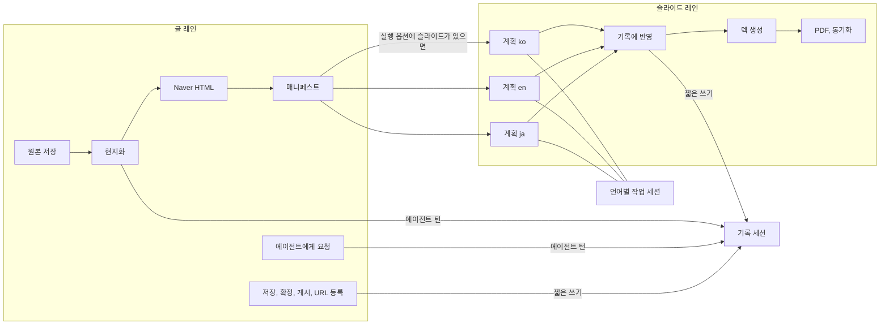
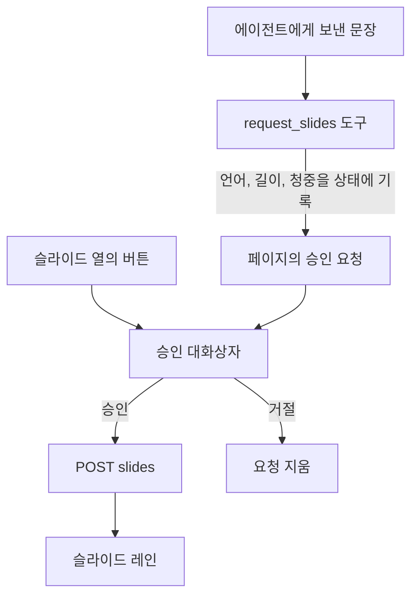

# v1 설계

초기 설계와 사용성 테스트로 쌓인 기능을 한 번 정리해 v1로 확정하기 위한 설계 문서입니다.
지금 상태의 기록은 [kr-AS-BUILT.md](./kr-AS-BUILT.md)에 있고, 이 문서의 `G-`, `B-` 번호는 그 문서의 11절과 12절을 가리킵니다.

| 항목 | 값 |
| :--- | :--- |
| 상태 | 제안. 구현은 시작하지 않았습니다 |
| 기준 | 커밋 `b5e1793`의 코드와 [SPEC.md](./SPEC.md) |
| 확정에 필요한 것 | 6절의 결정 7건 |
| 구현 단위 | 5절의 작업 패키지 18개. 하나씩 SPEC, 코드, 테스트 순서로 반영합니다 |

---

## 1. 목표와 원칙

v1의 목표는 기능을 더하는 것이 아니라, 지금 있는 기능이 SPEC의 불변 조건을 모든 경로에서 지키고, 같은 일을 하는 길이 하나만 남게 하는 것입니다.

| 원칙 | 뜻 | 지금 어긋난 곳 |
| :--- | :--- | :--- |
| 불변 조건이 먼저 | 12개 불변 조건은 페이지, 스크립트, 채팅, API 어디서나 지킵니다. 예외가 필요하면 SPEC을 먼저 고칩니다 | G-02, G-03, G-06, G-07 |
| 판단은 모델, 흐름은 코드 | 모델은 현지화, 계획, 검토, 글 다듬기와 요청문 해석만 합니다. 무엇을 언제 실행할지와 동시 실행은 코드가 정합니다 | B-03, B-08 |
| 한 가지 일에는 길 하나 | 사람이 시작한 액션이든 에이전트의 도구든 같은 함수를 지납니다 | B-05, B-07 |
| 페이지는 사실만 말한다 | 상태는 서버가 가진 값에서 계산하고, 시작한 액션은 완료 아니면 알림으로 끝납니다 | B-02, B-06, B-10 |
| 화면 문구는 한 곳에 | 페이지가 보여 주는 문장은 언어별 문구집에서만 나옵니다. 사람이 쓴 글은 기계가 몰래 바꾸지 않습니다 | B-11, G-02 |
| 사실 하나에 출처 하나 | 같은 정보를 두 곳에 두고 맞추지 않습니다 | B-09 |

### 그대로 두는 것

리뷰에서 문제가 없었고 v1에서도 바꾸지 않는 설계입니다.

- 확정을 제목과 본문의 다이제스트로 기록하는 방식. 누가 고치든 확정이 저절로 풀립니다.
- 확정과 게시 규칙을 `app/policy.py` 한 곳에 두고 도구가 그것을 부르는 구조.
- 게시와 덱 생성 도구의 승인 요청, 비공개 초안 기본값, 원본 플랫폼에 쓰지 않는 규칙.
- 통과 여부를 코드로 판정하는 게이트(`app/workflow_agents.py`)와 구조 검사.
- 단계마다 결과를 확인하고 안 된 일을 알림으로 남기는 실행기.
- SPEC 요구사항과 테스트 이름의 짝을 검사하는 `tests/unit/test_spec.py`.
- 빌드 단계가 없는 순수 HTML과 스크립트, 본문을 텍스트로만 넣는 렌더링, 미리보기의 내용 보안 정책.
- 언어와 플랫폼의 고정 매핑, 언어별로 따로 기록하는 슬라이드 상태.
- 사용성 테스트에서 정한 화면 배치(3행 진행 표시, 표의 열 순서, Settings 구성).

## 2. 리뷰 결과 요약

| 영역 | 판정 | 핵심 |
| :--- | :--- | :--- |
| 게시 안전성 | 양호 | 다이제스트 확정 덕분에 새로 생긴 편집 경로에서도 확정되지 않은 글은 나가지 않습니다 |
| 동시 실행 | 고쳐야 함 | 병행 편집이 세션 저장소의 낙관적 잠금과 충돌합니다. 진행 중인 슬라이드 계획을 깨뜨릴 수 있고, 결과를 받지 않는 작업이 있습니다 (B-01, B-02) |
| 덱 생성 승인 | 고쳐야 함 | 요청문의 낱말 검사로 Drive에 새 파일을 만듭니다 (B-03, G-06) |
| 원본 보존 | 고쳐야 함 | 모델이 원본을 다시 쓰고 원문은 남지 않습니다 (G-02, G-03) |
| 계층 분리 | 고쳐야 함 | 웹 계층이 요청문을 해석하고 모델을 부릅니다 (B-07, B-08) |
| 글 편집 | 정리 필요 | 편집 경로가 둘이고 서로 다르게 동작합니다 (B-05, G-04, G-05) |
| 슬라이드 수명주기 | 정리 필요 | 재생성하면 PDF와 이전 덱 주소가 어긋납니다. 페이지에 생성과 재생성 버튼이 없어 채팅으로 우회합니다 (B-06, G-10) |
| 화면 언어 | 정리 필요 | 문구집이 일부만 덮고, 사람이 쓴 프롬프트를 기계 번역합니다 (B-11) |
| 테스트 | 고쳐야 함 | 단위 테스트가 모델에 닿고, 새 기능 대부분에 테스트가 없습니다 (B-04) |
| 문서 | 고쳐야 함 | SPEC이 21개 커밋 뒤처졌습니다 (G-01 ~ G-15) |

## 3. 설계 결정

| 번호 | 결정 | 이유 | 버린 대안 |
| :--- | :--- | :--- | :--- |
| A-01 | 실행을 두 레인으로 나눕니다. 글 레인은 원본, 현지화, 글 액션, 에이전트 요청을 맡고, 슬라이드 레인은 계획, 덱, PDF, 동기화를 맡습니다. 레인마다 한 번에 하나만 실행하고 두 레인은 동시에 돕니다 | 슬라이드를 기다리는 동안 글을 검토하고 게시하려는 요구(결정 49)를 안전하게 지킵니다 | 하나씩만 실행(요구를 버림), 지금처럼 조건 검사로 우회(B-01) |
| A-02 | 실행의 세션은 기록입니다. 기록에는 한 번에 한 작성자만 씁니다. 슬라이드 계획은 언어별 작업 세션에서 돌리고 결과만 기록에 옮깁니다. 코드의 쓰기는 딕셔너리 전체가 아니라 바뀐 하위 키만 반영합니다 | 낙관적 잠금과 충돌하지 않고, 언어가 다른 두 변경이 서로를 지우지 않습니다. 언어별 계획이 서로 섞이지 않는다는 SLD-5도 구조로 보장됩니다 | 쓰기를 턴이 끝날 때까지 미루기(확정이 즉시 반영되지 않음) |
| A-03 | 사람이 시작한 액션은 모두 레인의 작업으로 실행하고 결과를 완료 또는 알림으로 남깁니다. 결과를 받지 않는 작업은 만들지 않습니다 | INV-12 | – |
| A-04 | 기계 밖에 무언가를 만드는 일(플랫폼 게시, Drive 파일)은 버튼과 승인 대화상자로만 시작합니다. 에이전트에게 보낸 문장은 글과 계획의 텍스트만 바꿉니다. 문장으로 슬라이드를 요청하면 모델이 언어, 길이, 청중을 읽어 구조화된 요청으로 남기고, 코드가 승인 대화상자를 띄웁니다 | INV-1, INV-6. 낱말 검사를 없앱니다 | 낱말 검사 유지, 채팅의 슬라이드 요청을 아예 막기 |
| A-05 | 글의 제목과 본문은 누가 바꾸든 함수 하나를 지납니다. 에이전트는 본문 전체를 다시 쓰지 않고, 인용한 구절을 다른 구절로 바꿉니다 | PUB-7과 공개 글 보호가 한 곳에서 지켜지고, 긴 글이 잘리거나 바뀌는 일을 막습니다 | 전체 본문을 다시 받는 도구 유지 |
| A-06 | 받은 원문은 그대로 보관합니다. 제목 줄이 없는 평문과 Naver 글의 구조화는 SPEC에 예외로 적고, 글자가 보존되었는지 코드가 확인한 경우에만 씁니다 | 결정 40의 편의를 유지하면서 INV-11을 되살립니다 | 구조화 삭제, 지금처럼 길이만 확인 |
| A-07 | 원본 종류를 표 하나로 정의하고, 접속 허용 목록과 안내문을 그 표에서 만듭니다. Medium은 읽기 전용 원본으로 SPEC에 적습니다 | INV-8의 목록과 코드가 한 곳에서 나옵니다 | – |
| A-08 | 모델을 부르는 곳은 에이전트 구성과 관문 모듈 둘뿐입니다. 웹 계층은 모델도 플랫폼도 직접 부르지 않습니다 | INV-7, 재시도와 로그의 일관성 | – |
| A-09 | PDF는 덱의 스냅샷입니다. 요청할 때 내보내고, 덱이 새로 만들어지면 지웁니다. 글 확정과의 연동은 없앱니다. 덱을 다시 만들면 이전 주소를 기록에 남깁니다 | B-06. 글 레인의 액션이 슬라이드 레인의 값을 건드리지 않게 됩니다 | 확정 시 자동 내보내기 유지 |
| A-10 | 칩은 문구집에 있는 제안만 보여 주고 사용 횟수로 순서를 정합니다. 직접 입력한 프롬프트는 "내 기록"에 입력한 그대로 둡니다 | 화면 문구와 사람이 쓴 글을 섞지 않습니다. 번역용 모델 호출이 사라집니다 | 정규식과 모델 번역 유지 |
| A-11 | 최근 원본은 서버의 실행 기록이 유일한 출처입니다. 목록은 제목과 요약만 주고 초안 본문은 필요할 때 받습니다 | B-09 | – |
| A-12 | 화면 문구를 언어별 파일로 옮기고 함수 하나로 꺼냅니다. 서버가 만든 알림은 코드와 값을 함께 보내 페이지가 번역합니다. 세 언어의 키가 같은지 테스트합니다 | B-11 | – |
| A-13 | 진행 표시는 3행을 유지하고, 슬라이드 칸에 언어별 상태를 보여 줍니다. 슬라이드 열에 생성, 덱 생성, 재생성, PDF 버튼을 둡니다 | 가장 오래 걸리는 단계의 진행을 언어 단위로 알 수 있고, 채팅으로 우회할 이유가 없어집니다 | – |
| A-14 | 중단된 실행은 빠진 슬라이드를 그 실행의 옵션으로 다시 만들 수 있게 합니다. 옵션(길이, 청중)을 실행 기록에 저장합니다 | B-13 | 처음부터 다시 실행 |
| A-15 | 스타일, 스크립트, 문구를 파일로 나누고 페이지에서 인라인 스크립트를 없앱니다 | 1,625줄 한 파일을 나누고, 스크립트 출처를 제한하는 정책을 걸 수 있습니다 | 프레임워크 도입 |
| A-16 | 단위 테스트는 네트워크 연결과 모델 관문을 막은 상태로 돕니다. `.env`는 테스트에서 읽지 않습니다 | OPS-2를 선언이 아니라 장치로 지킵니다 | – |
| A-17 | localhost가 아닌 주소로 띄우면 접근 토큰을 요구합니다 | B-14 | 문서의 경고만 유지 |

## 4. v1 설계

### 4.1 실행 모델



| 규칙 | 내용 |
| :--- | :--- |
| 레인 | 실행마다 `main`과 `slides` 두 개. 레인이 바쁘면 그 레인의 새 액션만 409로 거절하고, 어느 레인이 바쁜지 문장으로 말합니다 |
| 기록 세션의 작성자 | 글 레인의 에이전트 턴은 턴이 끝날 때까지 쓰기 잠금을 쥡니다. 코드의 쓰기는 잠금을 잡고, 세션을 새로 읽고, 한 번 쓰고, 놓습니다. 그래도 `StaleSessionError`가 나면(ADK의 대화 압축처럼 잠금 밖에서 쓰는 것이 있을 때) 새로 읽어 한 번 더 시도합니다 |
| 하위 키 병합 | 언어나 플랫폼을 키로 하는 딕셔너리는 도구가 읽은 값과 쓴 값을 비교해 바뀐 하위 키만 새로 읽은 값 위에 반영합니다 |
| 슬라이드 계획 | 기록 상태를 복사한 작업 세션에서 계획 파이프라인을 직접 실행합니다. 끝나면 그 언어의 계획과 타이밍만 기록에 옮기고 작업 세션을 지웁니다 |
| 병렬 계획 | 요청한 언어들의 계획을 동시에 돌립니다. `BLOG_AGENT_SLIDE_PARALLELISM`으로 줄일 수 있고 기본값은 3입니다. 덱은 계획이 끝난 순서대로 하나씩 만듭니다 |
| 실패의 범위 | 한 언어의 계획이나 덱이 실패하면 그 언어의 알림으로 남기고 나머지는 계속합니다 |
| 페이지에서의 도구 | 페이지가 모는 세션에는 `surface` 값이 `web`으로 들어갑니다. 이 세션에서 `set_presentation_brief`는 `request_slides`를 쓰라는 안내 오류를 돌려줍니다. 채팅과 API에서는 지금처럼 동작합니다 |

레인별 액션은 다음과 같습니다.

| 레인 | 액션 |
| :--- | :--- |
| 글 | 실행 시작(원본, 현지화, Naver HTML, 매니페스트), 글 저장, 확정, 게시, URL 등록, 에이전트에게 요청, 승인 응답 |
| 슬라이드 | 슬라이드 요청(계획과 덱), 계획에서 덱 만들기, PDF 내보내기, 덱 텍스트 동기화, 발표자 노트 파일 저장 |

이 설계의 근거를 모델 없이, 운영과 같은 SQLite 세션 저장소에서 실행해 확인했습니다.

| 상황 | 방식 | 결과 |
| :--- | :--- | :--- |
| 에이전트 턴 도중에 다른 쓰기가 낌 | 지금 | 턴이 `StaleSessionError`로 실패 (B-01) |
| 언어가 다른 두 액션이 겹침 | 지금(딕셔너리 전체 쓰기) | 한쪽 언어의 확정이 사라짐 (B-02) |
| 언어가 다른 두 액션이 겹침 | 하위 키 병합 | 둘 다 남음 |
| 에이전트 턴 도중에 사람의 액션 두 개가 도착 | 쓰기 잠금 | 턴이 끝까지 가고, 그 뒤에 두 변경이 반영됨 |
| 작업 세션에서 계획하는 동안 기록을 편집 | 세션 분리 | 계획과 편집이 모두 남음 |
| 계획 파이프라인의 인스턴스를 하나 더 만들어 별도 `App`의 루트로 실행 | 발표 개요 없는 세션 | `brief_gate`가 코드로 답하고 모델은 불리지 않음 |

확인하지 못한 것도 있습니다. 모델을 부르는 계획 전체를 이 구성으로 돌려 보지는 않았고, 세 언어를 동시에 계획할 때 모델 할당량이 버티는지도 모릅니다. WP-04에서 사람이 한 번 확인해야 합니다.

### 4.2 슬라이드 요청

버튼과 채팅이 같은 경로로 모입니다.



대화상자는 언어, 길이, 청중, 덱이 만들어질 계정을 보여 줍니다. 이미 덱이 있는 언어는 "새 파일이 만들어지고 이전 덱은 Drive에 남는다"고 알리고, 이미 계획이 있는 언어는 "발표자 노트에서 고친 내용이 새 계획으로 바뀐다"고 알립니다. 계획은 그대로 두고 덱만 만드는 일은 "덱 생성…" 버튼이 맡습니다. 길이를 정하지 않은 요청은 그 언어의 지금 계획 길이, 없으면 실행 옵션의 길이, 그것도 없으면 15분으로 코드가 정합니다.

### 4.3 글 편집

| 경로 | v1 |
| :--- | :--- |
| 페이지 편집기 | `apply_post_edit` 호출 |
| 에이전트, 제목 | `set_post_title` 도구가 `apply_post_edit` 호출 |
| 에이전트, 본문 | `replace_post_text` 도구. 인용한 구절이 본문에 정확히 한 번 있을 때만 바꾸고 `apply_post_edit` 호출 |
| 스크립트 | 같은 실행기 메서드 |

`apply_post_edit`가 하는 일은 한 곳에 모읍니다. 공개된 글은 거절하고, 현지화한 글이면 구조 검사를 다시 하고, 판을 저장하고, 파일을 쓰고, 한국어 글이면 Naver HTML을 다시 쓰거나 지웁니다. 본문의 첫 제목 줄이 이전 제목과 같으면 새 제목으로 바꿉니다.

원본 언어의 글을 고쳐도 현지화와 계획은 남깁니다(결정 44 유지). 대신 현지화할 때 원본의 다이제스트를 언어별로 기록해 두고, 원본이 그 뒤에 바뀌었으면 그 언어의 행에 "원본보다 오래됨"을 표시하고 다시 번역하는 제안을 보여 줍니다.

### 4.4 원본 입력

| 항목 | v1 |
| :--- | :--- |
| 원문 보관 | 받은 텍스트를 `source.original.md`와 글 저장소의 첫 판으로 그대로 둡니다 |
| 구조화 대상 | 제목 줄이 없는 100자 이상의 초안, Naver 페이지에서 읽은 글. 지금과 같습니다 |
| 구조화 검증 | 마크업과 공백을 뺀 글자의 종류와 개수가 원문과 같을 때만 구조화본을 원본으로 씁니다. 다르면 원문을 원본으로 쓰고 알림에 그렇게 적습니다 |
| 모델 호출 | 관문 모듈을 지나고, 본문은 무작위 표식 사이에 넣습니다 |
| 원본 종류 | 표 하나(`qiita`, `devto`, `naver_blog`, `gdoc`, `medium`)에서 판정 함수, 접속 호스트, 원본 플랫폼 여부를 정의합니다 |
| Medium | 작성자 피드에 남아 있는 글만 읽을 수 있다는 점을 SPEC과 거절 문장에 적습니다. 쓰지는 않습니다 |

### 4.5 슬라이드 수명주기

언어별 상태는 서버가 계산해 행에 실어 보냅니다.

| 상태 | 조건 | 슬라이드 열에 보이는 것 |
| :--- | :--- | :--- |
| 없음 | 계획이 없음 | "슬라이드 생성…" |
| 대기, 계획 중, 덱 생성 중 | 슬라이드 레인이 그 언어를 처리 중 | 진행 표시 |
| 계획만 | 계획은 있고 덱이 없음 | 발표자 노트, "덱 생성…" |
| 덱 있음 | 덱이 있음 | Google Slides, 발표자 노트, PDF 또는 "PDF 내보내기", "다시 만들기…" |
| 덱이 오래됨 | 계획 텍스트가 덱과 마지막으로 맞춘 텍스트와 다름 | 위에 더해 "덱 갱신…" |

덱 기록에는 만든 시각과 이전 덱의 주소 목록(최근 5개)을 둡니다. PDF에는 내보낸 시각을 함께 보여 줍니다. 덱에서 직접 고친 내용은 서버가 알 수 없으므로 PDF가 최신이라고 말하지 않고 시각만 말합니다.

### 4.6 화면 구성

| 영역 | v1에서 바뀌는 것 |
| :--- | :--- |
| 진행 표시 | 3행 유지. 2행의 슬라이드 칸에 `EN ✓`, `KO …`, `JA –`처럼 언어별 상태를 표시합니다. "Summarize"는 매니페스트가 처음 쓰인 시점(글 준비 직후)에 완료됩니다 |
| 결과 표 | 슬라이드 열에 4.5의 버튼. 언어 칸에 "원본보다 오래됨" 표시 |
| 알림 | 레인별로 구분합니다. 슬라이드 요청의 승인도 여기에 나옵니다 |
| 요청 카드 | 칩은 제안만. 모달은 "제안"과 "내 기록(입력한 그대로)" 두 묶음. 슬라이드 재생성 프롬프트 3개는 버튼으로 대체되어 빠집니다 |
| 최근 원본 | 서버 목록만 사용합니다. 항목은 제목, 종류, 길이, 실행 열기, 목록에서 숨기기 |
| 폼 안내문 | 근거 없는 소요 시간 대신 "글은 몇 분, 슬라이드는 발표가 길수록 더 걸리며 그동안 글을 검토할 수 있다"고 적습니다 |
| 화면 언어 | 대화상자, 토스트, 폼 옵션, 편집기, 미리보기까지 문구집으로 덮습니다. 언어 이름은 각 언어의 자기 표기(English, 한국어, 日本語)로 적습니다 |

### 4.7 화면 언어 구조

| 요소 | 내용 |
| :--- | :--- |
| 문구집 | `app/static/i18n/en.json`, `ko.json`, `ja.json`. 평평한 키와 `{name}` 자리표시자 |
| 꺼내는 함수 | `t(key, params)`. 키가 없으면 영어로 돌아갑니다. 문장을 조각으로 이어 붙이지 않습니다 |
| 정적 문구 | `data-i18n`, `data-i18n-placeholder`, `data-i18n-title` 속성 |
| 서버의 문장 | 알림과 오류에 `code`와 `params`를 함께 보냅니다. 문구집에 `server.<code>`가 있으면 그것을, 없으면 서버의 영어 문장을 보여 줍니다 |
| 미리보기 | 파일 링크에 `?lang=`을 붙이고 서버가 같은 문구집에서 "edit", "raw text"를 고릅니다 |
| 번역하지 않는 것 | 글 본문과 제목, 직접 입력한 프롬프트, 에이전트의 답, 플랫폼이 돌려준 오류 문장 |
| 테스트 | 세 파일의 키와 자리표시자가 같은지, 페이지가 찾는 키가 모두 있는지, 스크립트 파일에 한글이나 가나가 없는지 |

### 4.8 저장과 복구

실행 기록에 `title`, `source_kind`, `source_label`, `source_chars`, `hidden`, `options`(길이, 청중, 언어, 덱 요청), 레인별 `busy`를 더합니다. 다시 열었을 때 레인이 바쁜 상태로 남아 있으면 그 레인이 중단되었다고 알리고, 요청했던 언어 중 슬라이드가 없는 것이 있으면 4.2의 대화상자를 그 실행의 옵션으로 채워 열 수 있게 합니다.

### 4.9 보안과 운영

| 항목 | 내용 |
| :--- | :--- |
| 접근 토큰 | localhost가 아닌 주소로 띄우면 시작할 때 토큰을 만들고(또는 `BLOG_AGENT_UI_TOKEN`), 토큰이 든 주소를 로그에 한 번 보여 줍니다. 처음 접속하면 쿠키로 바꾸고 이후 모든 경로가 쿠키를 요구합니다. localhost에서는 지금과 같습니다 |
| 페이지 정책 | 스크립트를 파일로 옮긴 뒤 `/`와 `/edit`에 스크립트 출처를 자기 자신으로 제한하는 정책을 겁니다 |
| 테스트 격리 | 단위 테스트에서 소켓 연결과 모델 관문을 막고 `.env`를 읽지 않습니다 |
| 운영 규칙 | 사람이 쓰고 있는 서버는 실행이 진행 중일 때 다시 띄우지 않습니다. 변경 확인은 다른 포트와 다른 작업 폴더로 합니다. 실행 기록 파일은 손으로 고치지 않습니다 |

## 5. 작업 패키지

순서대로 진행합니다. 규모는 변경 범위의 어림입니다. S는 한두 파일의 국소 변경, M은 여러 파일과 새 테스트, L은 구조가 바뀌는 변경입니다. 테스트 이름은 저장소의 관례대로 문장으로 적었고, SPEC.md 부록 B에 그대로 올립니다.

### 묶음 1. 안전과 정합성

#### WP-01 단위 테스트 격리 (S, B-04, G-13)

- SPEC: OPS-2 개정.
- 코드: `tests/unit/conftest.py`에 모든 테스트에 적용되는 장치를 둡니다. 유닉스 소켓이 아닌 연결을 시도하면 실패시키고, 불러오기 전에 `BLOG_AGENT_NO_DOTENV=1`을 설정합니다. `app/web_ui.py`와 `app/fast_api_app.py`는 이 값이 있으면 `.env`를 읽지 않습니다. Naver 테스트는 구조화를 대역으로 바꿉니다.
- 테스트: `test_unit_tests_cannot_reach_the_network_or_a_model`.
- 완료 기준: `.env` 값을 환경에 넣고 돌려도 전체 실행 시간이 늘지 않습니다.

#### WP-02 기록 세션의 쓰기 직렬화와 하위 키 병합 (M, B-01, B-02)

- SPEC: RUN-2 신설. `tests/unit/test_spec.py`의 id 패턴에 `RUN`을 더합니다.
- 코드: `ArticlePipeline`에 쓰기 잠금을 둡니다. `_send`는 턴 전체에서 잠금을 쥡니다. `act`는 읽은 상태의 사본을 보관하고, 도구가 끝나면 잠금 안에서 세션을 새로 읽어 병합한 뒤 씁니다. 쓰기가 `StaleSessionError`로 실패하면 새로 읽고 다시 병합해 한 번 더 씁니다. 병합 대상 키는 `LOCALIZED_TITLES`, `FIDELITY_REPORT`, `FINALIZED_POSTS`, `FINALIZATIONS_ASKED`, `PUBLICATIONS`, `SLIDE_PLANS`, `SLIDE_TIMING`, `GOOGLE_SLIDES_DECKS`, `DECK_TEXT_BASELINE`입니다.
- 테스트: `test_a_write_by_code_waits_for_the_agent_turn_in_the_record_session`, `test_two_actions_on_different_languages_keep_both_changes`.
- 완료 기준: B-01 재현 절차를 실행기 수준에서 옮긴 테스트가 통과합니다.

#### WP-03 레인 (M, B-02, G-07)

- SPEC: RUN-1, RUN-3 신설. WEB-11 개정.
- 코드: 실행 관리(`Job`, 시작, 기록 저장)를 `app/web_ui.py`에서 `app/runs.py`로 옮기고 레인을 둡니다. `_posts_ready` 우회와 `asyncio.create_task`로 띄우는 경로를 지웁니다. `run_stages`를 글 부분과 슬라이드 부분으로 나누고, 글 부분이 끝나면 매니페스트를 쓰고 슬라이드 부분을 슬라이드 레인에 시작시킵니다. 상태 응답에 `lanes`를 싣습니다. `scripts/run_pipeline.py`는 두 부분을 차례로 부릅니다.
- 테스트: `test_a_busy_lane_refuses_its_own_actions_and_names_itself`, `test_posts_can_be_saved_finalized_and_posted_while_slides_are_made`, `test_every_started_action_ends_as_done_or_as_a_notice`.
- 완료 기준: `web_ui.py`에 결과를 받지 않는 작업이 없습니다.

#### WP-04 작업 세션에서의 슬라이드 계획 (M ~ L, B-01, 결정 49)

- SPEC: SLD-5 개정, SLD-14 신설.
- 코드: `app/agent.py`에 `build_slide_planning_pipeline()`을 두어 코디네이터의 하위 에이전트와 별도 `App`의 루트에 각각 한 인스턴스씩 씁니다. 실행기에 `plan_slides(language, minutes, audience)`를 둡니다. 순서는 기록 상태 복사(작업 영역 키와 `surface` 제외), 작업 세션 생성, `set_presentation_brief` 호출, 파이프라인 실행, 계획과 타이밍 확인, 기록에 반영, 작업 세션 삭제입니다. 여러 언어는 `asyncio.gather`로 돌리되 동시 실행 수를 `BLOG_AGENT_SLIDE_PARALLELISM`으로 제한합니다.
- 테스트: `test_slide_planning_runs_in_a_session_of_its_own_and_only_its_result_reaches_the_record`, `test_a_person_edit_during_slide_planning_does_not_stop_the_planning`, `test_one_language_failing_does_not_stop_the_others`.
- 완료 기준: 대역 모델로 세 언어를 계획하는 도중에 글 저장과 확정을 해도 세 계획이 모두 기록에 남습니다.
- 사람이 확인할 것: 실제 모델로 3개 언어를 동시에 계획했을 때 할당량 오류가 나는지. 나면 기본값을 1로 낮춥니다.

#### WP-05 슬라이드 요청의 구조화와 승인 (M, B-03, B-08, G-06)

- SPEC: INV-6 개정, WEB-9 개정.
- 코드: `POST /api/jobs/{id}/slides`를 더하고 `/deck`의 `replan`을 없앱니다. `send_message`의 후처리, `_requested_slide_languages`, `_LANG_MENTIONS`, `hasattr` 검사를 지웁니다. `request_slides(languages, minutes, audience)` 도구와 상태 키 `SLIDE_REQUEST`, `SURFACE`를 더합니다. 상태 응답에 `slide_request`를 싣고 승인과 거절 경로를 둡니다. `set_presentation_brief`의 기본 인자를 없애고, 0과 빈 문자열을 "지금 값 유지"로 정의합니다. 코디네이터 지시문의 슬라이드 문단을 새 도구에 맞춥니다.
- 테스트: `test_a_message_to_the_agent_creates_no_deck`, `test_a_slide_request_from_the_agent_waits_for_a_persons_approval`, `test_slides_for_several_languages_are_one_request`, `test_on_the_page_the_brief_tool_points_to_request_slides`.
- 완료 기준: `web_ui.py`에 요청문을 들여다보는 코드가 없습니다.

#### WP-06 글 편집 단일 경로 (M, B-05, G-04, G-05)

- SPEC: PUB-7 개정, PUB-11 신설, SRC-6 개정, WEB-15 신설, 7절의 편집 한계 문단 개정.
- 코드: `app/tools/articles.py`에 `apply_post_edit`를 두고 `save_edit`의 글 부분과 에이전트 도구가 이것을 부릅니다. `update_article_post`를 `set_post_title`과 `replace_post_text`로 바꿉니다. 현지화 보고 단계에서 `LOCALIZED_FROM`(언어별 원본 다이제스트)을 기록하고 행에 `older_than_source`를 싣습니다. 제목 길이 상수를 한 곳에 둡니다. `save_edit` 설명문과 편집기의 안내 문장을 고칩니다.
- 테스트: `test_a_post_is_changed_through_one_function_whoever_changes_it`, `test_the_agent_replaces_a_quoted_passage_and_nothing_else`, `test_a_passage_that_is_missing_or_repeated_is_refused`, `test_a_public_post_is_not_changed_by_the_agent`, `test_the_naver_file_follows_an_edit_by_the_agent`, `test_a_localization_older_than_the_source_is_marked`.

#### WP-07 원문 보관, 구조화 검증, 모델 관문 (M, G-02, G-03, B-07)

- SPEC: INV-11 개정, SRC-7 신설, SRC-3 개정, OPS-4 신설.
- 코드: `app/llm.py`에 관문을 둡니다. 작업 종류로 모델을 고르고, 재시도 설정을 에이전트와 맞추고, 크기만 로그에 남기고, 본문을 `prompts.fenced`로 감쌉니다. `structurer.py`는 관문을 쓰고 `same_letters(original, structured)`로 검증합니다. 코드 펜스의 언어 표시는 비교에서 뺍니다. 원문을 `source.original.md`와 저장소의 첫 판으로 남깁니다. `app/models.py`에 작업 종류 `structure_source`를 더합니다(모델 이름은 바꾸지 않습니다).
- 테스트: `test_the_text_as_supplied_is_kept_beside_the_seed`, `test_a_structured_copy_is_used_only_when_its_letters_are_the_same`, `test_text_for_structuring_goes_to_the_model_between_markers`.

#### WP-08 원본 종류 표와 Medium (S ~ M, G-01)

- SPEC: 1절의 Medium 문장, SRC-1, INV-8 개정, SRC-8 신설.
- 코드: 원본 종류를 표로 정의하고 `classify_source`, 접속 허용 목록, 거절 안내문이 표를 씁니다. `medium_get_markdown`의 3xx 응답과 피드에 없는 글을 구분해 말합니다.
- 테스트: `test_every_source_kind_is_in_one_table_and_the_fetch_list_comes_from_it`, `test_a_medium_post_is_read_from_the_feed_and_is_a_draft`, `test_a_medium_post_missing_from_the_feed_is_refused_in_plain_words`.

#### WP-09 슬라이드 수명주기 (S ~ M, B-06)

- SPEC: SLD-12 개정, SLD-13 신설.
- 코드: 덱 기록에 `created`와 `previous`를 더합니다. 새 덱을 만들면 그 언어의 PDF 파일과 `pdf_file` 값을 지웁니다. `finalize_post`에서 PDF 내보내기를 뺍니다. 행에 `slides_state`, `deck_outdated`, `pdf_exported_at`을 싣습니다. 매니페스트에 이전 덱을 적습니다.
- 테스트: `test_a_new_deck_keeps_the_address_of_the_one_it_replaces`, `test_a_pdf_never_outlives_the_deck_it_was_made_from`, `test_finalizing_a_post_does_not_touch_slides`.

### 묶음 2. 화면

#### WP-10 정적 자산 분리 (M)

- SPEC: SEC-8 신설(페이지의 스크립트 출처 제한).
- 코드: `index.html`에서 스타일을 `app.css`로, 스크립트를 `app.js`로, `edit.html`의 스크립트를 `edit.js`로 옮깁니다. 내용은 바꾸지 않는 이동입니다. `/static`을 캐시 없이 제공하고 `/`와 `/edit`에 정책 헤더를 겁니다. 쓰지 않는 코드(`exportPdf` 등 B-12)를 지웁니다.
- 테스트: `test_the_page_runs_no_inline_script`. 페이지 문구를 읽는 기존 테스트 2건은 새 위치를 읽게 고칩니다.

#### WP-11 문구집 (M ~ L, B-11)

- SPEC: WEB-13 신설, WEB-1과 WEB-12 개정.
- 코드: 4.7의 구조. 화면 언어를 직접 비교하는 5곳, 대화상자, 토스트, 폼 옵션, 편집기, 미리보기의 문장을 문구집으로 옮깁니다. 폼 안내문을 4.6대로 고칩니다(B-10).
- 테스트: `test_every_language_has_the_same_texts`, `test_every_text_the_page_asks_for_exists`, `test_no_sentence_for_people_is_written_in_the_scripts`.

#### WP-12 슬라이드 열과 언어별 진행 (M, G-09, G-10)

- SPEC: WEB-3, WEB-5 개정.
- 코드: 4.5의 버튼과 4.2의 대화상자, 진행 표시 2행의 언어별 상태.
- 테스트: `test_each_row_offers_the_slide_action_its_state_allows`.

#### WP-13 제안과 내 기록 (S ~ M, G-11)

- SPEC: WEB-9 개정.
- 코드: `POST /api/prompts/localize`와 `PromptLocalizeRequest`를 지웁니다. 페이지에서 요청문을 정규식으로 해석하고 다시 조립하는 코드와 번역 저장을 지웁니다. 제안은 문구집의 키로 정의하고 사용 횟수는 키별로 셉니다. 저장된 기록에서 번역 필드를 버립니다.
- 테스트: `test_no_route_translates_what_a_person_typed`.

#### WP-14 최근 원본 (S ~ M, B-09)

- SPEC: WEB-14 신설.
- 코드: 4.8의 기록 필드. `GET /api/jobs`는 기록 파일만 읽습니다. `POST /api/jobs/{id}/hide`, `GET /api/jobs/{id}/source`를 더합니다. 페이지의 `tba.source_history`, `tba.source_hidden`을 없애고, 폴링마다 저장소에 쓰는 코드를 지웁니다.
- 테스트: `test_listing_runs_reads_records_only`, `test_a_hidden_run_is_not_listed_and_its_files_remain`.

#### WP-15 서버 문장의 코드화 (M, B-11)

- SPEC: WEB-13에 포함.
- 코드: 실행기와 웹 계층이 만드는 알림과 거절 문장에 코드를 붙입니다. 대상은 레인이 바쁨, 중단됨, 저장된 글 없음, 읽을 수 없는 주소, 구조 검사 실패, 덱이 만들어지지 않음, 태그 규칙, 게시되지 않음입니다.
- 테스트: `test_notices_carry_a_code_the_page_can_translate`.

### 묶음 3. 복구, 보안, 문서

#### WP-16 중단된 실행 이어 하기 (S ~ M, B-13)

- SPEC: RUN-4 신설, PER-2 개정.
- 코드: 실행 기록에 `options`를 저장하고, 상태 응답에 `missing_slides`를 싣고, 페이지가 4.2의 대화상자를 그 값으로 채웁니다.
- 테스트: `test_an_interrupted_run_offers_the_slides_that_are_missing`.

#### WP-17 접근 토큰 (M, B-14)

- SPEC: SEC-1 개정, SEC-7 신설.
- 코드: 4.9.
- 테스트: `test_another_address_needs_the_token`, `test_localhost_needs_no_token`.

#### WP-18 SPEC v1.0 마감 (M, G-15)

- 문서: SPEC.md 머리에 버전을 적고, 부록 A에 결정 37 ~ 51과 이 문서의 A-01 ~ A-17을 올리고, 7절과 8절을 고칩니다. kr-SPEC.md를 맞춥니다. README의 구조 그림, 상태 표, 파일 목록과 AGENTS.md의 프로젝트 규칙(레인, 단일 편집 경로, 웹 계층의 금지 사항, 문구집, 운영 규칙)을 고칩니다. 이 문서와 kr-AS-BUILT.md 머리에 "v1.0에 반영됨"을 적습니다.
- 완료 기준: kr-AS-BUILT.md의 G-01 ~ G-15와 B-01 ~ B-14가 모두 아래 표의 작업으로 닫혔습니다.

### 추적표

| 작업 | 닫는 항목 |
| :--- | :--- |
| WP-01 | B-04, G-13 |
| WP-02 | B-01, B-02 |
| WP-03 | B-02, G-07 |
| WP-04 | B-01 |
| WP-05 | B-03, B-08, G-06, G-14 |
| WP-06 | B-05, B-12, G-04, G-05 |
| WP-07 | B-07, G-02, G-03 |
| WP-08 | G-01 |
| WP-09 | B-06 |
| WP-10 | B-12 |
| WP-11 | B-10, B-11, G-08 |
| WP-12 | G-09, G-10 |
| WP-13 | B-07, G-11 |
| WP-14 | B-09, G-12 |
| WP-15 | B-11 |
| WP-16 | B-13 |
| WP-17 | B-14 |
| WP-18 | G-12, G-15 |

### 구현할 때의 규칙

1. 작업 하나를 SPEC 문구, 코드, 테스트 순서로 끝내고 `uv run pytest tests/unit -q`가 통과한 뒤 커밋합니다. 작업 하나가 커밋 하나입니다.
2. SPEC.md와 kr-SPEC.md는 같은 커밋에서 함께 고칩니다. 영어 문구는 부록 2의 문장을 씁니다.
3. 모델 이름, 사실과 예시에 관한 지시문, 게시 정책은 해당 작업에 적힌 범위 밖에서는 건드리지 않습니다.
4. 실제 플랫폼 게시와 Drive 파일 생성이 따르는 확인은 사람이 합니다. 구현 중에는 단위 테스트와 대역으로만 확인합니다.
5. 사람이 쓰고 있는 서버를 다시 띄우지 않습니다. 확인이 필요하면 `--port 8503`, 별도의 `BLOG_AGENT_WORKSPACE_DIR`과 `LOCAL_SESSION_DB`로 띄웁니다. 실행 기록 파일은 고치지 않습니다.
6. 묶음 1은 순서를 지킵니다(WP-01, 02, 03, 04, 05). WP-06 ~ 09는 WP-02 뒤라면 순서가 자유롭습니다. 묶음 2는 WP-10, WP-11을 먼저 합니다.

## 6. 결정이 필요한 항목

권장안으로 설계를 적어 두었습니다. 다르게 정하면 해당 작업만 바뀝니다.

| 번호 | 질문 | 권장 | 다른 선택 | 영향 |
| :--- | :--- | :--- | :--- | :--- |
| Q1 | 직접 입력한 프롬프트를 칩에 계속 보여 줄까요 | 칩은 제안만, 직접 입력한 것은 모달의 "내 기록"에 입력한 그대로 | 지금처럼 칩에 섞고 화면 언어로 번역 | WP-13. 다른 선택이면 번역 호출을 관문 모듈로 옮겨 유지합니다 |
| Q2 | 문장으로 슬라이드를 요청했을 때 승인 대화상자를 거칠까요 | 거칩니다. 클릭 한 번이 늘지만 Drive에 파일이 생기는 일은 항상 승인을 지납니다 | 지금처럼 바로 생성 | WP-05. 다른 선택이면 INV-6을 "문장으로 요청해도 된다"로 고쳐야 합니다 |
| Q3 | 평문 자동 구조화를 어떻게 할까요 | 유지하되 글자 보존 검사를 통과한 경우에만 적용 | 기능 삭제, 또는 실행 옵션의 체크박스로 | WP-07 |
| Q4 | 글 확정 때 PDF를 자동으로 내보내던 동작을 없애도 될까요 | 없애고 버튼으로만 | 유지 | WP-09. 유지하면 글 레인의 확정이 슬라이드 레인의 덱 기록을 고치게 되어 레인의 경계가 흐려집니다 |
| Q5 | 접근 토큰을 v1에 넣을까요 | 넣습니다. 다른 주소로 띄워 쓰는 경우 게시 권한이 열려 있습니다 | v1 뒤로 미룸 | WP-17 |
| Q6 | 세 언어의 슬라이드 계획을 동시에 돌릴까요 | 동시에(기본 3). 할당량 오류가 나면 1로 낮춥니다 | 차례로(기본 1) | WP-04의 기본값 |
| Q7 | `LICENSE` 파일을 추가할까요 | README와 파일 머리말대로 Apache-2.0을 추가 | 다른 라이선스, 또는 보류 | WP-18. SPEC 8절의 열린 항목입니다 |

## 7. v1에 넣지 않는 것

| 항목 | 이유 |
| :--- | :--- |
| 슬라이드를 한 번 계획하고 다른 언어로 현지화해 세 덱의 구성을 맞추는 방식 | 지금은 언어마다 따로 계획해 슬라이드 구성이 언어별로 다릅니다. 구성이 같은 편이 발표 자료로는 낫고 추론 모델 호출도 줄지만, 4단계의 에이전트 구성과 SLD 요구사항을 다시 써야 합니다. v1.1 후보로 남깁니다 |
| 현지화 단계를 코디네이터 없이 직접 실행 | 슬라이드와 같은 방식으로 가능하지만 지금 문제를 일으키지 않습니다 |
| 폴링을 서버 전송 이벤트나 증분 응답으로 교체 | 한 사람이 쓰는 로컬 도구에서는 2초 폴링으로 충분합니다 |
| ADK `Workflow`로 이전 | `Workflow`를 LLM 에이전트의 하위에 둘 수 없는 동안은 유지합니다 (README에 기록됨) |
| 에이전트의 답과 플랫폼 오류 문장의 번역 | 모델과 외부 서비스가 만든 문장입니다 |
| 로그인과 여러 사용자 | SPEC의 범위 밖입니다 |
| 배포, Terraform 적용, CI | SPEC 8절 그대로입니다 |

---

## 부록 1. 기록 세션에 쓰는 규칙의 참고 구현

4.1의 확인에 쓴 코드에서 규칙에 해당하는 부분입니다. WP-02에서 `ArticlePipeline.act`와 `_update_state`가 이 순서를 따르면 됩니다. `base`는 도구를 부르기 전에 읽어 둔 상태의 사본, `delta`는 도구가 쓴 키와 값입니다.

```python
MERGED = {  # 언어나 플랫폼이 하위 키인 딕셔너리
    state.LOCALIZED_TITLES, state.FIDELITY_REPORT, state.FINALIZED_POSTS,
    state.FINALIZATIONS_ASKED, state.PUBLICATIONS, state.SLIDE_PLANS,
    state.SLIDE_TIMING, state.GOOGLE_SLIDES_DECKS, state.DECK_TEXT_BASELINE,
}

async def commit(self, base: dict, delta: dict) -> None:
    for attempt in (1, 2):
        async with self._write_lock:          # 에이전트 턴은 턴 내내 이 잠금을 쥔다
            fresh = await self._session()      # 잠금 안에서 새로 읽는다
            merged = {}
            for key, value in delta.items():
                if key in MERGED and isinstance(value, dict):
                    before = base.get(key) or {}
                    now = dict(fresh.state.get(key) or {})
                    now.update({k: v for k, v in value.items() if before.get(k) != v})
                    for gone in before.keys() - value.keys():
                        now.pop(gone, None)
                    merged[key] = now          # 도구가 바꾼 하위 키만 반영
                else:
                    merged[key] = value
            try:
                await self._sessions.append_event(fresh, _edit_event(merged))
                return
            except StaleSessionError:          # 잠금 밖의 작성자가 있었을 때 한 번 더
                if attempt == 2:
                    raise
```

## 부록 2. SPEC 문구

SPEC.md에 들어갈 영어 문장입니다. 개정은 지금 문장을 이것으로 바꾸고, 신설은 해당 절의 끝에 더합니다.

| id | 종류 | 문장 |
| :--- | :--- | :--- |
| INV-6 | 개정 | New Google Slides files are created only after a person approved them: with the run options (a slide length and at least one language), or in the approval dialog of a slide request, which names the languages, the length, the audience and the account. A message typed to the agent never creates a file in Drive by itself |
| INV-8 | 개정 | 접속 대상 목록에 "the public RSS feed of a Medium author (`medium.com/feed/...`)"를 더합니다 |
| INV-11 | 개정 | The text an author supplied is kept exactly as supplied, as `source.original.md` and as the first version in the article store. The seed is that text; the one exception is SRC-7 |
| SRC-1 | 개정 | 원본 목록에 "or one https URL of a Medium post (`medium.com/@author/slug`)"를 더합니다 |
| SRC-3 | 개정 | 마지막 문장을 "Naver text is given Markdown structure under SRC-7"로 바꿉니다 |
| SRC-6 | 개정 | 끝에 더합니다. "Editing the source-language post, on the page or through the agent, keeps the localizations and slide plans; each localization made from an earlier text is shown as older than the source until it is made again (WEB-15)" |
| SRC-7 | 신설 | A draft of 100 characters or more without a Markdown heading, and text rebuilt from a Naver page, is given Markdown structure by a model before it becomes the seed. The structured text is used only when code confirms that it has the same letters and digits as the original, markup and spacing aside; otherwise the original is the seed. Either way the run carries a notice saying which happened. The text goes to the model as data (INV-7) |
| SRC-8 | 신설 | A Medium post is read from its author's public RSS feed and is a draft: no blog platform is the source (INV-4), and Medium is never written to. Only a post still in the feed can be read; an older one is refused with that reason |
| PUB-7 | 개정 | "again whenever the Korean post is edited"를 "again whenever the Korean post is changed, by a person or by the agent"로 바꿉니다 |
| PUB-11 | 신설 | The title or text of a post is changed through one function, whoever changes it. It refuses a post that is public, checks the structure of a localization again, keeps a version, and writes or removes the Naver file. The agent changes a text by replacing a passage it quotes exactly, found once in the post; it does not retype a post |
| SLD-5 | 개정 | 둘째 문장을 "Each language is planned in a working session of its own, so what one planning left behind cannot reach another"로 바꿉니다 |
| SLD-12 | 개정 | A deck is exported as `slides.<lang>.pdf` on demand, and again when a deck text sync pushes changes while a PDF exists. The page shows when it was exported. A PDF is removed when a new deck replaces the one it was made from |
| SLD-13 | 신설 | Creating a deck again makes a new file; the earlier file stays in Drive, and its address stays in the run's record and in the manifest |
| SLD-14 | 신설 | Slides for several languages are one request. The languages are planned at the same time, up to `BLOG_AGENT_SLIDE_PARALLELISM` at once; a language that fails is reported for that language and does not stop the others |
| RUN-1 | 신설 | A run has two lanes: main (source document, localization, posts, requests to the agent) and slides (plans, decks, PDF, deck text sync). One action runs at a time in a lane, and the two lanes run at the same time: while slides are made, posts can be reviewed, edited, finalized and posted |
| RUN-2 | 신설 | The session of a run is its record and has one writer at a time: an agent turn in the main lane, or a short write by code that reads the record first. Slide planning works in a session of its own, and only its result is written to the record. Two actions that change different languages never lose each other's change |
| RUN-3 | 신설 | Every action a person starts ends in one of two ways that the page shows: done, or a notice saying what did not happen. Nothing is started whose result nobody waits for |
| RUN-4 | 신설 | A run that a server stop interrupted says which lane was interrupted and offers to make the slides that were asked for and are missing, with the options of that run |
| WEB-3 | 개정 | 진행 표시 설명을 3행 배치와 "the slides step shows each language asked for as waiting, planning, creating the deck, done or failed"로 바꿉니다 |
| WEB-5 | 개정 | Slides: per language, what its state allows and nothing else: "Create slides…" without a plan; "Speaker notes" and "Create deck…" with a plan; with a deck also "Google Slides", "PDF" with its export time or "Export PDF", and "Re-create…"; "Update deck…" when the speaker notes changed after the deck was made |
| WEB-9 | 개정 | 끝에 더합니다. "Under the box are suggestions from the page's own texts, in the interface language, ordered by how often they were used. What a person typed is kept in the browser as typed, listed under its own heading, and never translated. A request for slides is shown for approval before anything is made (INV-6)" |
| WEB-11 | 개정 | While a lane works, nothing else can be started in that lane; one sentence says so and names the lane. The other lane stays usable (RUN-1). A lost connection is shown. When an action ends without doing what was asked, a notice says what did not happen (INV-12) |
| WEB-13 | 신설 | The page, the editor and the previews are shown in English, Korean or Japanese, chosen in Settings and remembered in the browser. Every text the page itself shows comes from one catalog per language with the same keys; a text that is missing falls back to English. Notices from the server carry a code so the page can show them in that language. What the author wrote or typed, what the agent answered and what a platform returned are shown as they are |
| WEB-14 | 신설 | "Recent sources" lists the runs on this server, newest first, with title, kind and length, from the run records alone. An entry opens its run or fills the source box; hiding an entry removes it from the list and leaves its files |
| WEB-15 | 신설 | A localization made from an earlier text of the source is marked as older than the source, and re-translating is offered |
| PER-2 | 개정 | 끝에 "see RUN-4"를 더합니다 |
| SEC-1 | 개정 | 둘째 문장을 "Started with another `--host`, it answers under any name and requires the access token of SEC-7"로 바꿉니다 |
| SEC-7 | 신설 | On an address other than localhost every route requires an access token: `BLOG_AGENT_UI_TOKEN`, or one made at start and shown once in the server's log as part of the address to open. The first visit exchanges it for a cookie. It is never written to the activity log or returned by a route |
| SEC-8 | 신설 | The page and the editor run script from this server's own files only; a policy header forbids inline script |
| OPS-2 | 개정 | 끝에 더합니다. "A fixture makes this so: it refuses network connections and the model gateway, and `.env` is not read" |
| OPS-4 | 신설 | Models are called from two places: the agents in `app/agent.py` and the gateway in `app/llm.py`. The web layer calls no model and no platform; it starts actions of the pipeline |
