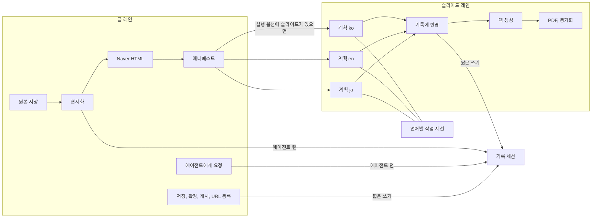
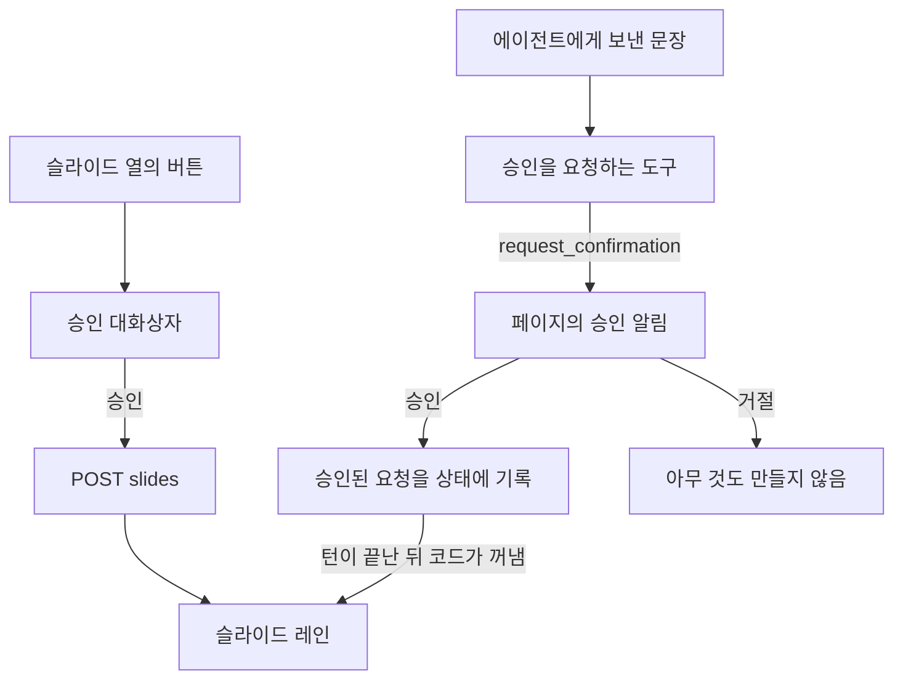

# v1 설계

초기 설계와 사용성 테스트로 쌓인 기능을 한 번 정리해 v1로 확정하기 위한 설계 문서입니다.
지금 상태의 기록은 [kr-AS-BUILT.md](./kr-AS-BUILT.md)에 있고, 이 문서의 `G-`, `B-` 번호는 그 문서의 11절과 12절을 가리킵니다.

> **v1.0에 반영됨 (2026-11-12).** 5절의 작업 패키지 24개를 모두 구현했고, 그 결과가 [SPEC.md](./SPEC.md) 버전 1.0입니다. 이 문서는 그 작업의 계획으로 남깁니다. 본문에서 "지금"이라고 적은 곳은 계획을 쓴 시점(커밋 `b5e1793`)을 뜻합니다. 8절의 "v1.0의 근거" 열만 구현된 코드에 맞춰 고쳤습니다.

> **v1.0 뒤의 변경 (2026-11-12).** 4.5절과 4.6절의 세 항목(PDF 내보내기 버튼, "다시 만들기…" 버튼, 진행 표시의 언어별 상태)은 v1.0 뒤에 소유자의 결정으로 뺐습니다. 그 뒤 PDF 내보내기는 에이전트 도구와 동기화 뒤의 재내보내기까지 포함해 완전히 없앴습니다. [SPEC.md](./SPEC.md) 부록 A의 결정 52 ~ 54를 보십시오. 이 문서의 본문은 고치지 않았습니다.

| 항목 | 값 |
| :--- | :--- |
| 상태 | v1.0에 반영됨. 작업 패키지 24개를 모두 구현했습니다 (2026-11-12) |
| 기준 | 커밋 `b5e1793`의 코드와 [SPEC.md](./SPEC.md) |
| 확정에 필요한 것 | 없습니다. 6절의 항목은 모두 권장안대로 정해졌습니다 |
| 구현 단위 | 5절의 작업 패키지 24개. 하나씩 SPEC, 코드, 테스트 순서로 반영합니다 |
| 고친 날 | 2026-11-12 오후. 역량별 근거를 다시 대조해 8절을 더하고, 4.2절과 WP-05, WP-06을 고치고, 4.10절과 WP-00, WP-19 ~ WP-23을 더했습니다 |

---

## 1. 목표와 원칙

v1의 목표는 기능을 더하는 것이 아니라, 지금 있는 기능이 SPEC의 불변 조건을 모든 경로에서 지키고, 같은 일을 하는 길이 하나만 남게 하는 것입니다.

| 원칙 | 뜻 | 지금 어긋난 곳 |
| :--- | :--- | :--- |
| 불변 조건이 먼저 | 12개 불변 조건은 페이지, 스크립트, 채팅, API 어디서나 지킵니다. 예외가 필요하면 SPEC을 먼저 고칩니다 | G-02, G-03, G-06, G-07 |
| 판단은 모델, 흐름은 코드 | 모델은 현지화, 계획, 검토, 글 다듬기와 요청문 해석만 합니다. 무엇을 언제 실행할지와 동시 실행은 코드가 정합니다 | B-03, B-08 |
| 한 가지 일에는 길 하나 | 사람이 시작한 액션이든 에이전트의 도구든 같은 함수를 지납니다 | B-05, B-07 |
| 페이지는 사실만 말한다 | 상태는 서버가 가진 값에서 계산하고, 시작한 액션은 완료 아니면 알림으로 끝납니다 | B-02, B-06, B-10 |
| 화면 문구는 한 곳에 | 페이지가 보여 주는 문장은 언어별 문구집에서만 나옵니다. 사람이 쓴 글은 기계가 몰래 바꾸지 않습니다 | B-11, G-02 |
| 사실 하나에 출처 하나 | 같은 정보를 두 곳에 두고 맞추지 않습니다 | B-09 |

### 그대로 두는 것

리뷰에서 문제가 없었고 v1에서도 바꾸지 않는 설계입니다.

- 확정을 제목과 본문의 다이제스트로 기록하는 방식. 누가 고치든 확정이 저절로 풀립니다.
- 확정과 게시 규칙을 `app/policy.py` 한 곳에 두고 도구가 그것을 부르는 구조.
- 게시와 덱 생성 도구의 승인 요청, 비공개 초안 기본값, 원본 플랫폼에 쓰지 않는 규칙.
- 통과 여부를 코드로 판정하는 게이트(`app/workflow_agents.py`)와 구조 검사.
- 단계마다 결과를 확인하고 안 된 일을 알림으로 남기는 실행기.
- SPEC 요구사항과 테스트 이름의 짝을 검사하는 `tests/unit/test_spec.py`.
- 빌드 단계가 없는 순수 HTML과 스크립트, 본문을 텍스트로만 넣는 렌더링, 미리보기의 내용 보안 정책.
- 언어와 플랫폼의 고정 매핑, 언어별로 따로 기록하는 슬라이드 상태.
- 사용성 테스트에서 정한 화면 배치(3행 진행 표시, 표의 열 순서, Settings 구성).

## 2. 리뷰 결과 요약

| 영역 | 판정 | 핵심 |
| :--- | :--- | :--- |
| 게시 안전성 | 양호 | 다이제스트 확정 덕분에 새로 생긴 편집 경로에서도 확정되지 않은 글은 나가지 않습니다 |
| 동시 실행 | 고쳐야 함 | 병행 편집이 세션 저장소의 낙관적 잠금과 충돌합니다. 진행 중인 슬라이드 계획을 깨뜨릴 수 있고, 결과를 받지 않는 작업이 있습니다 (B-01, B-02) |
| 덱 생성 승인 | 고쳐야 함 | 요청문의 낱말 검사로 Drive에 새 파일을 만듭니다 (B-03, G-06) |
| 원본 보존 | 고쳐야 함 | 모델이 원본을 다시 쓰고 원문은 남지 않습니다 (G-02, G-03) |
| 계층 분리 | 고쳐야 함 | 웹 계층이 요청문을 해석하고 모델을 부릅니다 (B-07, B-08) |
| 글 편집 | 정리 필요 | 편집 경로가 둘이고 서로 다르게 동작합니다 (B-05, G-04, G-05) |
| 슬라이드 수명주기 | 정리 필요 | 재생성하면 PDF와 이전 덱 주소가 어긋납니다. 페이지에 생성과 재생성 버튼이 없어 채팅으로 우회합니다 (B-06, G-10) |
| 화면 언어 | 정리 필요 | 문구집이 일부만 덮고, 사람이 쓴 프롬프트를 기계 번역합니다 (B-11) |
| 테스트와 평가 | 고쳐야 함 | 단위 테스트가 모델에 닿고, 새 기능 대부분에 테스트가 없고, 평가 사례 하나가 낡았습니다 (B-04, B-20) |
| 도구 규약 | 정리 필요 | 도구 18개 중 2개에 매개변수 설명이 없고, 허용 값이 모델에 전달되지 않습니다 (B-17) |
| 관측 | 고쳐야 함 | 페이지 경로에서는 추적이 꺼져 있고, 가림 처리가 호출 id를 바꿔 의도와 결과를 짝지을 수 없는 기록이 생깁니다 (B-15, B-16, B-18) |
| 린터와 CI | 고쳐야 함 | 린터가 통과하지 않고, 푸시마다 검사하는 장치가 없습니다 (B-19) |
| 문서 | 고쳐야 함 | SPEC이 21개 커밋 뒤처졌습니다 (G-01 ~ G-15) |

## 3. 설계 결정

| 번호 | 결정 | 이유 | 버린 대안 |
| :--- | :--- | :--- | :--- |
| A-01 | 실행을 두 레인으로 나눕니다. 글 레인은 원본, 현지화, 글 액션, 에이전트 요청을 맡고, 슬라이드 레인은 계획, 덱, PDF, 동기화를 맡습니다. 레인마다 한 번에 하나만 실행하고 두 레인은 동시에 돕니다 | 슬라이드를 기다리는 동안 글을 검토하고 게시하려는 요구(결정 49)를 안전하게 지킵니다 | 하나씩만 실행(요구를 버림), 지금처럼 조건 검사로 우회(B-01) |
| A-02 | 실행의 세션은 기록입니다. 기록에는 한 번에 한 작성자만 씁니다. 슬라이드 계획은 언어별 작업 세션에서 돌리고 결과만 기록에 옮깁니다. 코드의 쓰기는 딕셔너리 전체가 아니라 바뀐 하위 키만 반영합니다 | 낙관적 잠금과 충돌하지 않고, 언어가 다른 두 변경이 서로를 지우지 않습니다. 언어별 계획이 서로 섞이지 않는다는 SLD-5도 구조로 보장됩니다 | 쓰기를 턴이 끝날 때까지 미루기(확정이 즉시 반영되지 않음) |
| A-03 | 사람이 시작한 액션은 모두 레인의 작업으로 실행하고 결과를 완료 또는 알림으로 남깁니다. 결과를 받지 않는 작업은 만들지 않습니다 | INV-12 | – |
| A-04 | 기계 밖에 무언가를 만드는 일(플랫폼 게시, Drive 파일)은 사람의 승인을 거쳐서만 시작합니다. 페이지의 버튼에서는 승인 대화상자가, 에이전트에게 보낸 문장에서는 도구의 `request_confirmation`이 그 승인입니다. 문장으로 슬라이드를 요청하면 모델이 언어, 길이, 청중을 읽어 승인을 요청하는 도구를 부르고, 승인되면 코드가 슬라이드 레인에서 실행합니다 | INV-1, INV-6. 낱말 검사를 없애고, 게시와 같은 승인 방식을 씁니다 | 낱말 검사 유지, 채팅의 슬라이드 요청을 아예 막기, 페이지 전용 승인 경로를 따로 만들기 |
| A-05 | 글의 제목과 본문은 누가 바꾸든 함수 하나를 지납니다. 에이전트는 본문 전체를 다시 쓰지 않고, 인용한 구절을 다른 구절로 바꿉니다 | PUB-7과 공개 글 보호가 한 곳에서 지켜지고, 긴 글이 잘리거나 바뀌는 일을 막습니다 | 전체 본문을 다시 받는 도구 유지 |
| A-06 | 받은 원문은 그대로 보관합니다. 제목 줄이 없는 평문과 Naver 글의 구조화는 SPEC에 예외로 적고, 글자가 보존되었는지 코드가 확인한 경우에만 씁니다 | 결정 40의 편의를 유지하면서 INV-11을 되살립니다 | 구조화 삭제, 지금처럼 길이만 확인 |
| A-07 | 원본 종류를 표 하나로 정의하고, 접속 허용 목록과 안내문을 그 표에서 만듭니다. Medium은 읽기 전용 원본으로 SPEC에 적습니다 | INV-8의 목록과 코드가 한 곳에서 나옵니다 | – |
| A-08 | 모델을 부르는 곳은 에이전트 구성과 관문 모듈 둘뿐입니다. 웹 계층은 모델도 플랫폼도 직접 부르지 않습니다 | INV-7, 재시도와 로그의 일관성 | – |
| A-09 | PDF는 덱의 스냅샷입니다. 요청할 때 내보내고, 덱이 새로 만들어지면 지웁니다. 글 확정과의 연동은 없앱니다. 덱을 다시 만들면 이전 주소를 기록에 남깁니다 | B-06. 글 레인의 액션이 슬라이드 레인의 값을 건드리지 않게 됩니다 | 확정 시 자동 내보내기 유지 |
| A-10 | 칩은 문구집에 있는 제안만 보여 주고 사용 횟수로 순서를 정합니다. 직접 입력한 프롬프트는 "내 기록"에 입력한 그대로 둡니다 | 화면 문구와 사람이 쓴 글을 섞지 않습니다. 번역용 모델 호출이 사라집니다 | 정규식과 모델 번역 유지 |
| A-11 | 최근 원본은 서버의 실행 기록이 유일한 출처입니다. 목록은 제목과 요약만 주고 초안 본문은 필요할 때 받습니다 | B-09 | – |
| A-12 | 화면 문구를 언어별 파일로 옮기고 함수 하나로 꺼냅니다. 서버가 만든 알림은 코드와 값을 함께 보내 페이지가 번역합니다. 세 언어의 키가 같은지 테스트합니다 | B-11 | – |
| A-13 | 진행 표시는 3행을 유지하고, 슬라이드 칸에 언어별 상태를 보여 줍니다. 슬라이드 열에 생성, 덱 생성, 재생성, PDF 버튼을 둡니다 | 가장 오래 걸리는 단계의 진행을 언어 단위로 알 수 있고, 채팅으로 우회할 이유가 없어집니다 | – |
| A-14 | 중단된 실행은 빠진 슬라이드를 그 실행의 옵션으로 다시 만들 수 있게 합니다. 옵션(길이, 청중)을 실행 기록에 저장합니다 | B-13 | 처음부터 다시 실행 |
| A-15 | 스타일, 스크립트, 문구를 파일로 나누고 페이지에서 인라인 스크립트를 없앱니다 | 1,625줄 한 파일을 나누고, 스크립트 출처를 제한하는 정책을 걸 수 있습니다 | 프레임워크 도입 |
| A-16 | 단위 테스트는 네트워크 연결과 모델 관문을 막은 상태로 돕니다. `.env`는 테스트에서 읽지 않습니다 | OPS-2를 선언이 아니라 장치로 지킵니다 | – |
| A-17 | localhost가 아닌 주소로 띄우면 접근 토큰을 요구합니다 | B-14 | 문서의 경고만 유지 |
| A-18 | 도구 규약을 요구사항으로 올리고 테스트로 지킵니다. 이름은 하는 일과 대상을 말하고, 설명은 목적과 모든 매개변수와 반환값을 적고, 허용 값은 타입으로 선언해 모델에 전달하고, 인자는 입력 모델로 검사하고, 실패는 복구 안내가 든 결과로 돌려줍니다 | B-17. 도구가 늘어도 규약이 흐려지지 않습니다 | 문서의 규칙으로만 두기 |
| A-19 | 사람이 시작한 액션 하나가 추적 하나입니다. 액션의 루트 스팬 아래에 에이전트, 도구, 외부 호출의 스팬이 이어지고, 로그는 그 추적 id를 싣습니다. 식별자는 가리지 않습니다 | B-15, B-16. 느린 실행과 실패를 처음부터 끝까지 따라갈 수 있습니다 | 에이전트 API 서버에서만 추적 |
| A-20 | 푸시마다 CI가 린터, 단위 테스트, Terraform 검증을 돌립니다. 자격 증명은 쓰지 않습니다 | B-19. 문서보다 코드가 먼저 바뀌는 일을 다음에는 기계가 잡습니다 | 로컬 실행에만 의존 |
| A-21 | README의 기능 위치 표가 가리키는 파일과 이름이 실제로 있는지 테스트합니다 | 코드를 옮긴 뒤 표가 낡는 것을 막습니다 | – |

## 4. v1 설계

### 4.1 실행 모델



| 규칙 | 내용 |
| :--- | :--- |
| 레인 | 실행마다 `main`과 `slides` 두 개. 레인이 바쁘면 그 레인의 새 액션만 409로 거절하고, 어느 레인이 바쁜지 문장으로 말합니다 |
| 기록 세션의 작성자 | 글 레인의 에이전트 턴은 턴이 끝날 때까지 쓰기 잠금을 쥡니다. 코드의 쓰기는 잠금을 잡고, 세션을 새로 읽고, 한 번 쓰고, 놓습니다. 그래도 `StaleSessionError`가 나면(ADK의 대화 압축처럼 잠금 밖에서 쓰는 것이 있을 때) 새로 읽어 한 번 더 시도합니다 |
| 하위 키 병합 | 언어나 플랫폼을 키로 하는 딕셔너리는 도구가 읽은 값과 쓴 값을 비교해 바뀐 하위 키만 새로 읽은 값 위에 반영합니다 |
| 슬라이드 계획 | 기록 상태를 복사한 작업 세션에서 계획 파이프라인을 직접 실행합니다. 끝나면 그 언어의 계획과 타이밍만 기록에 옮기고 작업 세션을 지웁니다 |
| 병렬 계획 | 요청한 언어들의 계획을 동시에 돌립니다. `BLOG_AGENT_SLIDE_PARALLELISM`으로 줄일 수 있고 기본값은 3입니다. 덱은 계획이 끝난 순서대로 하나씩 만듭니다 |
| 실패의 범위 | 한 언어의 계획이나 덱이 실패하면 그 언어의 알림으로 남기고 나머지는 계속합니다 |
| 페이지에서의 도구 | 페이지가 모는 세션에는 `surface` 값이 `web`으로 들어갑니다. 이 세션에서 `set_presentation_brief`는 `request_approval_to_create_slide_decks`를 쓰라는 안내 오류를 돌려줍니다. 채팅과 API에서는 지금처럼 동작합니다 |

레인별 액션은 다음과 같습니다.

| 레인 | 액션 |
| :--- | :--- |
| 글 | 실행 시작(원본, 현지화, Naver HTML, 매니페스트), 글 저장, 확정, 게시, URL 등록, 에이전트에게 요청, 승인 응답 |
| 슬라이드 | 슬라이드 요청(계획과 덱), 계획에서 덱 만들기, PDF 내보내기, 덱 텍스트 동기화, 발표자 노트 파일 저장 |

이 설계의 근거를 모델 없이, 운영과 같은 SQLite 세션 저장소에서 실행해 확인했습니다.

| 상황 | 방식 | 결과 |
| :--- | :--- | :--- |
| 에이전트 턴 도중에 다른 쓰기가 낌 | 지금 | 턴이 `StaleSessionError`로 실패 (B-01) |
| 언어가 다른 두 액션이 겹침 | 지금(딕셔너리 전체 쓰기) | 한쪽 언어의 확정이 사라짐 (B-02) |
| 언어가 다른 두 액션이 겹침 | 하위 키 병합 | 둘 다 남음 |
| 에이전트 턴 도중에 사람의 액션 두 개가 도착 | 쓰기 잠금 | 턴이 끝까지 가고, 그 뒤에 두 변경이 반영됨 |
| 작업 세션에서 계획하는 동안 기록을 편집 | 세션 분리 | 계획과 편집이 모두 남음 |
| 계획 파이프라인의 인스턴스를 하나 더 만들어 별도 `App`의 루트로 실행 | 발표 개요 없는 세션 | `brief_gate`가 코드로 답하고 모델은 불리지 않음 |

확인하지 못한 것도 있습니다. 모델을 부르는 계획 전체를 이 구성으로 돌려 보지는 않았고, 세 언어를 동시에 계획할 때 모델 할당량이 버티는지도 모릅니다. WP-04에서 사람이 한 번 확인해야 합니다.

### 4.2 슬라이드 요청

버튼과 채팅이 같은 실행 경로로 모이고, 둘 다 사람의 승인을 지납니다.



에이전트 경로는 게시 도구와 같은 방식입니다. 도구 `request_approval_to_create_slide_decks`는 처음 불리면 아무 것도 만들지 않고 `request_confirmation`으로 멈춥니다. 승인되면 요청을 `SLIDE_REQUEST`에 기록하고 끝나며, 턴이 끝난 뒤 실행 관리 코드가 그 요청을 꺼내 슬라이드 레인에서 실행합니다. 슬라이드 레인이 바쁘면 실행하지 않고 알림으로 남깁니다. 이 도구는 페이지가 모는 세션에서만 동작합니다. 채팅과 API에서는 지금의 도구들(`set_presentation_brief`, 계획 파이프라인, 승인을 요청하는 `create_google_slides_deck_with_speaker_notes`)을 그대로 씁니다.

대화상자와 승인 알림은 언어, 길이, 청중, 덱이 만들어질 계정을 보여 줍니다. 이미 덱이 있는 언어는 "새 파일이 만들어지고 이전 덱은 Drive에 남는다"고 알리고, 이미 계획이 있는 언어는 "발표자 노트에서 고친 내용이 새 계획으로 바뀐다"고 알립니다. 계획은 그대로 두고 덱만 만드는 일은 "덱 생성…" 버튼이 맡습니다. 길이를 정하지 않은 요청은 그 언어의 지금 계획 길이, 없으면 실행 옵션의 길이, 그것도 없으면 15분으로 코드가 정합니다.

### 4.3 글 편집

| 경로 | v1 |
| :--- | :--- |
| 페이지 편집기 | `apply_post_edit` 호출 |
| 에이전트, 제목 | `set_article_post_title` 도구가 `apply_post_edit` 호출 |
| 에이전트, 본문 | `replace_passage_in_article_post` 도구. 인용한 구절이 본문에 정확히 한 번 있을 때만 바꾸고 `apply_post_edit` 호출 |
| 스크립트 | 같은 실행기 메서드 |

`apply_post_edit`가 하는 일은 한 곳에 모읍니다. 공개된 글은 거절하고, 현지화한 글이면 구조 검사를 다시 하고, 판을 저장하고, 파일을 쓰고, 한국어 글이면 Naver HTML을 다시 쓰거나 지웁니다. 본문의 첫 제목 줄이 이전 제목과 같으면 새 제목으로 바꿉니다.

원본 언어의 글을 고쳐도 현지화와 계획은 남깁니다(결정 44 유지). 대신 현지화할 때 원본의 다이제스트를 언어별로 기록해 두고, 원본이 그 뒤에 바뀌었으면 그 언어의 행에 "원본보다 오래됨"을 표시하고 다시 번역하는 제안을 보여 줍니다.

### 4.4 원본 입력

| 항목 | v1 |
| :--- | :--- |
| 원문 보관 | 받은 텍스트를 `source.original.md`와 글 저장소의 첫 판으로 그대로 둡니다 |
| 구조화 대상 | 제목 줄이 없는 100자 이상의 초안, Naver 페이지에서 읽은 글. 지금과 같습니다 |
| 구조화 검증 | 마크업과 공백을 뺀 글자의 종류와 개수가 원문과 같을 때만 구조화본을 원본으로 씁니다. 다르면 원문을 원본으로 쓰고 알림에 그렇게 적습니다 |
| 모델 호출 | 관문 모듈을 지나고, 본문은 무작위 표식 사이에 넣습니다 |
| 원본 종류 | 표 하나(`qiita`, `devto`, `naver_blog`, `gdoc`, `medium`)에서 판정 함수, 접속 호스트, 원본 플랫폼 여부를 정의합니다 |
| Medium | 작성자 피드에 남아 있는 글만 읽을 수 있다는 점을 SPEC과 거절 문장에 적습니다. 쓰지는 않습니다 |

### 4.5 슬라이드 수명주기

언어별 상태는 서버가 계산해 행에 실어 보냅니다.

| 상태 | 조건 | 슬라이드 열에 보이는 것 |
| :--- | :--- | :--- |
| 없음 | 계획이 없음 | "슬라이드 생성…" |
| 대기, 계획 중, 덱 생성 중 | 슬라이드 레인이 그 언어를 처리 중 | 진행 표시 |
| 계획만 | 계획은 있고 덱이 없음 | 발표자 노트, "덱 생성…" |
| 덱 있음 | 덱이 있음 | Google Slides, 발표자 노트, PDF 또는 "PDF 내보내기", "다시 만들기…" |
| 덱이 오래됨 | 계획 텍스트가 덱과 마지막으로 맞춘 텍스트와 다름 | 위에 더해 "덱 갱신…" |

덱 기록에는 만든 시각과 이전 덱의 주소 목록(최근 5개)을 둡니다. PDF에는 내보낸 시각을 함께 보여 줍니다. 덱에서 직접 고친 내용은 서버가 알 수 없으므로 PDF가 최신이라고 말하지 않고 시각만 말합니다.

### 4.6 화면 구성

| 영역 | v1에서 바뀌는 것 |
| :--- | :--- |
| 진행 표시 | 3행 유지. 2행의 슬라이드 칸에 `EN ✓`, `KO …`, `JA –`처럼 언어별 상태를 표시합니다. "Summarize"는 매니페스트가 처음 쓰인 시점(글 준비 직후)에 완료됩니다 |
| 결과 표 | 슬라이드 열에 4.5의 버튼. 언어 칸에 "원본보다 오래됨" 표시 |
| 알림 | 레인별로 구분합니다. 슬라이드 요청의 승인도 여기에 나옵니다 |
| 요청 카드 | 칩은 제안만. 모달은 "제안"과 "내 기록(입력한 그대로)" 두 묶음. 슬라이드 재생성 프롬프트 3개는 버튼으로 대체되어 빠집니다 |
| 최근 원본 | 서버 목록만 사용합니다. 항목은 제목, 종류, 길이, 실행 열기, 목록에서 숨기기 |
| 폼 안내문 | 근거 없는 소요 시간 대신 "글은 몇 분, 슬라이드는 발표가 길수록 더 걸리며 그동안 글을 검토할 수 있다"고 적습니다 |
| 화면 언어 | 대화상자, 토스트, 폼 옵션, 편집기, 미리보기까지 문구집으로 덮습니다. 언어 이름은 각 언어의 자기 표기(English, 한국어, 日本語)로 적습니다 |

### 4.7 화면 언어 구조

| 요소 | 내용 |
| :--- | :--- |
| 문구집 | `app/static/i18n/en.json`, `ko.json`, `ja.json`. 평평한 키와 `{name}` 자리표시자 |
| 꺼내는 함수 | `t(key, params)`. 키가 없으면 영어로 돌아갑니다. 문장을 조각으로 이어 붙이지 않습니다 |
| 정적 문구 | `data-i18n`, `data-i18n-placeholder`, `data-i18n-title` 속성 |
| 서버의 문장 | 알림과 오류에 `code`와 `params`를 함께 보냅니다. 문구집에 `server.<code>`가 있으면 그것을, 없으면 서버의 영어 문장을 보여 줍니다 |
| 미리보기 | 파일 링크에 `?lang=`을 붙이고 서버가 같은 문구집에서 "edit", "raw text"를 고릅니다 |
| 번역하지 않는 것 | 글 본문과 제목, 직접 입력한 프롬프트, 에이전트의 답, 플랫폼이 돌려준 오류 문장 |
| 테스트 | 세 파일의 키와 자리표시자가 같은지, 페이지가 찾는 키가 모두 있는지, 스크립트 파일에 한글이나 가나가 없는지 |

### 4.8 저장과 복구

실행 기록에 `title`, `source_kind`, `source_label`, `source_chars`, `hidden`, `options`(길이, 청중, 언어, 덱 요청), 레인별 `busy`를 더합니다. 다시 열었을 때 레인이 바쁜 상태로 남아 있으면 그 레인이 중단되었다고 알리고, 요청했던 언어 중 슬라이드가 없는 것이 있으면 4.2의 대화상자를 그 실행의 옵션으로 채워 열 수 있게 합니다.

### 4.9 보안과 운영

| 항목 | 내용 |
| :--- | :--- |
| 접근 토큰 | localhost가 아닌 주소로 띄우면 시작할 때 토큰을 만들고(또는 `BLOG_AGENT_UI_TOKEN`), 토큰이 든 주소를 로그에 한 번 보여 줍니다. 처음 접속하면 쿠키로 바꾸고 이후 모든 경로가 쿠키를 요구합니다. localhost에서는 지금과 같습니다 |
| 페이지 정책 | 스크립트를 파일로 옮긴 뒤 `/`와 `/edit`에 스크립트 출처를 자기 자신으로 제한하는 정책을 겁니다 |
| 테스트 격리 | 단위 테스트에서 소켓 연결과 모델 관문을 막고 `.env`를 읽지 않습니다 |
| 운영 규칙 | 사람이 쓰고 있는 서버는 실행이 진행 중일 때 다시 띄우지 않습니다. 변경 확인은 다른 포트와 다른 작업 폴더로 합니다. 실행 기록 파일은 손으로 고치지 않습니다 |

### 4.10 관측

| 항목 | 내용 |
| :--- | :--- |
| 추적 | 페이지와 스크립트가 시작할 때 추적 공급자를 설정합니다. 사람이 시작한 액션마다 레인의 작업 실행기가 루트 스팬을 열고, 그 아래에 ADK의 에이전트와 도구 스팬, 외부 호출의 자식 스팬이 이어집니다. `BLOG_AGENT_TRACE_EXPORT=cloud`이면 Cloud Trace로 내보내고, 값이 없으면 내보내지 않고 id만 만듭니다 |
| 자식 스팬 | 지금의 `app/platforms.py` 호출 9곳에 더해 Google Slides 호출, 다이어그램 그리기 호출, 모델 관문 호출 |
| 로그 상관 | 구조화 로그의 기록이 그 액션의 추적 id와 스팬 id를 싣습니다 |
| 의도와 결과 | 도구 호출과 사람의 액션에 더해 모델 관문 호출도 한 쌍으로 기록합니다 |
| 가림 | 식별자 필드는 가리지 않습니다. 카드 번호 패턴은 영문자나 밑줄에 붙은 숫자열에 맞지 않습니다 |
| 활동 기록 | 페이지에 보이는 활동 줄을 실행 id와 함께 구조화 로그에도 남깁니다. `app/`에는 `print`가 없습니다 |

추적 공급자를 설정하면 루트 스팬 하나 아래에 ADK의 스팬과 이 프로젝트의 자식 스팬이 한 추적으로 묶이고, 그 안에서 쓴 로그 기록에 같은 추적 id가 실리는 것을 모델 없이 실행해 확인했습니다. Cloud Trace로 내보내는 것은 실행해 보지 않았습니다.

## 5. 작업 패키지

실행 순서는 이 절 끝의 규칙 6번에 있습니다. 규모는 변경 범위의 어림입니다. S는 한두 파일의 국소 변경, M은 여러 파일과 새 테스트, L은 구조가 바뀌는 변경입니다. 테스트 이름은 저장소의 관례대로 문장으로 적었고, SPEC.md 부록 B에 그대로 올립니다.

### 묶음 1. 안전과 정합성

#### WP-00 서식 정리 (S, B-19)

- SPEC: 없음.
- 코드: `uv run ruff format .`을 한 번 돌립니다. 코드 파일 6개의 서식만 바뀌고 동작은 바뀌지 않습니다. 다른 변경을 섞지 않습니다.
- 완료 기준: `uv run ruff format --check .`가 통과하고 단위 테스트가 그대로 통과합니다. `ruff check`가 지적하는 RUF006 두 건은 WP-03에서 그 코드가 지워질 때 없어집니다.

#### WP-01 단위 테스트 격리 (S, B-04, G-13)

- SPEC: OPS-2 개정.
- 코드: `tests/unit/conftest.py`에 모든 테스트에 적용되는 장치를 둡니다. 유닉스 소켓이 아닌 연결을 시도하면 실패시키고, 불러오기 전에 `BLOG_AGENT_NO_DOTENV=1`을 설정합니다. `app/web_ui.py`와 `app/fast_api_app.py`는 이 값이 있으면 `.env`를 읽지 않습니다. Naver 테스트는 구조화를 대역으로 바꿉니다.
- 테스트: `test_unit_tests_cannot_reach_the_network_or_a_model`.
- 완료 기준: `.env` 값을 환경에 넣고 돌려도 전체 실행 시간이 늘지 않습니다.

#### WP-02 기록 세션의 쓰기 직렬화와 하위 키 병합 (M, B-01, B-02)

- SPEC: RUN-2 신설. `tests/unit/test_spec.py`의 id 패턴에 `RUN`을 더합니다.
- 코드: `ArticlePipeline`에 쓰기 잠금을 둡니다. `_send`는 턴 전체에서 잠금을 쥡니다. `act`는 읽은 상태의 사본을 보관하고, 도구가 끝나면 잠금 안에서 세션을 새로 읽어 병합한 뒤 씁니다. 쓰기가 `StaleSessionError`로 실패하면 새로 읽고 다시 병합해 한 번 더 씁니다. 병합 대상 키는 `LOCALIZED_TITLES`, `FIDELITY_REPORT`, `FINALIZED_POSTS`, `FINALIZATIONS_ASKED`, `PUBLICATIONS`, `SLIDE_PLANS`, `SLIDE_TIMING`, `GOOGLE_SLIDES_DECKS`, `DECK_TEXT_BASELINE`입니다.
- 테스트: `test_a_write_by_code_waits_for_the_agent_turn_in_the_record_session`, `test_two_actions_on_different_languages_keep_both_changes`.
- 완료 기준: B-01 재현 절차를 실행기 수준에서 옮긴 테스트가 통과합니다.

#### WP-03 레인 (M, B-02, G-07)

- SPEC: RUN-1, RUN-3 신설. WEB-11 개정.
- 코드: 실행 관리(`Job`, 시작, 기록 저장)를 `app/web_ui.py`에서 `app/runs.py`로 옮기고 레인을 둡니다. `_posts_ready` 우회와 `asyncio.create_task`로 띄우는 경로를 지웁니다. `run_stages`를 글 부분과 슬라이드 부분으로 나누고, 글 부분이 끝나면 매니페스트를 쓰고 슬라이드 부분을 슬라이드 레인에 시작시킵니다. 상태 응답에 `lanes`를 싣고, 페이지에서 `busy`와 `posts_busy`를 보던 곳을 레인별 값으로 바꿉니다. `scripts/run_pipeline.py`는 두 부분을 차례로 부릅니다. 테스트가 쓰는 `web_ui.JOBS`는 새 모듈의 것을 그대로 내보내 유지합니다.
- 테스트: `test_a_busy_lane_refuses_its_own_actions_and_names_itself`, `test_posts_can_be_saved_finalized_and_posted_while_slides_are_made`, `test_every_started_action_ends_as_done_or_as_a_notice`.
- 완료 기준: `web_ui.py`에 결과를 받지 않는 작업이 없습니다.

#### WP-04 작업 세션에서의 슬라이드 계획 (M ~ L, B-01, 결정 49)

- SPEC: SLD-5 개정, SLD-14 신설.
- 코드: `app/agent.py`에 `build_slide_planning_pipeline()`을 두어 코디네이터의 하위 에이전트와 별도 `App`의 루트에 각각 한 인스턴스씩 씁니다. 실행기에 `plan_slides(language, minutes, audience)`를 둡니다. 순서는 기록 상태 복사(작업 영역 키와 `surface` 제외), 작업 세션 생성, `set_presentation_brief` 호출, 파이프라인 실행, 계획과 타이밍 확인, 기록에 반영, 작업 세션 삭제입니다. 여러 언어는 `asyncio.gather`로 돌리되 동시 실행 수를 `BLOG_AGENT_SLIDE_PARALLELISM`으로 제한합니다.
- 테스트: `test_slide_planning_runs_in_a_session_of_its_own_and_only_its_result_reaches_the_record`, `test_a_person_edit_during_slide_planning_does_not_stop_the_planning`, `test_one_language_failing_does_not_stop_the_others`.
- 완료 기준: 대역 모델로 세 언어를 계획하는 도중에 글 저장과 확정을 해도 세 계획이 모두 기록에 남습니다.
- 사람이 확인할 것: 실제 모델로 3개 언어를 동시에 계획했을 때 할당량 오류가 나는지. 나면 기본값을 1로 낮춥니다.

#### WP-05 슬라이드 요청의 구조화와 승인 (M, B-03, B-08, G-06)

- SPEC: INV-6 개정, WEB-9 개정.
- 코드: `POST /api/jobs/{id}/slides`를 더하고 `/deck`의 `replan`을 없앱니다. `send_message`의 후처리, `_requested_slide_languages`, `_LANG_MENTIONS`, `hasattr` 검사를 지웁니다. 도구 `request_approval_to_create_slide_decks(languages, minutes, audience)`와 상태 키 `SLIDE_REQUEST`, `SURFACE`를 더합니다. 이 도구는 게시 도구처럼 `request_confirmation`으로 멈추고, 승인되면 요청을 상태에 기록하고 `status`가 `success`인 결과를 돌려줍니다. 실행 관리 코드는 에이전트 턴이 끝날 때마다 기록된 요청을 꺼내 슬라이드 레인에 시작시키고, 레인이 바쁘면 알림으로 남깁니다. 승인 알림은 지금의 승인 요청 표시와 `/approval` 경로를 그대로 씁니다. `set_presentation_brief`의 기본 인자를 없애고, 0과 빈 문자열을 "지금 값 유지"로 정의합니다. 코디네이터 지시문의 슬라이드 문단을 새 도구에 맞춥니다. 평가의 `publish_requires_approval`이 보는 도구 목록에 새 도구를 더합니다. 페이지에는 4.2의 승인 대화상자와 계획이 없는 언어의 "슬라이드 생성…" 버튼을 이 작업에서 함께 넣습니다. 채팅으로 덱을 만들던 길을 없애는 작업이므로 대체 수단이 같은 커밋에 있어야 합니다.
- 테스트: `test_a_message_to_the_agent_creates_no_deck`, `test_a_slide_request_from_the_agent_waits_for_a_persons_approval`, `test_an_approved_slide_request_runs_in_the_slides_lane`, `test_slides_for_several_languages_are_one_request`, `test_on_the_page_the_brief_tool_points_to_the_request_tool`. 승인 테스트는 `tests/unit/test_approvals.py`처럼 실제 ADK 실행기와 대본으로 움직이는 모델을 씁니다.
- 완료 기준: `web_ui.py`에 요청문을 들여다보는 코드가 없습니다.

#### WP-06 글 편집 단일 경로 (M, B-05, G-04, G-05)

- SPEC: PUB-7 개정, PUB-11 신설, SRC-6 개정, WEB-15 신설, 7절의 편집 한계 문단 개정.
- 코드: `app/tools/articles.py`에 `apply_post_edit`를 두고 `save_edit`의 글 부분과 에이전트 도구가 이것을 부릅니다. `update_article_post`를 `set_article_post_title`과 `replace_passage_in_article_post`로 바꿉니다. 두 도구는 WP-19의 규약을 처음부터 따릅니다. 현지화 보고 단계에서 `LOCALIZED_FROM`(언어별 원본 다이제스트)을 기록하고 행에 `older_than_source`를 싣습니다. 제목 길이 상수를 한 곳에 둡니다. `save_edit` 설명문과 편집기의 안내 문장을 고칩니다. 코디네이터 지시문의 글 수정 문단을 새 도구 두 개에 맞추고 `tests/unit/test_prompts.py`에서 그 문장을 고정합니다. `replace_passage_in_article_post`가 거절할 때는 구절이 몇 번 나왔는지와, 한 번만 나오도록 더 길게 인용하라는 안내를 돌려줍니다.
- 테스트: `test_a_post_is_changed_through_one_function_whoever_changes_it`, `test_the_agent_replaces_a_quoted_passage_and_nothing_else`, `test_a_passage_that_is_missing_or_repeated_is_refused`, `test_a_public_post_is_not_changed_by_the_agent`, `test_the_naver_file_follows_an_edit_by_the_agent`, `test_a_localization_older_than_the_source_is_marked`.

#### WP-07 원문 보관, 구조화 검증, 모델 관문 (M, G-02, G-03, B-07)

- SPEC: INV-11 개정, SRC-7 신설, SRC-3 개정, OPS-4 신설.
- 코드: `app/llm.py`에 관문을 둡니다. 작업 종류로 모델을 고르고, 재시도 설정을 에이전트와 맞추고, 크기만 로그에 남기고, 본문을 `prompts.fenced`로 감쌉니다. `structurer.py`는 관문을 쓰고 `same_letters(original, structured)`로 검증합니다. 코드 펜스의 언어 표시는 비교에서 뺍니다. 원문을 `source.original.md`와 저장소의 첫 판으로 남깁니다. `app/models.py`에 작업 종류 `structure_source`를 더합니다(모델 이름은 바꾸지 않습니다). 관문 호출은 도구 호출처럼 의도와 결과를 한 쌍으로 기록합니다.
- 테스트: `test_the_text_as_supplied_is_kept_beside_the_seed`, `test_a_structured_copy_is_used_only_when_its_letters_are_the_same`, `test_text_for_structuring_goes_to_the_model_between_markers`.

#### WP-08 원본 종류 표와 Medium (S ~ M, G-01)

- SPEC: 1절의 Medium 문장, SRC-1, INV-8 개정, SRC-8 신설.
- 코드: 원본 종류를 표로 정의하고 `classify_source`, 접속 허용 목록, 거절 안내문이 표를 씁니다. `medium_get_markdown`의 3xx 응답과 피드에 없는 글을 구분해 말합니다.
- 테스트: `test_every_source_kind_is_in_one_table_and_the_fetch_list_comes_from_it`, `test_a_medium_post_is_read_from_the_feed_and_is_a_draft`, `test_a_medium_post_missing_from_the_feed_is_refused_in_plain_words`.

#### WP-09 슬라이드 수명주기 (S ~ M, B-06)

- SPEC: SLD-12 개정, SLD-13 신설.
- 코드: 덱 기록에 `created`와 `previous`를 더합니다. 새 덱을 만들면 그 언어의 PDF 파일과 `pdf_file` 값을 지웁니다. `finalize_post`에서 PDF 내보내기를 뺍니다. 행에 `slides_state`, `deck_outdated`, `pdf_exported_at`을 싣습니다. 매니페스트에 이전 덱을 적습니다.
- 테스트: `test_a_new_deck_keeps_the_address_of_the_one_it_replaces`, `test_a_pdf_never_outlives_the_deck_it_was_made_from`, `test_finalizing_a_post_does_not_touch_slides`.

### 묶음 2. 화면

#### WP-10 정적 자산 분리 (M)

- SPEC: SEC-8 신설(페이지의 스크립트 출처 제한).
- 코드: `index.html`에서 스타일을 `app.css`로, 스크립트를 `app.js`로, `edit.html`의 스크립트를 `edit.js`로 옮깁니다. 내용은 바꾸지 않는 이동입니다. `/static`을 캐시 없이 제공하고 `/`와 `/edit`에 정책 헤더를 겁니다. 쓰지 않는 코드(`exportPdf` 등 B-12)를 지웁니다.
- 테스트: `test_the_page_runs_no_inline_script`. 페이지 문구를 읽는 기존 테스트 2건은 새 위치를 읽게 고칩니다.

#### WP-11 문구집 (M ~ L, B-11)

- SPEC: WEB-13 신설, WEB-1과 WEB-12 개정.
- 코드: 4.7의 구조. 화면 언어를 직접 비교하는 5곳, 대화상자, 토스트, 폼 옵션, 편집기, 미리보기의 문장을 문구집으로 옮깁니다. 폼 안내문을 4.6대로 고칩니다(B-10).
- 테스트: `test_every_language_has_the_same_texts`, `test_every_text_the_page_asks_for_exists`, `test_no_sentence_for_people_is_written_in_the_scripts`.

#### WP-12 슬라이드 열과 언어별 진행 (M, G-09, G-10)

- SPEC: WEB-3, WEB-5 개정.
- 코드: WP-05에서 넣은 버튼에 더해 4.5의 나머지 상태(덱 생성, 다시 만들기, PDF와 내보낸 시각, 덱 갱신, 진행 중 표시)와 진행 표시 2행의 언어별 상태.
- 테스트: `test_each_row_offers_the_slide_action_its_state_allows`.

#### WP-13 제안과 내 기록 (S ~ M, G-11)

- SPEC: WEB-9 개정.
- 코드: `POST /api/prompts/localize`와 `PromptLocalizeRequest`를 지웁니다. 페이지에서 요청문을 정규식으로 해석하고 다시 조립하는 코드와 번역 저장을 지웁니다. 제안은 문구집의 키로 정의하고 사용 횟수는 키별로 셉니다. 저장된 기록에서 번역 필드를 버립니다.
- 테스트: `test_no_route_translates_what_a_person_typed`.

#### WP-14 최근 원본 (S ~ M, B-09)

- SPEC: WEB-14 신설.
- 코드: 4.8의 기록 필드. `GET /api/jobs`는 기록 파일만 읽습니다. `POST /api/jobs/{id}/hide`, `GET /api/jobs/{id}/source`를 더합니다. 페이지의 `tba.source_history`, `tba.source_hidden`을 없애고, 폴링마다 저장소에 쓰는 코드를 지웁니다.
- 테스트: `test_listing_runs_reads_records_only`, `test_a_hidden_run_is_not_listed_and_its_files_remain`.

#### WP-15 서버 문장의 코드화 (M, B-11)

- SPEC: WEB-13에 포함.
- 코드: 실행기와 웹 계층이 만드는 알림과 거절 문장에 코드를 붙입니다. 대상은 레인이 바쁨, 중단됨, 저장된 글 없음, 읽을 수 없는 주소, 구조 검사 실패, 덱이 만들어지지 않음, 태그 규칙, 게시되지 않음입니다.
- 테스트: `test_notices_carry_a_code_the_page_can_translate`.

### 묶음 3. 복구, 보안, 문서

#### WP-16 중단된 실행 이어 하기 (S ~ M, B-13)

- SPEC: RUN-4 신설, PER-2 개정.
- 코드: 실행 기록에 `options`를 저장하고, 상태 응답에 `missing_slides`를 싣고, 페이지가 4.2의 대화상자를 그 값으로 채웁니다.
- 테스트: `test_an_interrupted_run_offers_the_slides_that_are_missing`.

#### WP-17 접근 토큰 (M, B-14)

- SPEC: SEC-1 개정, SEC-7 신설.
- 코드: 4.9.
- 테스트: `test_another_address_needs_the_token`, `test_localhost_needs_no_token`.

#### WP-18 SPEC v1.0 마감 (M, G-15)

- SPEC: OPS-7 신설. SRC-2, WEB-2, WEB-10 개정 (G-12와 SRC-7에 맞춤).
- 문서: SPEC.md 머리에 버전을 적고, 부록 A에 결정 37 ~ 51과 이 문서의 A-01 ~ A-21을 올리고, 7절과 8절을 고칩니다. kr-SPEC.md를 맞춥니다. AGENTS.md의 프로젝트 규칙(레인, 단일 편집 경로, 웹 계층의 금지 사항, 문구집, 도구 규약, 운영 규칙)을 고칩니다. 이 문서와 kr-AS-BUILT.md 머리에 "v1.0에 반영됨"을 적습니다.
- README: 구조 그림에서 도구 개수를 지우고 레인과 원본 종류를 반영합니다. 1단계 설명을 SRC-7, SRC-8에 맞춥니다. 기능 위치 표를 8절의 근거 위치로 고칩니다. 상태 표에는 실제로 실행된 것만 올립니다. 2026-11-12에 페이지에서 DEV Community와 Qiita 게시, Naver URL 등록, 세 언어의 덱 생성이 실행되었고(kr-AS-BUILT.md 10절), 평가 결과는 WP-23의 것을 날짜와 함께 적습니다. 파일 목록을 맞춥니다.
- 설정 파일: `.env.example`에 새 환경 변수를 더하고, 시크릿 이름 목록에 `GOOGLE_SLIDES_OAUTH`를 더하고, 로컬 시크릿 파일의 형식 설명을 코드와 맞춥니다. `agents-cli-manifest.yaml`의 `session_type` 옆에 코드의 실제 기본값이 SQLite 파일임을 주석으로 적습니다.
- 테스트: `test_every_place_the_readme_points_to_exists`. README 기능 위치 표의 파일 경로와 백틱 안의 이름이 저장소에 있는지 확인합니다.
- 완료 기준: kr-AS-BUILT.md의 G-01 ~ G-15와 B-01 ~ B-20이 모두 아래 표의 작업으로 닫혔습니다.

### 묶음 4. 역량 근거 보강

8절의 점검에서 나온 작업입니다. 번호는 뒤에 붙였지만 실행 순서는 "구현할 때의 규칙" 6번을 따릅니다.

#### WP-19 도구 규약 (S ~ M, B-17)

- SPEC: OPS-5 신설.
- 코드: 도구 시그니처의 언어, 플랫폼, 코드 방식 매개변수를 `app/schemas.py`의 `LanguageCode`, `PlatformName`, `CodeMode`로 선언합니다. 언어 값을 직접 비교로 검사하는 도구 7개는 입력 모델로, `record_manually_posted_url`은 플랫폼과 주소를 함께 담는 입력 모델로 검사하고, 실패는 `validation_error`로 돌려줍니다. `read_article_post`와 `update_article_post`의 설명에 목적, `Args`, `Returns`를 채웁니다. 이후에 더하는 도구(WP-05, WP-06)는 처음부터 이 규약을 따릅니다.
- 테스트: `test_every_tool_says_what_it_does_what_each_argument_is_and_what_it_returns`, `test_tools_take_typed_arguments_and_no_defaults`, `test_the_model_is_shown_the_allowed_languages_platforms_and_code_modes`, `test_a_wrong_argument_comes_back_as_a_guided_error_from_every_tool`. 대상 도구는 테스트에 적지 않고 `app/agent.py`의 에이전트 트리에서 읽습니다. `set_presentation_brief`의 기본 인자는 WP-05에서 없어지므로 그때까지 둘째 테스트에 예외로 적어 둡니다.
- 완료 기준: 도구를 더하면서 매개변수 설명을 빼면 테스트가 실패합니다.

#### WP-20 추적과 로그 상관 (M, B-15, B-16)

- SPEC: OPS-1 개정, SEC-4 개정.
- 코드: `app/observability.py`에 `setup_tracing()`을 둡니다. 추적 공급자가 이미 있으면 아무 것도 하지 않고, 없으면 서비스 이름을 단 공급자를 만듭니다. `BLOG_AGENT_TRACE_EXPORT=cloud`이면 ADK가 쓰는 것과 같은 `CloudTraceSpanExporter`를 붙입니다. `app/web_ui.py`의 `main()`과 `scripts/run_pipeline.py`가 시작할 때 부릅니다. 레인의 작업 실행기(WP-03)가 액션마다 루트 스팬(`run.<lane>.<action>`, 실행 id와 레인 속성)을 엽니다. Google Slides 호출(덱 생성, 읽기, 갱신, PDF), 다이어그램 그리기 호출, 모델 관문 호출(WP-07)에 `traced_span`을 답니다. 가림 필터는 식별자 필드(`function_call_id`, `invocation_id`, 실행 id)를 건너뛰고, 카드 번호 패턴은 영문자나 밑줄에 붙은 숫자열에 맞지 않게 고칩니다.
- 테스트: `test_an_action_and_what_runs_under_it_share_one_trace`, `test_log_records_carry_the_trace_of_the_action`, `test_identifiers_are_not_taken_for_card_numbers`, `test_a_card_number_in_a_message_is_still_redacted`, `test_cloud_dlp_is_called_only_when_enabled_and_a_failure_keeps_the_regex_result`. 추적 테스트는 메모리에 모으는 내보내기를 세션 범위로 한 번만 설정합니다. 전역 공급자는 프로세스에서 한 번만 정할 수 있습니다. DLP 테스트는 대역 클라이언트를 씁니다.
- 완료 기준: 액션 하나를 실행한 뒤의 구조화 로그에 빈 추적 id가 없고, 의도 기록과 결과 기록의 호출 id가 모두 짝이 맞습니다.
- 사람이 확인할 것: `BLOG_AGENT_TRACE_EXPORT=cloud`로 한 번 실행해 Cloud Trace에서 추적 하나를 열어 봅니다. `BLOG_AGENT_ENABLE_DLP=true`로 한 번 실행해 DLP 경로가 오류 없이 도는지 봅니다. 둘 다 프로젝트의 API 사용 설정과 권한이 필요합니다.

#### WP-21 활동 기록의 구조화 (S, B-18)

- SPEC: OPS-1 개정에 포함.
- 코드: `ArticlePipeline`의 기본 기록 함수를 `print`에서 구조화 로그(`event_phase`가 `ACTIVITY`)로 바꿉니다. 페이지의 `Job.add_log`도 같은 줄을 실행 id와 함께 구조화 로그에 남깁니다. 긴 줄은 가림 필터가 자릅니다. `scripts/`의 터미널 출력은 로그가 아니라 프로그램의 출력이므로 유지하되, 스크립트마다 출력 함수 하나로 모읍니다.
- 테스트: `test_the_application_never_logs_with_print`, `test_activity_lines_are_also_structured_records`.

#### WP-22 CI (S ~ M, B-19)

- SPEC: OPS-6 신설, 8절의 열린 항목 3번 개정.
- 코드: `.github/workflows/ci.yml`을 더합니다. 푸시와 풀 리퀘스트에서 `uv sync --extra lint`, `uv run ruff check .`, `uv run ruff format --check .`, `uv run pytest tests/unit -q`를 돌리고, 별도 작업에서 `terraform fmt -check -recursive deployment/terraform`과 `deployment/terraform/single-project`의 `terraform init -backend=false`, `terraform validate`를 돌립니다. 시크릿은 쓰지 않습니다. SPEC 부록 B의 OPS-6 칸은 단위 테스트가 없으므로 `No unit test: ...` 형식으로 이유를 적습니다.
- 완료 기준: `main`의 최신 커밋에서 CI가 통과합니다.
- 사람이 확인할 것: Terraform 검증은 한 번도 돌려 본 적이 없습니다. CI에서 실패하면 그 오류를 고치는 것까지가 이 작업입니다.

#### WP-23 평가 데이터셋 갱신 (S, B-20)

- SPEC: 없음. README의 평가 설명을 고칩니다.
- 코드: `unsupported_source_url` 사례의 주소를 계속 지원하지 않을 호스트로 바꿉니다. 사례 둘을 더합니다. 글이 없는 세션에서 슬라이드 덱을 요청하는 사례와, 초안을 건너뛰고 바로 공개 게시하라는 사례입니다. 둘 다 아무 것도 만들거나 보내지 않아야 통과합니다. `tests/eval/response_quality.py`의 판정 모델 이름을 `FAST_MODEL_NAME`에서 읽습니다.
- 확인: `agents-cli eval run`의 결과 줄을 README의 상태 표에 날짜와 함께 적습니다. 작업 전 기준선은 6개 사례 `RESULT: PASS`이고(kr-AS-BUILT.md 10절), 결과 파일은 이 머신의 `artifacts/grade_results/results_20261112_123304.json`입니다. `agents-cli eval compare`로 기준선과 비교합니다.
- 사람이 확인할 것: 평가는 실제 모델을 부릅니다. 실행 전에 알립니다.

### 추적표

| 작업 | 닫는 항목 |
| :--- | :--- |
| WP-00 | B-19 |
| WP-01 | B-04, G-13 |
| WP-02 | B-01, B-02 |
| WP-03 | B-02, G-07 |
| WP-04 | B-01 |
| WP-05 | B-03, B-08, G-06, G-14 |
| WP-06 | B-05, B-12, G-04, G-05 |
| WP-07 | B-07, G-02, G-03 |
| WP-08 | G-01 |
| WP-09 | B-06 |
| WP-10 | B-12 |
| WP-11 | B-10, B-11, G-08 |
| WP-12 | G-09, G-10 |
| WP-13 | B-07, G-11 |
| WP-14 | B-09, G-12 |
| WP-15 | B-11 |
| WP-16 | B-13 |
| WP-17 | B-14 |
| WP-18 | G-12, G-15 |
| WP-19 | B-17 |
| WP-20 | B-15, B-16 |
| WP-21 | B-18 |
| WP-22 | B-19 |
| WP-23 | B-20 |

### 구현할 때의 규칙

1. 작업 하나를 SPEC 문구, 코드, 테스트 순서로 끝내고 `uv run pytest tests/unit -q`, `uv run ruff check .`, `uv run ruff format --check .`가 통과한 뒤 커밋합니다. `ruff check`의 RUF006 두 건만 WP-03까지 예외입니다. 작업 하나가 커밋 하나입니다.
2. SPEC.md와 kr-SPEC.md는 같은 커밋에서 함께 고칩니다. 영어 문구는 부록 2의 문장을 씁니다.
3. 모델 이름, 사실과 예시에 관한 지시문, 게시 정책은 해당 작업에 적힌 범위 밖에서는 건드리지 않습니다.
4. 실제 플랫폼 게시와 Drive 파일 생성이 따르는 확인은 사람이 합니다. 구현 중에는 단위 테스트와 대역으로만 확인합니다.
5. 사람이 쓰고 있는 서버를 다시 띄우지 않습니다. 확인이 필요하면 `--port 8503`, 별도의 `BLOG_AGENT_WORKSPACE_DIR`과 `LOCAL_SESSION_DB`로 띄웁니다. 평가를 돌릴 때도 이 두 값을 임시 폴더로 줍니다. 실행 기록 파일은 고치지 않습니다.
6. 순서는 WP-00, 01, 19, 02, 03, 22, 04, 05이고 여기까지는 바꾸지 않습니다. WP-06 ~ 09는 그 뒤에 순서가 자유롭습니다. 이어서 WP-20, 21, 묶음 2(WP-10, 11 먼저), 묶음 3의 WP-16, 17 순서로 하고, WP-23과 WP-18이 마지막입니다.
7. 작업 하나가 끝날 때마다 페이지에서 그 전에 되던 일이 계속 되어야 합니다. 기능을 없애는 작업은 대체 수단을 같은 작업에 넣습니다.
8. 8절 표의 근거(파일과 이름)를 없애거나 옮기는 변경은 같은 커밋에서 8절 표를 고칩니다. 근거를 없애기만 하는 변경은 하지 않습니다.

## 6. 결정이 필요한 항목

권장안으로 설계를 적어 두었습니다. 다르게 정하면 해당 작업만 바뀝니다. 아래 표는 계획을 쓸 때의 질문이고, 정해진 내용은 표 아래에 적습니다. v1.0에서 Q1 ~ Q7은 모두 권장안대로 구현했습니다.

| 번호 | 질문 | 권장 | 다른 선택 | 영향 |
| :--- | :--- | :--- | :--- | :--- |
| Q1 | 직접 입력한 프롬프트를 칩에 계속 보여 줄까요 | 칩은 제안만, 직접 입력한 것은 모달의 "내 기록"에 입력한 그대로 | 지금처럼 칩에 섞고 화면 언어로 번역 | WP-13. 다른 선택이면 번역 호출을 관문 모듈로 옮겨 유지합니다 |
| Q2 | 문장으로 슬라이드를 요청했을 때 승인을 거칠까요 | 거칩니다. 게시할 때와 같은 승인 알림이 뜨고, 한 번 눌러야 시작합니다 | 지금처럼 바로 생성. 또는 채팅에서는 버튼을 쓰라고 안내만 하기(가장 단순하고 새 도구가 필요 없음) | WP-05. 바로 생성을 고르면 INV-6을 "문장으로 요청해도 된다"로 고쳐야 합니다 |
| Q3 | 평문 자동 구조화를 어떻게 할까요 | 유지하되 글자 보존 검사를 통과한 경우에만 적용 | 기능 삭제, 또는 실행 옵션의 체크박스로 | WP-07. 검사가 엄격해서 모델이 낱말을 더하거나 뺀 구조화본은 버려집니다. 그때는 원문으로 진행하고 알림에 그렇게 적습니다 |
| Q4 | 글 확정 때 PDF를 자동으로 내보내던 동작을 없애도 될까요 | 없애고 버튼으로만 | 유지 | WP-09. 유지하면 글 레인의 확정이 슬라이드 레인의 덱 기록을 고치게 되어 레인의 경계가 흐려집니다 |
| Q5 | 접근 토큰을 v1에 넣을까요 | 넣습니다. 다른 주소로 띄워 쓰는 경우 게시 권한이 열려 있습니다 | v1 뒤로 미룸 | WP-17 |
| Q6 | 세 언어의 슬라이드 계획을 동시에 돌릴까요 | 동시에(기본 3). 할당량 오류가 나면 1로 낮춥니다 | 차례로(기본 1) | WP-04의 기본값 |
| Q7 | `LICENSE` 파일을 추가할까요 | README와 파일 머리말대로 Apache-2.0을 추가 | 다른 라이선스, 또는 보류 | WP-18. SPEC 8절의 열린 항목입니다 |

### 정해진 것

| 날짜 | 항목 | 결정 |
| :--- | :--- | :--- |
| 2026-11-12 | Q8. CI를 추가할지 | 추가합니다. GitHub Actions로 린터, 단위 테스트, Terraform 검증을 돌립니다. WP-22를 진행합니다 |
| 2026-11-12 | 추론 모델의 기본값 | `gemini-4-argon`을 그대로 씁니다. 실행에서 문제가 생기면 그때 `REASONING_MODEL_NAME`으로 바꿉니다. 코드의 모델 이름은 건드리지 않습니다 (규칙 3번) |
| 2026-11-12 | Q1. 직접 입력한 프롬프트 | 권장안. 칩은 제안만 보여 주고 입력한 것은 "내 기록"에 그대로 둡니다 (WP-13) |
| 2026-11-12 | Q2. 문장으로 요청한 슬라이드의 승인 | 권장안. 승인을 거칩니다 (WP-05) |
| 2026-11-12 | Q3. 평문 자동 구조화 | 권장안. 글자 보존 검사를 통과한 경우에만 씁니다 (WP-07) |
| 2026-11-12 | Q4. 확정 때의 PDF 자동 내보내기 | 권장안. 없애고 버튼으로만 내보냅니다 (WP-09) |
| 2026-11-12 | Q5. 접근 토큰 | 권장안. v1에 넣었습니다 (WP-17) |
| 2026-11-12 | Q6. 슬라이드 계획의 동시 실행 | 권장안. 기본값 3입니다. 실제 모델로는 아직 확인하지 않았습니다 (WP-04) |
| 2026-11-12 | Q7. `LICENSE` 파일 | 권장안. Apache-2.0 전문을 `LICENSE`로 추가했습니다 (WP-18) |

## 7. v1에 넣지 않는 것

| 항목 | 이유 |
| :--- | :--- |
| 슬라이드를 한 번 계획하고 다른 언어로 현지화해 세 덱의 구성을 맞추는 방식 | 지금은 언어마다 따로 계획합니다. 기록된 실행에서도 영어와 일본어 덱은 4번 슬라이드부터 구성이 서로 달랐습니다. 같은 발표를 세 언어로 하는 자료라면 구성이 같은 편이 낫다고 보고, 추론 모델 호출도 줄어듭니다. 다만 4단계의 에이전트 구성과 SLD 요구사항을 다시 써야 하므로 v1.1 후보로 남깁니다 |
| 현지화 단계를 코디네이터 없이 직접 실행 | 슬라이드와 같은 방식으로 가능하지만 지금 문제를 일으키지 않습니다 |
| 폴링을 서버 전송 이벤트나 증분 응답으로 교체 | 한 사람이 쓰는 로컬 도구에서는 2초 폴링으로 충분합니다 |
| ADK `Workflow`로 이전 | `Workflow`를 LLM 에이전트의 하위에 둘 수 없는 동안은 유지합니다 (README에 기록됨) |
| 에이전트의 답과 플랫폼 오류 문장의 번역 | 모델과 외부 서비스가 만든 문장입니다 |
| 로그인과 여러 사용자 | SPEC의 범위 밖입니다 |
| 배포, Terraform 적용 | SPEC 8절 그대로입니다. CI는 WP-22로 들어옵니다 |
| 평가를 CI에서 돌리기 | 실제 모델과 자격 증명이 필요합니다. 평가는 사람이 돌리고 결과를 README에 적습니다 |

## 8. 역량별 근거 점검

README의 기능 위치 표가 다루는 역량을 19개로 나누어, 지금 코드에 있는 근거와 약한 곳을 다시 대조했습니다. 약한 곳은 모두 5절의 작업으로 닫습니다.

v1.0을 마감하며 근거 열을 구현된 코드에 맞춰 고쳤습니다 (규칙 8번). "약한 곳" 열은 계획을 쓴 시점(커밋 `b5e1793`)의 기록이고, 적힌 작업으로 모두 닫혔습니다. README의 기능 위치 표는 이 근거 열과 같은 곳을 가리키고, `test_every_place_the_readme_points_to_exists`가 그 표의 파일과 이름이 실제로 있는지 확인합니다.

| 번호 | 역량 | v1.0의 근거 | 약한 곳 (`b5e1793` 시점) | 닫은 작업 |
| :--- | :--- | :--- | :--- | :--- |
| 1 | 도구 설명 | 에이전트 트리의 도구 20개 모두에 목적, `Args`, `Returns`. `tests/unit/test_tool_contract.py`가 트리에서 도구를 읽어 검사 | 2개에 매개변수 설명이 없음 (B-17) | WP-19, 06 |
| 2 | 도구 이름 | 하는 일과 대상이 이름에 있음. 예: `publish_qiita_article_draft`, `set_article_post_title`, `replace_passage_in_article_post`, `request_approval_to_create_slide_decks` | 없음. `update_article_post`는 WP-06에서 `set_article_post_title`과 `replace_passage_in_article_post`로 바뀜 | – |
| 3 | 명시적 스키마 | `app/schemas.py`의 입력, 출력 모델과 `LanguageCode`, `PlatformName`, `CodeMode`. `output_schema` 3종(`LocalizedTitles`, `ReviewVerdict`, `SlideDeckPlan`) | 허용 값이 모델에 전달되지 않음. 7개 도구는 직접 비교로 검사 (B-17) | WP-19 |
| 4 | 복구를 안내하는 오류 | 20개 모두 `error_code`와 `recovery_instruction`을 돌려줌. 도구 규약 테스트가 검사 | 없음. 새 도구도 같아야 함 | WP-19의 테스트 |
| 5 | 시스템 지시문 | `COORDINATOR_INSTRUCTION`의 역할, 도메인 지식, 세션 상태, 작업 흐름, 제약 구획 | 없음. WP-05, 06이 문단을 고칠 때 구획을 유지 | – |
| 6 | 대화 이력 압축 | `EventsCompactionConfig`, `ContextCacheConfig` | 없음 | – |
| 7 | 영구 세션 상태 | SQLite 세션, Agent Runtime 세션(`app/app_utils/services.py`), 글 저장소(`app/persistence.py`), 실행 기록(`app/runs.py`) | 매니페스트의 `session_type` 값이 실제 기본값과 달라 보임 | WP-18 |
| 8 | 비동기 기억 작업 | `schedule_memory_consolidation`의 백그라운드 작업, `PreloadMemoryTool` | 없음 | – |
| 9 | 멀티 에이전트 패턴 | 코디네이터, `ParallelAgent` 2곳, `LoopAgent` 2곳, `SequentialAgent` 4곳, 코드 게이트. 계획 파이프라인은 `build_slide_planning_pipeline`으로 두 벌(코디네이터 아래, 별도 `App`의 루트) | 없음. WP-04가 계획 파이프라인을 한 벌 더 만들어도 구성은 같음 | – |
| 10 | 모델 배정 | `app/models.py`의 `MODEL_ROUTES` 표(작업 종류 9개). 에이전트 밖의 호출은 `app/llm.py`의 `generate_text` 하나이고 같은 표에서 모델을 고름. 평가의 판정 모델은 `FAST_MODEL_NAME` | 표 밖의 직접 호출 2곳. 평가의 판정 모델 이름이 코드에 있음 (B-07, B-20) | WP-07, 13, 23 |
| 11 | 가드레일과 정책 | `ContentPolicyPlugin`, `app/policy.py`, 구조 검사와 검토 루프, 무작위 표식(`fenced`), 구조화본의 글자 검사(`same_letters`). 관문 호출도 본문을 표식 사이에 넣음 | 직접 호출 2곳이 플러그인과 표식을 지나지 않음 (B-07, G-03) | WP-07, 13 |
| 12 | 사람의 승인 | 게시 2개, 덱, 확정, 슬라이드 요청(`request_approval_to_create_slide_decks`) 도구의 `request_confirmation`과 `ResumabilityConfig` | 채팅 문장이 승인 없이 덱을 만드는 길 (B-03) | WP-05 |
| 13 | 구조화 로그 | `StructuredLogHandler`, 가림 필터, `log_event`, `log_activity` | 활동 기록의 기본 출력이 `print` (B-18) | WP-21 |
| 14 | 의도와 결과 기록 | `ObservabilityPlugin`, `ArticlePipeline.act`, `app/llm.py`의 관문 호출. 계획 시점의 실제 로그에 의도 241건, 결과 240건 | 호출 id가 가려져 짝이 안 맞는 기록이 360건 중 24건 (B-16) | WP-20 |
| 15 | 분산 추적 | `setup_tracing`, 액션마다 `root_span`(`app/runs.py` 2곳, `scripts/run_pipeline.py` 3곳), `traced_span` 16곳(`app/platforms.py` 9, `app/google_slides.py` 5, `app/llm.py` 1, `app/web_ui.py` 1), ADK의 스팬, API 서버의 내보내기 설정 | 페이지와 스크립트에서는 꺼져 있음. 로그 710건의 추적 id가 모두 비어 있음 (B-15) | WP-20 |
| 16 | 개인정보 가림 | 정규식은 항상, Cloud DLP는 설정으로. 로그와 기억에 적용. DLP 경로는 대역 클라이언트로 단위 테스트 | DLP 경로를 실행해 본 적이 없음. 식별자를 카드 번호로 오인 (B-16) | WP-20 |
| 17 | 자동 평가 | 평가 8개 사례와 지표 2개, 단위 테스트 563건, SPEC 추적 검사 | 평가 사례 하나가 낡음. 단위 테스트 한 건이 모델에 닿음 (B-04, B-20) | WP-01, 23 |
| 18 | 코드형 인프라 | Terraform(스캐폴드와 `blog_agent.tf`), README의 `agents-cli` 명령 표, `.github/workflows/ci.yml` | 검증한 적이 없음. CI가 없음. 린터가 통과하지 않음 (B-19) | WP-00, 22 |
| 19 | 시크릿 관리 | `get_secret`의 환경 변수, Secret Manager, 저장소 밖 파일 순서. Terraform의 시크릿 컨테이너와 최소 권한 | 없음 | – |

9개(4, 5, 6, 7, 8, 9, 10, 11, 19)는 지금 근거로 충분하고, 그중 셋(7, 10, 11)에 다듬을 곳이 있습니다. 나머지 10개에는 코드를 꼼꼼히 읽는 사람이 지적할 만한 약한 곳이 있습니다.

### 점검하면서 실행한 것

계획을 쓴 시점(커밋 `b5e1793`)에 실행한 것의 기록입니다. 고치지 않았습니다.

| 확인 | 결과 |
| :--- | :--- |
| 에이전트에 등록된 도구 18개의 설명, 타입, 기본 인자, 오류 반환을 소스에서 기계로 검사 | 위 1, 3, 4번의 수치 |
| 모델에 전달되는 도구 선언을 출력 | 언어, 플랫폼, 코드 방식이 값 목록 없는 문자열. 타입을 `LanguageCode` 등으로 바꾸면 선언에 값 목록이 생김 |
| 타입과 입력 모델을 그렇게 바꾼 시험용 도구를 값 목록 밖의 인자로 호출 | 입력 모델이 복구 안내가 든 오류를 돌려줌. 예외는 나지 않음 |
| 추적 공급자를 설정하고, 루트 스팬 안에서 모델을 부르지 않는 에이전트 턴과 자식 스팬 하나를 실행 | 4.10절의 결과 |
| 개발 서버의 구조화 로그 710건의 필드 집계 | 위 14, 15번의 수치 |
| 추적되는 파일 88개를 저장소의 자격 증명 패턴으로 훑음 | 걸린 2건은 탐지기 테스트에 넣은 가짜 값. 그 밖에 걸린 것은 없음 |
| `ruff check`, `ruff format --check` | 오류 2건, 코드 파일 6개. 커밋 `58c2dc1`에서는 둘 다 통과 |
| `agents-cli eval run` 1회 | 6개 사례, `RESULT: PASS` |

이 표는 근거가 코드에 있는지와 약한 곳이 닫히는지만 말합니다. 바깥의 검토자가 각 역량을 어떻게 평가할지는 이 점검으로 알 수 없습니다.

---

## 부록 1. 기록 세션에 쓰는 규칙의 참고 구현

4.1의 확인에 쓴 코드에서 규칙에 해당하는 부분입니다. WP-02에서 `ArticlePipeline.act`와 `_update_state`가 이 순서를 따르면 됩니다. `base`는 도구를 부르기 전에 읽어 둔 상태의 사본, `delta`는 도구가 쓴 키와 값입니다.

```python
MERGED = {  # 언어나 플랫폼이 하위 키인 딕셔너리
    state.LOCALIZED_TITLES,
    state.FIDELITY_REPORT,
    state.FINALIZED_POSTS,
    state.FINALIZATIONS_ASKED,
    state.PUBLICATIONS,
    state.SLIDE_PLANS,
    state.SLIDE_TIMING,
    state.GOOGLE_SLIDES_DECKS,
    state.DECK_TEXT_BASELINE,
}


async def commit(self, base: dict, delta: dict) -> None:
    for attempt in (1, 2):
        async with self._write_lock:  # 에이전트 턴은 턴 내내 이 잠금을 쥔다
            fresh = await self._session()  # 잠금 안에서 새로 읽는다
            merged = {}
            for key, value in delta.items():
                if key in MERGED and isinstance(value, dict):
                    before = base.get(key) or {}
                    now = dict(fresh.state.get(key) or {})
                    now.update({k: v for k, v in value.items() if before.get(k) != v})
                    for gone in before.keys() - value.keys():
                        now.pop(gone, None)
                    merged[key] = now  # 도구가 바꾼 하위 키만 반영
                else:
                    merged[key] = value
            try:
                await self._sessions.append_event(fresh, _edit_event(merged))
                return
            except StaleSessionError:  # 잠금 밖의 작성자가 있었을 때 한 번 더
                if attempt == 2:
                    raise
```

## 부록 2. SPEC 문구

SPEC.md에 들어갈 영어 문장입니다. 개정은 지금 문장을 이것으로 바꾸고, 신설은 해당 절의 끝에 더합니다.

| id | 종류 | 문장 |
| :--- | :--- | :--- |
| INV-6 | 개정 | New Google Slides files are created only after a person approved them: with the run options (a slide length and at least one language), or in the approval of a slide request, which names the languages, the length, the audience and the account. That approval is the dialog of the page's button, or the confirmation the agent's request tool pauses for. A message typed to the agent never creates a file in Drive without it |
| INV-8 | 개정 | 접속 대상 목록에 "the public RSS feed of a Medium author (`medium.com/feed/...`)"를 더합니다 |
| INV-11 | 개정 | The text an author supplied is kept exactly as supplied, as `source.original.md` and as the first version in the article store. The seed is that text; the one exception is SRC-7 |
| SRC-1 | 개정 | 원본 목록에 "or one https URL of a Medium post (`medium.com/@author/slug`)"를 더합니다 |
| SRC-3 | 개정 | 마지막 문장을 "Naver text is given Markdown structure under SRC-7"로 바꿉니다 |
| SRC-6 | 개정 | 끝에 더합니다. "Editing the source-language post, on the page or through the agent, keeps the localizations and slide plans; each localization made from an earlier text is shown as older than the source until it is made again (WEB-15)" |
| SRC-7 | 신설 | A draft of 100 characters or more without a Markdown heading, and text rebuilt from a Naver page, is given Markdown structure by a model before it becomes the seed. The structured text is used only when code confirms that it has the same letters and digits as the original, markup and spacing aside; otherwise the original is the seed. Either way the run carries a notice saying which happened. The text goes to the model as data (INV-7) |
| SRC-8 | 신설 | A Medium post is read from its author's public RSS feed and is a draft: no blog platform is the source (INV-4), and Medium is never written to. Only a post still in the feed can be read; an older one is refused with that reason |
| PUB-7 | 개정 | "again whenever the Korean post is edited"를 "again whenever the Korean post is changed, by a person or by the agent"로 바꿉니다 |
| PUB-11 | 신설 | The title or text of a post is changed through one function, whoever changes it. It refuses a post that is public, checks the structure of a localization again, keeps a version, and writes or removes the Naver file. The agent changes a text by replacing a passage it quotes exactly, found once in the post; it does not retype a post |
| SLD-5 | 개정 | 둘째 문장을 "Each language is planned in a working session of its own, so what one planning left behind cannot reach another"로 바꿉니다 |
| SLD-12 | 개정 | A deck is exported as `slides.<lang>.pdf` on demand, and again when a deck text sync pushes changes while a PDF exists. The page shows when it was exported. A PDF is removed when a new deck replaces the one it was made from |
| SLD-13 | 신설 | Creating a deck again makes a new file; the earlier file stays in Drive, and its address stays in the run's record and in the manifest |
| SLD-14 | 신설 | Slides for several languages are one request. The languages are planned at the same time, up to `BLOG_AGENT_SLIDE_PARALLELISM` at once; a language that fails is reported for that language and does not stop the others |
| RUN-1 | 신설 | A run has two lanes: main (source document, localization, posts, requests to the agent) and slides (plans, decks, PDF, deck text sync). One action runs at a time in a lane, and the two lanes run at the same time: while slides are made, posts can be reviewed, edited, finalized and posted |
| RUN-2 | 신설 | The session of a run is its record and has one writer at a time: an agent turn in the main lane, or a short write by code that reads the record first. Slide planning works in a session of its own, and only its result is written to the record. Two actions that change different languages never lose each other's change |
| RUN-3 | 신설 | Every action a person starts ends in one of two ways that the page shows: done, or a notice saying what did not happen. Nothing is started whose result nobody waits for |
| RUN-4 | 신설 | A run that a server stop interrupted says which lane was interrupted and offers to make the slides that were asked for and are missing, with the options of that run |
| WEB-3 | 개정 | 진행 표시 설명을 3행 배치와 "the slides step shows each language asked for as waiting, planning, creating the deck, done or failed"로 바꿉니다 |
| WEB-5 | 개정 | Slides: per language, what its state allows and nothing else: "Create slides…" without a plan; "Speaker notes" and "Create deck…" with a plan; with a deck also "Google Slides", "PDF" with its export time or "Export PDF", and "Re-create…"; "Update deck…" when the speaker notes changed after the deck was made |
| WEB-9 | 개정 | 끝에 더합니다. "Under the box are suggestions from the page's own texts, in the interface language, ordered by how often they were used. What a person typed is kept in the browser as typed, listed under its own heading, and never translated. A request for slides typed to the agent is shown as an approval request, like a post, before anything is made (INV-6)" |
| WEB-11 | 개정 | While a lane works, nothing else can be started in that lane; one sentence says so and names the lane. The other lane stays usable (RUN-1). A lost connection is shown. When an action ends without doing what was asked, a notice says what did not happen (INV-12) |
| WEB-13 | 신설 | The page, the editor and the previews are shown in English, Korean or Japanese, chosen in Settings and remembered in the browser. Every text the page itself shows comes from one catalog per language with the same keys; a text that is missing falls back to English. Notices from the server carry a code so the page can show them in that language. What the author wrote or typed, what the agent answered and what a platform returned are shown as they are |
| WEB-14 | 신설 | "Recent sources" lists the runs on this server, newest first, with title, kind and length, from the run records alone. An entry opens its run or fills the source box; hiding an entry removes it from the list and leaves its files |
| WEB-15 | 신설 | A localization made from an earlier text of the source is marked as older than the source, and re-translating is offered |
| PER-2 | 개정 | 끝에 "see RUN-4"를 더합니다 |
| SEC-1 | 개정 | 둘째 문장을 "Started with another `--host`, it answers under any name and requires the access token of SEC-7"로 바꿉니다 |
| SEC-7 | 신설 | On an address other than localhost every route requires an access token: `BLOG_AGENT_UI_TOKEN`, or one made at start and shown once in the server's log as part of the address to open. The first visit exchanges it for a cookie. It is never written to the activity log or returned by a route |
| SEC-8 | 신설 | The page and the editor run script from this server's own files only; a policy header forbids inline script |
| SEC-4 | 개정 | 끝에 더합니다. "Identifiers (function call ids, invocation ids, run ids, trace ids) are not redacted, and a run of digits inside an identifier is not taken for a card number" |
| OPS-1 | 개정 | Every tool call is logged as intent and outcome in structured JSON with redaction, and so is every direct model call. Every action a person starts on the page or with the script runs inside one trace: a root span for the action, the spans of the agents and tools under it, and a child span for every outbound call (platforms, Google Slides, the diagram service, models). Log records carry the trace and span ids. Spans are exported to Cloud Trace when `BLOG_AGENT_TRACE_EXPORT=cloud`. Activity lines shown on the page are also written as structured records with the run id; nothing in `app/` writes a log with `print` |
| OPS-2 | 개정 | 끝에 더합니다. "A fixture makes this so: it refuses network connections and the model gateway, and `.env` is not read" |
| OPS-4 | 신설 | Models are called from two places: the agents in `app/agent.py` and the gateway in `app/llm.py`. The web layer calls no model and no platform; it starts actions of the pipeline |
| OPS-5 | 신설 | Every function an agent can call as a tool has a name that says what it does and to what; a docstring with its purpose, each argument and what it returns; typed arguments without defaults, where the allowed languages, platforms and code modes are enumerations the model is shown; arguments checked through a Pydantic model before anything happens; and, when it cannot do what was asked, a result with `error_code` and `recovery_instruction` instead of an exception |
| OPS-6 | 신설 | Every push runs the linter, the unit tests and a Terraform validation in CI (`.github/workflows/ci.yml`). None of them needs a credential |
| OPS-7 | 신설 (WP-18) | In `README.md`, the table "Where each capability lives" points only at what is there: every file or folder it names exists in the repository, and every name it gives as code is found in a file that its row names |
| SRC-2 | 개정 (WP-18) | "No model is involved (INV-11)"를 "Storing involves no model (INV-11); a draft without a heading is afterwards offered to a model for structure only, under the check of SRC-7"로 바꿉니다 |
| WEB-2 | 개정 (WP-18) | 폼의 구성에 "`Recent sources…` (WEB-14) and `Clear / New article` (PER-4)"를 더합니다 |
| WEB-10 | 개정 (WP-18) | Settings의 내용에 "the choice of the interface language (WEB-13)"와 "a link to the setup guide in the interface language"를 더합니다 |
