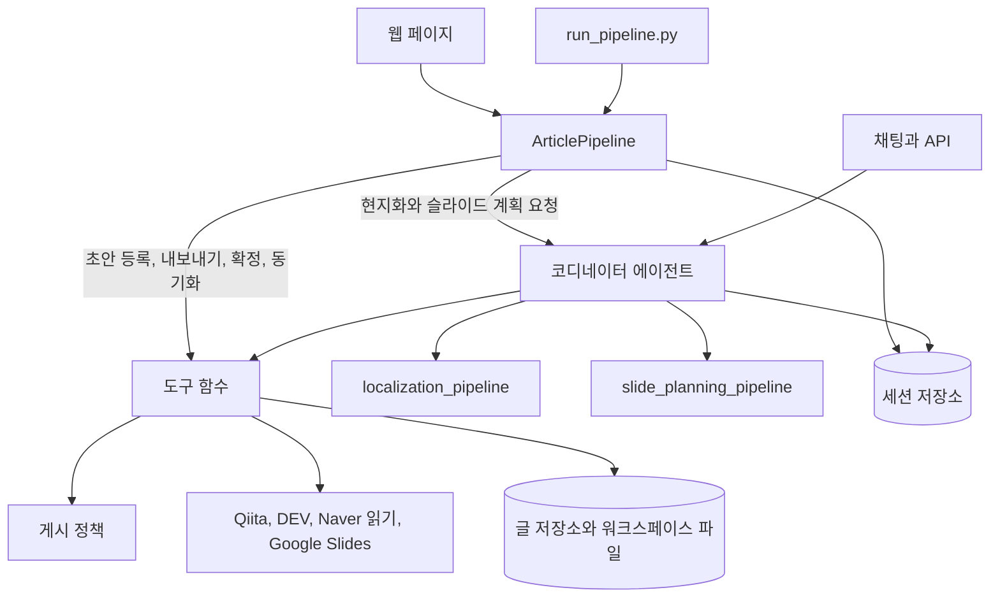

# 명세: trilingual-blog-agent

이 문서는 [SPEC.md](./SPEC.md)의 한국어판으로, 검토용이다. 두 문서의 내용이
다르면 `SPEC.md`가 우선한다.

이 명세는 시스템이 하는 일을 정하는 기준 문서이다. 코드, 테스트, `README.md`는
이 명세를 따른다. 동작을 바꾸려면 먼저 이 명세를 고치고, 다음으로 코드를,
그다음으로 부록 B에서 해당 요구사항에 지정된 테스트를 고친다.

요구사항 ID(`INV-1`, `PUB-3`, ...)는 바뀌지 않는다. 아직 구현되지 않은
요구사항은 그 사실을 요구사항 본문에 적고 8절에 다시 나열한다.

> **상태, 2026-11-12.** 코드가 이 문서보다 앞서 있다. 아래 내용은 커밋
> `58c2dc1`까지 정확하다. 그 뒤 21개 커밋이 이 문서를 고치지 않은 채 동작을
> 바꾸었다. 차이 15건과 기록하면서 찾은 결함은
> [kr-AS-BUILT.md](./kr-AS-BUILT.md) 11절과 12절에 있고, 그중 4건은 여기 적힌
> 불변 조건(INV-6, INV-7, INV-8, INV-11)에 닿는다. 코드, 테스트, 이 문서를
> 버전 1.0으로 다시 맞추는 방법은 [kr-DESIGN-v1.md](./kr-DESIGN-v1.md)에
> 제안되어 있다. 그 작업이 끝날 때까지 이 문서는 그 목록과 함께 읽는다.

---

## 1. 목적

작성자 한 명이 기술 글 한 편을 한국어, 영어, 일본어 중 한 언어로 쓴다.
시스템은 이 글을 세 언어의 게시물로 만들고, 각 게시물을 해당 플랫폼에 맞게
준비하며, 발표도 준비한다. 발표 준비물은 발표자 노트에 발표 대본이 들어간
Google Slides 덱이다. 작성자는 검토하고 승인하며, 승인과 승인 사이의 기계적인
작업은 시스템이 한다.

| 언어 | 플랫폼 | 게시물이 올라가는 방법 |
| :--- | :--- | :--- |
| 한국어 | Naver Blog | 시스템이 바로 붙여 넣을 수 있는 HTML을 작성하고, 작성자가 이를 붙여 넣은 뒤 URL을 등록한다. Naver에는 공개된 쓰기 API가 없다 |
| 영어 | DEV Community | 작성자가 승인한 뒤 API로 올린다 |
| 일본어 | Qiita | 작성자가 승인한 뒤 API로 올린다 |

이 대응은 고정이다. Medium은 범위 밖이다(쓰기 API가 더 이상 발급되지 않는다).

## 2. 불변 조건

아래 조건은 모든 경로, 곧 웹 페이지, 명령줄 스크립트, 에이전트와의 채팅,
에이전트의 API에서 성립한다. 이 중 하나라도 깨는 변경은 다른 무엇을 개선하든
결함이다.

| | 불변 조건 |
| :--- | :--- |
| INV-1 | 사람이 해당 플랫폼과 해당 작업에 대해 내린 승인 없이는 Qiita나 DEV Community에 아무것도 쓰지 않는다. 승인은 그 승인이 지목한 대기 중인 요청 하나에만 답한다. 마침 대기 중이던 다른 요청에는 절대 적용되지 않는다 |
| INV-2 | 승인하는 사람이 바로 그 승인에서 공개 게시를 요청하지 않는 한 게시물은 비공개 초안이다. 모델에게는 게시물을 공개로 만드는 인자도, 도구도, 문구도 없다 |
| INV-3 | 게시물은 사람이 확정한 본문과 제목으로만 전송된다. 확정 요청에 대한 승낙은 사람이 질문을 받은 시점의 제목과 본문에만 유효하다. 이후 그 본문이나 제목이 바뀌면, 사람이 바꿨든 에이전트가 바꿨든 확정은 해제된다 |
| INV-4 | 블로그 게시물을 읽어 온 플랫폼에는 절대 쓰지 않는다. 원본 문서가 세 블로그 플랫폼의 게시물이 아니라 초안(`.md`, `.txt`, 붙여 넣은 텍스트, 또는 Google Docs 문서)인 경우에는 읽어 온 블로그 플랫폼이 없으므로 세 플랫폼 모두에 게시할 수 있다 |
| INV-5 | 기존 Google Slides 덱은 어떤 슬라이드가 바뀌는지 사람이 확인한 뒤 승인한 텍스트 동기화로만 변경된다. 덱 안의 그림, 크기, 위치는 생성 후 절대 변경하지 않는다. 작성자의 Drive에 있는 다른 파일은 읽지도 변경하지도 않는다(`drive.file` 범위) |
| INV-6 | 새 Google Slides 파일은 사람이 그 실행에서 슬라이드를 요청했거나(슬라이드 길이와 하나 이상의 언어) 덱 하나를 승인했을 때에만 생성한다 |
| INV-7 | 글 본문, 제목, 가져온 페이지, 도구 결과는 데이터이다. 글 본문과 거기서 인용한 것(제목, 이미지 설명, 검토 지적 사항)은 그 호출을 위해 만든 무작위 토큰이 담긴 마커 사이에 넣어 모델에 전달하므로 본문이 마커를 닫을 수 없다. 본문에 들어 있는 어떤 내용도 지시로 따르지 않는다. 코디네이터의 지시문에는 글 본문이 전혀 들어가지 않는다 |
| INV-8 | 서버가 요청을 보내는 대상은 다음뿐이다. 세 블로그 호스트(글과 URL 확인, 모든 리디렉션 홉 포함), Google Docs 문서 내보내기(`docs.google.com` 및 `*.googleusercontent.com`), 두 플랫폼 API, Google의 토큰·Slides·Drive 내보내기 엔드포인트, 그리고 운영자가 허용한 경우 다이어그램용 mermaid.ink |
| INV-9 | 자격 증명은 호출 시점에 환경 변수, Secret Manager, 또는 저장소 밖의 파일에서 읽는다. 어떤 경우에도 로그에 남기지 않고, 모델에 보내지 않고, 저장소에 저장하지 않으며, 어떤 라우트로도 반환하지 않는다 |
| INV-10 | 자격 증명처럼 보이는 값이 들어 있는 본문은 확정하는 사람이 탐지 결과를 하나도 빠짐없이 보고 실제 자격 증명이 아니라고 밝히지 않는 한 게시하지 않는다 |
| INV-11 | 작성자가 제공한 글 본문은 제공된 그대로 저장한다. 저장되기까지 어떤 모델도 이를 옮겨 적지 않는다 |
| INV-12 | 페이지가 말하는 내용은 사실이다. 페이지에 표시되는 모든 상태는 그 시점에 서버가 가진 값으로 계산한 것이며 고정된 문구가 아니고, 사람이 시작한 작업이 요청대로 수행되지 않으면 언제나 알림이 나타난다 |

## 3. 용어

| 용어 | 의미 |
| :--- | :--- |
| 원본 문서 | 작성자가 제출하는 것. Markdown 텍스트나 파일, 또는 세 플랫폼 중 한 곳에 올라온 게시물의 URL |
| 시드 | 저장된 뒤의 원본 문서. 언어 하나, 제목 하나를 가지며 최종본이다 |
| 게시물 | 한 언어로 된 글. 원본 언어에서는 시드 자체이고, 나머지 두 언어에서는 현지화본이다 |
| 확정 | 작성자가 게시물 하나(제목과 본문)를 전송해도 된다고 최종 확인하는 것 |
| 슬라이드 계획 | 언어별로 만든다. 덱 제목, 도입 대본, 번호가 붙은 슬라이드(제목, 불릿, 시각 자료 메모, 선택 사항인 이미지 참조, 발표 대본), 마무리 대본으로 이루어진다. 세션에 저장하고 `slides.<lang>.md`에 그대로 반영한다 |
| 발표자 노트 | 페이지에서는 `slides.<lang>.md`로 가는 링크이고, 덱에서는 각 슬라이드 아래의 노트이다. 둘에는 같은 대본이 들어 있다 |
| 실행 | 원본 문서 하나를 처음부터 끝까지 처리하는 것. 페이지 주소 하나, 세션 하나에 대응한다 |

## 4. 작업 흐름

| 단계 | 시스템이 하는 일 | 작성자가 하는 일 |
| :--- | :--- | :--- |
| 1 Source document | 초안을 시드로 저장하거나, 게시된 글을 해당 플랫폼을 통해 읽어 와서 저장한다 | 문서를 제출한다 |
| 2 Transform | 나머지 두 언어의 글과 제목을 병렬로 작성하고, 코드로 구조를 검사하고, 두 번째 모델에게 의미를 검토하게 한 뒤, 통과하지 못한 부분을 고친다(최대 두 차례) | — |
| 3 Prepare posts | Naver용 HTML을 작성하고, 모든 게시물을 그 파일과 함께 나열한다 | 게시물을 검토하고 편집하며, 각각 확정하고, 게시물마다 초안 또는 공개로 승인한다 |
| 4 Prepare slides | 선택한 언어별로 발표를 계획하고, 시간을 점검하고, 대본을 노트에 넣은 덱을 생성한다 | 덱을 검토한다. 대본은 파일이나 덱에서 편집한 뒤 동기화한다 |
| 5 Summarize | 생성된 모든 것의 목록인 `manifest.md`를 작성한다 | — |

웹 페이지는 버튼 하나로 1단계부터 5단계까지 실행한다. 채팅에서는 에이전트가
한 번에 한 단계씩 실행하고 기다린다.

---

## 5. 요구사항

### 5.1 원본 문서와 시드

| | 요구사항 |
| :--- | :--- |
| SRC-1 | 원본 문서는 50자 이상 60,000자(`BLOG_AGENT_MAX_ARTICLE_CHARS`) 이하의 Markdown 또는 일반 텍스트(붙여 넣은 텍스트, 또는 `.md`, `.markdown`, `.txt` 파일), Google Docs 문서 URL(`https://docs.google.com/document/d/...`), 또는 `qiita.com`, `dev.to`, `blog.naver.com`, `m.blog.naver.com` 중 한 곳의 게시물 https URL 하나이다. 그 밖의 파일 형식(Microsoft Word 등), 다른 곳의 주소, https가 아닌 주소, 너무 짧거나 긴 텍스트는 무엇이든 저장하기 전에 알기 쉬운 말로 거부한다 |
| SRC-2 | 웹 페이지나 스크립트에 제출된 초안(붙여 넣은 텍스트, `.md`/`.txt` 파일, 또는 Markdown으로 내보낸 Google Docs URL)은 코드가 바이트 단위로 그대로 저장하며, 언어는 글이 쓰인 문자 체계로 판별한다. 제목은 코드 블록 밖의 첫 번째 1단계 헤딩이고, 없으면 프런트 매터의 `title`, 그것도 없으면 본문의 첫 줄이다. 뒤의 두 경우에는 어떤 제목을 취했는지 알리는 알림이 실행에 붙는다. 어떤 모델도 관여하지 않는다(INV-11). URL만 있는 입력도 코드가 읽는다. URL 외에 다른 말이 더 있는 짧은 메시지만 에이전트로 간다 |
| SRC-3 | URL은 플랫폼의 API(Qiita, DEV)로 읽거나 공개된 모바일 페이지(Naver)에서 읽는다. 그 플랫폼은 원본으로 기록하고 절대 쓰지 않는다(INV-4). Naver에서 읽은 본문은 헤딩, 목록, 링크가 빠질 수 있으며, 그때는 그 사실을 알리는 알림이 실행에 붙는다 |
| SRC-4 | 시드는 웹 페이지나 스크립트가 저장하는 시점에 최종본이 된다. 채팅에서는 작성자가 그렇다고 말할 때에만 최종본이 된다 |
| SRC-5 | 글에 딸린 코드는 선택 사항이며, 어떤 경우에도 요구하지 않는다 |
| SRC-6 | 실행 하나는 글 한 편을 담는다. 같은 세션에 다른 게시된 글을 읽어 오면 새 프로젝트가 시작되고 이전 글의 것은 아무것도 남지 않는다. 시드 본문을 고치면 이전 본문으로 만든 현지화본, 확정, 슬라이드 계획과 그 파일들이 폐기된다. 게시 기록과 덱은 여전히 그 글의 것이므로 남는다. 이전 본문에서 남은 게시물 파일은 다시 저장할 수 없다 |

### 5.2 현지화

| | 요구사항 |
| :--- | :--- |
| LOC-1 | 시드의 언어가 아닌 두 언어는 시드를 바탕으로 병렬로 작성하며, 절대 서로를 바탕으로 작성하지 않는다. 제목도 현지화한다. 시드의 제목은 쓰인 그대로 둔다 |
| LOC-2 | 구조는 보존하며 코드로 검사한다. 대상은 헤딩(수준과 순서), 목록, 표, 링크(대상은 그대로), 코드 블록이다. 프로그램 코드는 주석을 제외하고 동일하다. Mermaid 다이어그램은 ID, 화살표, 키워드를 유지하고 레이블을 번역한다. 일반 텍스트 블록은 한국어나 일본어로 쓰인 줄을 번역하고 그 밖의 줄은 모두 그대로 둔다. 따라서 영어 시드에서 만든 현지화본은 일반 텍스트 블록을 쓰인 그대로 유지한다 |
| LOC-3 | 기술적 서술, 그리고 실제 조직, 제품, 인물, 장소, 수치, 인용에 관한 서술은 추가하지도, 삭제하지도, 완화하지도, 바꾸지도 않는다 |
| LOC-4 | 설명을 위해 지어낸 예시 가운데 원본 언어 독자의 지역에 속한 것의 이름을 든 예시(한 항공사를 선호하는 예시 속 여행자, 가상의 가게, 예시 속 인물의 이름)는, 그 이름에 기술적으로 의존하는 것이 없을 때, 대상 언어 독자가 아는 대응물로 바꾸며, 나오는 모든 곳에서 같은 대응물을 쓴다. 영어의 경우 배경은 미국이다. 어떤 것이 예시인지 사실인지 불분명하면 사실로 본다(LOC-3). 현지화본이 대체하는 내용은 이것뿐이다. 이는 작성 모델에 주는 지시이며, 확정 전에 작성자가 하는 검토가 그 검사이다 |
| LOC-5 | 검토 모델은 의미가 바뀌었거나, 번역투로 읽히거나, 예시의 이름을 어떤 곳에서는 바꾸고 다른 곳에서는 그대로 둔 언어를 불합격 처리한다. 검토 모델에는 LOC-3과 LOC-4를 작성 모델과 같은 문구로 알려 준다. 불합격한 언어는 다시 작성하고 다시 검사하되 최대 두 번까지 한다. 그래도 구조 검사를 통과하지 못하면 실행은 알림과 함께 멈추고 그 뒤로는 아무 일도 일어나지 않는다 |
| LOC-6 | 현지화한 글 본문은 모델이 쓴 그대로 저장한다. 자격 증명 패턴은 탐지하지만(INV-10) 본문을 고쳐 쓰지는 않는다 |

### 5.3 게시

| | 요구사항 |
| :--- | :--- |
| PUB-1 | 게시물은 본문이 있고, 해당 플랫폼이 글을 읽어 온 블로그 플랫폼(`existing_source`)이 아니며, 이미 공개된 상태가 아닐 때 확정할 수 있다. 원본 문서가 초안(`.md`, `.txt`, 붙여 넣은 텍스트, Google Docs)일 때는 원본 언어의 게시물도 다른 두 언어와 똑같이 확정하고 게시할 수 있다. 확정하면 제목과 본문의 다이제스트를 기록한다(INV-3) |
| PUB-2 | 자격 증명처럼 보이는 값이 들어 있는 본문의 확정은, 사람이 탐지 결과를 보았다는 내용이 요청에 담기지 않으면 거부한다(INV-10). 페이지와 스크립트는 탐지 결과를 빠짐없이(종류와 줄 번호만, 값은 절대 표시하지 않고) 보여 주고 묻는다. 채팅에서는 승낙만으로 이를 밝힐 수 없으므로 에이전트가 페이지나 스크립트를 안내한다 |
| PUB-3 | 게시 도구는 다음 경우에 조치 방법을 안내하는 오류와 함께 거부한다. 확정된 시드가 없음, 플랫폼이 원본임, 본문이 없음, 확정되지 않음(PUB-1), 이미 공개됨. 승인이 도착하면 다시 검사한다 |
| PUB-4 | 전송되는 제목은 확정된 제목이다. 게시 도구는 태그만 받고 그 밖에는 아무것도 받지 않으므로 모델이 다른 제목을 지정할 수 없다 |
| PUB-5 | 승인 요청에는 플랫폼, 제목, 태그, 그리고 초안을 새로 만드는지 갱신하는지가 명시된다. 갱신할 초안이 플랫폼에서 다른 제목을 달고 있으면 그 제목도 명시된다. 공개 여부를 선택하지 않은 승인은 비공개 초안을 뜻한다(INV-2) |
| PUB-6 | 이미 있는 초안은 갱신하며 절대 중복해서 만들지 않는다. 공개된 게시물은 다시 게시하지 않는다 |
| PUB-7 | Naver: HTML 내보내기 파일은 실행 중에 작성하고, 한국어 게시물이 편집될 때마다, 그리고 확정될 때 다시 작성한다. 이 파일에는 스크립트, 이벤트 핸들러, `javascript:` 링크, SVG, MathML이 없다. 내보내기가 거부한 본문은 파일을 남기지 않는다. 다시 내보내도 등록된 URL은 절대 폐기되지 않는다 |
| PUB-8 | 등록하는 URL은 해당 플랫폼 호스트의 https 주소여야 하고, 그 플랫폼은 원본이 아니어야 한다. 그런 다음 그 URL을 가져와 보고, 응답하지 않으면 알림으로 그 사실을 알린다 |
| PUB-9 | 페이지가 없는 환경(채팅, 스크립트)에서는 사람에게 확인을 요청하고 본문 길이를 알려 주는 도구로 게시물을 확정한다. 스크립트는 입력 프롬프트에서 묻는다 |
| PUB-10 | 태그는 다른 어떤 일보다 먼저 플랫폼 자체 규칙에 맞는지 검사한다. DEV는 최대 네 개이며 소문자와 숫자로 쓴다. Qiita는 한 개에서 다섯 개이며 공백이 없다 |

### 5.4 발표와 슬라이드

| | 요구사항 |
| :--- | :--- |
| SLD-1 | 작성자는 길이(없음, 3, 5, 10, 15, 20, 30, 45, 60분), 언어(세 언어 중 임의로 선택하며 페이지와 스크립트 모두 기본값은 전부), 청중(Developers, Experts, Students, Executives, Non-technical)을 고른다. 길이와 언어를 고르면 그 실행에서 언어마다 덱 하나를 요청하는 것이다(INV-6) |
| SLD-2 | 계획에는 번호가 붙은 슬라이드가 1분당 정확히 한 장 있고, 슬라이드마다 가정한 말하기 속도로 약 1분(45초에서 75초) 분량의 대본이 있다. 여기에 도입 대본과 마무리 대본이 더해지며 이 둘은 세지 않는다. 슬라이드 번호는 빠짐이나 중복 없이 1..N이다. 계획의 언어는 모델이 무엇을 썼든 요청된 언어이다 |
| SLD-3 | 도입 대본은 제목 슬라이드에서 말한다. 인사, 발표 제목, 이어서 제목이 뜻하는 바와 청중이 얻어 갈 것으로 이루어진다. 인사는 여기서만 한다. 마무리 대본은 감사 슬라이드에서 말한다. 감사 인사와 질문을 청하는 말로 이루어진다. 작별 인사는 여기서만 한다 |
| SLD-4 | 슬라이드가 다섯 장 이상이면 1번 슬라이드는 목차이고, 제목은 해당 언어에서 "Agenda"에 해당하는 단어이다. 모든 계획은 해당 언어로 "Conclusion" 또는 "Summary"라는 제목이 붙은 결론 슬라이드로 끝난다. 슬라이드가 여섯 장 이상이면, 글이 다음 단계, 향후 작업, 후속 내용을 언급할 때 그 내용은 결론 뒤에 별도의 슬라이드를 갖는다. 언급하지 않으면 그런 슬라이드는 없다. 슬라이드 제목은 그 슬라이드의 요지를 꾸밈없이 나타내며 발표 제목을 절대 반복하지 않는다. 이상은 계획 모델에 주는 지시이며, 코드는 SLD-2만 검사한다 |
| SLD-5 | SLD-2를 통과하지 못한 계획은 실패 내용을 명시해 한 번 더 계획한다. 한 언어의 계획 과정에서 남은 것은 다른 언어의 계획 과정에 절대 전달되지 않는다 |
| SLD-6 | 덱은 제목 슬라이드, 번호가 붙은 슬라이드(제목, 불릿), 감사 슬라이드("Thank you", "감사합니다", "ありがとうございました")로 구성된다. 발표자 노트에는 도입 대본, 각 슬라이드의 대본과 그 뒤에 오는 `[Visual]` 및 시각 자료 메모, 마무리 대본이 들어간다 |
| SLD-7 | 슬라이드에는 글에 있는 이미지만 넣는다. 이미지 URL, 그리고 `BLOG_AGENT_RENDER_MERMAID`가 켜져 있을 때 mermaid.ink가 그린 Mermaid 다이어그램이 이에 해당한다. 각 이미지는 한 번만 쓴다. 모델이 지어낸 참조는 버린다 |
| SLD-8 | 그려진 다이어그램은 가장 크게 들어가는 자리에 배치한다. 가로로 넓으면 불릿 아래에 페이지 너비 전체로, 세로로 길면 제목을 좁히고 페이지 높이 전체로, 그 밖에는 불릿 옆에 텍스트에 맞춰 크기를 정한 열로 배치한다. 형태를 알 수 없는 이미지는 오른쪽 절반을 차지한다. 텍스트와 이미지는 절대 겹치지 않으며 페이지 안에 머문다 |
| SLD-9 | 계획, 시간 보고서, 덱, 동기화 기준선은 언어별로 보관한다. 계획이 있는 언어라면 어느 언어든 덱을 생성하거나 다시 생성할 수 있다 |
| SLD-10 | 파일이 생긴 뒤에 덱 생성이 실패하면, 그 파일이 Drive 안에서 잊히지 않도록 오류에 파일의 주소를 명시한다 |
| SLD-11 | 글에 있는 Markdown 표는 계획 모델에 `table:N` 참조로 제공된다. 이미지가 없는 슬라이드에 선택되면 불릿 아래에 Google Slides 네이티브 표(최대 8행 6열)로 배치하며, 각 표는 한 번만 쓴다 |
| SLD-12 | Google Slides 덱은 검토가 끝난 뒤 `slides.<lang>.pdf`로 내보낼 수 있다. 해당 언어의 게시물을 확정할 때, PDF가 있는 상태에서 덱으로 텍스트를 푸시할 때 자동으로 내보내며, Slides 열이나 `export_google_slides_pdf` 도구로 언제든 내보낼 수 있다 |

### 5.5 덱 텍스트 동기화

| | 요구사항 |
| :--- | :--- |
| SYN-1 | `slides.<lang>.md`를 다시 읽으면 그 파일을 만들어 낸 계획과 같은 계획이 된다. 편집 내용을 저장하면 계획을 정규 형식으로 저장하고 기준 계획을 교체한다. 더 이상 계획으로 읽히지 않는 파일은 입력된 그대로 저장하고 그 이유를 보여 주며, 동기화할 수 없다 |
| SYN-2 | 푸시(파일에서 덱으로)는 파일과 덱이 마지막으로 일치한 이후 파일 쪽에서 바뀐 필드만 옮긴다. 풀(덱에서 파일로)은 덱 쪽에서 바뀐 필드만 옮긴다. 필드는 덱 제목, 슬라이드 제목, 불릿, 그리고 도입 대본과 마무리 대본을 포함한 발표자 노트이다 |
| SYN-3 | 어느 방향이든 무언가를 쓰기 전에, 사람은 바뀌는 슬라이드, 제목과 불릿 목록과 노트가 각각 몇 개 바뀌는지, 어떤 슬라이드가 양쪽에서 모두 편집되었는지를 본 뒤 승인하거나 취소한다(INV-5). 승인은 보여 준 변경 사항에만 유효하다. 그 뒤 파일이나 덱이 바뀌었으면 아무것도 쓰지 않고 다시 묻는다 |
| SYN-4 | 교체된 텍스트는 원래 있던 텍스트의 글꼴, 크기, 굵기, 글머리 기호를 유지한다. 슬라이드는 절대 추가하거나 삭제하지 않는다. 한쪽에 없는 슬라이드는 건너뛰고 어떤 슬라이드인지 밝힌다 |
| SYN-5 | 덱에서 비워진 제목은 풀로 가져오지 않는다 |

### 5.6 웹 페이지

| | 요구사항 |
| :--- | :--- |
| WEB-1 | 페이지는 하나이다. 헤딩은 "Trilingual Blog Agent"이고, 그 아래에 "Automatically transform an article in one language into blog posts and presentation slides across three languages."가 온다 |
| WEB-2 | 폼: 힌트 "Share a post URL, a .md file, or your document."가 붙은 "Source document", 파일 첨부 또는 끌어다 놓기, "Choose the slide length to create Google Slides in your configured Google Drive."가 붙은 "Slide options", Length, Languages(체크박스, 모두 선택됨), Audience(SLD-1), Run 버튼 하나 |
| WEB-3 | 진행 상황 카드: 글 제목 아래에 상태 줄(작업 중일 때는 경과 시간과 최근 활동, 끝났을 때는 `manifest.md` 링크)이 오고, 그 아래에 5단계 진행 막대 두 줄이 온다. 첫 번째 막대(자동 생성): "Source document", "Transform", "Prepare posts", "Prepare slides"(슬라이드를 요청했을 때), "Summarize". 두 번째 막대(Summarize 이후 검토 및 게시): "Review & edit", "Finalize posts", "Approve & draft", "Publish posts", "Verify & complete". 각 단계의 완료 여부는 서버 상태로 계산하며 새로고침 전후가 같다 |
| WEB-4 | 결과 표는 입력 글의 언어(원본 언어)를 맨 먼저 두고, 열은 작업 순서대로 Language(이름, 그 아래 상태 배지), Title, Files, Slides, Next step이다. 표 아래에는 아무것도 나열하지 않는다 |
| WEB-5 | Files: `post.<lang>.md`, 그리고 한국어에는 `naver_blog.html`이 있으며 각각 미리보기를 연다. Slides: "Google Slides"(해당 언어의 덱만), "Speaker notes"(`slides.<lang>.md`), 그리고 "PDF"(내보낸 뒤에는 `slides.<lang>.pdf` 링크, 내보내기 전에는 "Export PDF")가 있다. 계획은 있고 덱은 없는 언어에서는 덱 생성을 제안한다 |
| WEB-6 | Next step은 다음에 할 일 한 가지를 보여 준다. 블로그 플랫폼에서 읽어 온 기존 게시물(`existing_source`) → "Open original". 공개 → "Open post". 확정 전 → 검토할 대상과 "Finalize". 확정됨, API 플랫폼 → "Post…"(또는 "Update post…") 버튼이 나타나며, 클릭하면 제목, 태그 입력란(바로 아래에 해당 플랫폼의 태그 규칙 안내 표시), Draft / Public 선택지(Draft 기본 선택)가 있는 승인 대화상자가 열린다. 확정됨, Naver → 붙여 넣기 안내, URL 입력란, "Register URL" |
| WEB-7 | 미리보기: 파일 이름, 파일을 편집할 수 있을 때의 "edit", "raw text"가 있다. Markdown은 렌더링한다. 글 본문에서 온 스크립트는 실행될 수 없고, 폼은 제출될 수 없으며, 기준 주소는 설정될 수 없다. Mermaid 블록은 운영자가 mermaid.ink를 허용했으면 그림으로 나타나고 그 아래에 소스가 붙는다. 그렇지 않으면 코드로 나타난다 |
| WEB-8 | 편집기: 창 전체를 쓴다. 게시물에는 제목 입력란이 있다. Save가 있다. 저장하지 않은 변경 사항은 보호한다. 게시물을 저장하면 확정이 해제되고 그 사실을 알린다. 덱이 있는 슬라이드 계획의 경우, Save 후 덱과 내용이 다르면 동기화 대화상자가 열린다. "Update deck…"과 "Pull from deck…"은 항상 있다 |
| WEB-9 | "Ask the agent for a change": 에이전트에게 보내는 한 줄이다. 턴이 끝나면 에이전트의 답이 페이지에 표시된다. 에이전트가 승인을 요청하면 그 요청이 Approve, Decline과 함께 표시된다. 답은 그 요청에만 전달되고(INV-1), 그 시점에 대기 중이던 다른 요청은 거절되며 그 사실이 표시된다. 새 줄을 보낼 때 답하지 않은 채 남아 있던 요청은 사라지며, 알림이 그 사실을 알린다 |
| WEB-10 | Settings는 고정된 언어-플랫폼 대응, 자격 증명별 설정 여부, 그리고 덱이 들어가는 Google 계정을 그 시점에 서버가 보고한 대로 보여 준다. 시크릿의 이름이나 값은 표시하지 않는다 |
| WEB-11 | 에이전트가 작업하는 동안에는 다른 어떤 것도 시작할 수 없으며, 한 문장으로 그 사실을 알린다. 연결이 끊기면 이를 표시한다. 작업이 요청대로 수행되지 않은 채 끝나면 무엇이 이루어지지 않았는지 알림으로 알린다(INV-12) |
| WEB-12 | 사람에게 보여 주는 문구는 사람이 읽도록 쓴다. ID가 아닌 플랫폼 이름을 쓰고, Python 리스트나 예외 클래스 이름은 쓰지 않는다 |

### 5.7 영속성

| | 요구사항 |
| :--- | :--- |
| PER-1 | 실행은 서버가 재시작되어도 유지된다. 실행의 세션(게시물, 제목, 확정, 계획, 덱 기록, 동기화 기준선, 게시 기록)과 활동 로그가 디스크에 있다. 실행의 주소를 다시 열면 이전 상태 그대로 보인다 |
| PER-2 | 서버가 멈출 때 작업 중이던 실행은 알림과 함께 중단된 것으로 표시된다. 그때 대기 중이던 승인은 다시 요청해야 한다 |
| PER-3 | 생성된 파일은 `workspace/<project id>/`에 둔다. 모든 게시물의 모든 수정본과 모든 게시 기록은 글 저장소에도 보관한다(로컬에서는 SQLite, 설정된 경우 Firestore) |
| PER-4 | 주소에 실행이 지정되지 않은 채 페이지를 열면 이 브라우저의 마지막 실행을 다시 열며, 상단 입력창에도 해당 실행의 원본 문서를 복원하고 새로 시작할 수 있는 "Clear / New article" 버튼을 제공한다 |

### 5.8 보안과 개인정보 보호

| | 요구사항 |
| :--- | :--- |
| SEC-1 | 웹 서버에는 로그인이 없다. localhost에서 수신하며 localhost 앞으로 온 요청에만 응답한다. 다른 `--host`로 시작한 경우에는 예외로, 서버에 닿을 수 있는 누구에게나 어떤 이름으로든 응답한다. 에이전트의 API 서버는 수동으로 시작하면 localhost에서 수신한다 |
| SEC-2 | 라우트는 생성된 이름과 일치하는 파일 이름만 받으며 절대 프로젝트 폴더를 벗어나지 않는다 |
| SEC-3 | 인증된 HTTP 클라이언트는 리디렉션을 따라가지 않는다. 인증 없는 요청은 리디렉션을 최대 세 번까지 따라가며 매번 호스트를 다시 검사한다(INV-8) |
| SEC-4 | 로그와 저장되는 메모리는 마스킹을 거친다(이메일, 전화번호, 자격 증명 패턴. 활성화된 경우 Cloud DLP). 메모리에는 작성자와 코디네이터가 한 말을 담으며 각 메시지는 1,000자로 자른다. 작성 에이전트가 만들어 낸 것과 도구가 반환한 것은 저장하지 않는다 |
| SEC-5 | 다이어그램 소스는 슬라이드용이든 미리보기용이든 `BLOG_AGENT_RENDER_MERMAID`가 켜져 있을 때에만 mermaid.ink로 보낸다. README는 두 경우를 모두 밝힌다 |
| SEC-6 | Slides 권한 부여는 개인 계정이나 전용 Google 계정의 것이어야 하며, 회사나 학교 계정이어서는 절대 안 된다. 덱 하나를 승인해 달라는 요청은 채팅에서든 페이지에서든 그 계정을 명시한다. Settings도 계정을 명시하며, 실행 양식의 "your configured Google Drive"가 어느 계정인지는 여기서 확인한다 |

### 5.9 운영

| | 요구사항 |
| :--- | :--- |
| OPS-1 | 모든 도구 호출은 의도와 결과로 나누어, 마스킹을 적용한 구조화된 JSON으로 로그에 남긴다. 플랫폼 호출은 트레이싱 스팬 안에서 실행한다 |
| OPS-2 | `uv run pytest tests/unit`은 모델, 네트워크, 자격 증명 없이 실행되며, 부록 B가 단위 테스트에 배정한 모든 요구사항을 다룬다. 이것은 픽스처가 보장한다. 픽스처는 네트워크 연결과 모델 관문을 거부하고, `.env`는 읽지 않는다 |
| OPS-3 | 모델 이름은 설정값(`FAST_MODEL_NAME`, `REASONING_MODEL_NAME`)이며 코드 수정으로 바꾸지 않는다 |

---

## 6. 아키텍처

- 채팅에서 무엇을 할지는 코디네이터가 결정한다. 시드가 있는지, 어떤 언어를
  실행할지, 검토나 시간 점검을 통과했는지, 게시물을 전송해도 되는지를 판정하는
  게이트는 모델이 아니라 코드(`app/workflow_agents.py`, `app/policy.py`)이다.
- 파이프라인은 판단이 필요 없는 일(SRC-2, URL 읽기, Naver 내보내기, 확정, 덱
  생성, 게시, 동기화, 매니페스트)을 코드로 처리한다. 이때 에이전트가 호출하는
  것과 같은 도구 함수를 사람이 시작한 작업으로서 호출하며, 에이전트에는
  현지화와 슬라이드 계획만 요청한다. 각 단계가 끝나면 그 단계가 요청된 결과를
  만들어 냈는지 확인하고, 그렇지 않으면 알림으로 보고한다.
- 세션 상태는 한 실행 안에서의 기록이며, 키는 모두 `app/state.py`에 있다.
  워크스페이스 파일은 읽기용으로 세션 상태를 그대로 반영한다. 글 저장소는
  이력이다.

| 언어별 상태 | 담는 내용 |
| :--- | :--- |
| `localized_key(lang)`, `LOCALIZED_TITLES` | 게시물 |
| `FINALIZED_POSTS` | 확정된 제목과 본문의 다이제스트, 그리고 탐지 결과를 확인했는지 여부 |
| `SLIDE_PLANS`, `SLIDE_TIMING` | 기준 계획과 그 시간 보고서 |
| `GOOGLE_SLIDES_DECKS` | 덱 ID, 주소, 개수 |
| `DECK_TEXT_BASELINE` | 파일과 덱이 마지막으로 일치했던 텍스트 |
| `PUBLICATIONS`(플랫폼별) | 원본, 내보냄, 초안 또는 공개 상태와 그 ID 및 주소 |

위 이름은 `app/state.py`의 상수이다. `PRESENTATION_BRIEF`, `SLIDE_DECK_PLAN`,
`SLIDE_DRAFT_TIMING`은 진행 중인 슬라이드 계획 실행의 작업 영역이다. 그 뒤에는
파이프라인만 브리프를 읽어, 받은 계획이 요청한 언어로 되어 있는지 확인한다.

## 7. 알려진 제한

- Naver: 읽기는 공개 페이지에서 가능한 범위까지만 하며, 게시는 수동으로 한다.
- 구조 검사는 일반 텍스트 블록 안에서 라틴 문자로 쓰인 산문과 명령어를
  구분하지 못하며(LOC-2), 주석 표시로 시작하는 줄을 어느 언어에서든 주석으로
  취급한다.
- 발표 시간은 측정한 값이 아니라 가정한 속도와 분량으로 추정한 값이다.
- SLD-4는 계획 모델에 달려 있다. 계획 두 건에서 관찰되었을 뿐 증명된 것은
  아니다.
- 주소가 2,000자를 넘게 되는 다이어그램은 슬라이드에 넣을 수 없다. 그때 해당
  슬라이드는 텍스트로 배치한다.
- 덱 레이아웃은 한 번만 계산한다. 나중에 푸시한 텍스트에 맞춰 다시 조정하지
  않는다.
- 페이지에는 로그인이 없다(SEC-1). 다른 주소를 `--host`로 지정해 시작하면 어떤
  이름으로 온 요청에든 응답한다. 이때 작성자의 브라우저에 열린 페이지가 자기
  이름을 그 주소로 향하게 하면 작성자와 똑같이 응답을 받는다. 에이전트의 API
  서버(`app/fast_api_app.py`)는 요청이 어떤 이름 앞으로 왔는지 전혀 확인하지
  않는다.
- 채팅에서 같은 대화에 두 번째 초안을 저장하면 첫 번째 초안의 수정으로
  처리된다. 프로젝트가 유지되고 첫 번째 글의 플랫폼 초안이 갱신된다. 승인
  요청은 교체되는 제목을 명시한다(PUB-5). 다른 글은 새 대화에서 시작한다.
- 블로그 플랫폼에서 읽어 온 게시물(`existing_source`)이나 이미 공개된 게시물은
  페이지에서 편집할 수 없으며, 초안으로 입력된 원본 언어 게시물과 현지화된
  게시물은 공개 전에 페이지에서 편집할 수 있다. 제목은 채팅이 아니라 페이지의
  편집기에서 바꿀 수 있다.
- 에이전트는 한 턴의 답을 한꺼번에 받는다. 따라서 승인 요청 하나에 답하면 그
  시점에 대기 중이던 나머지 요청은 거절된다(INV-1). 거절된 요청은 다시 요청해야
  한다.
- 서버가 멈출 때 대기 중이던 승인 요청은 재시작 후에 사라진다(PER-2).
- "Prepare posts" 단계는 Naver 파일이 있거나 Naver가 원본이면 완료로 표시된다.
  작성자의 검토를 기다리지 않는다.
- 로컬 메모리는 프로세스 내부에 있다. Memory Bank에는 배포가 필요한데 아직
  배포하지 않았다.

## 8. 미해결 질문과 구현되지 않은 작업

| | 항목 | 상태 |
| :--- | :--- | :--- |
| 1 | 라이선스 | `README.md`에는 Apache-2.0이라고 적혀 있으나 저장소에 `LICENSE` 파일이 없다. 소유자가 결정한다 |
| 2 | 사이트에서 초안을 수동으로 공개한 뒤의 세 번째 게시 상태 | 현재는 Public을 선택한 "Update post…"로 처리한다. 공개 주소만 등록하는 방법은 구현되지 않았다 |
| 3 | Agent Runtime 배포, Terraform apply, Cloud DLP, CI | 작성만 했고 실행한 적은 없다 |

<!-- requirements:end -->

---

## 부록 A. 설계가 여기에 이른 과정

첫 계획(시스템 설계 v2, 코드를 쓰기 전에 작성)에는 진입 방식 두 가지, 단계 네
개, 검토 루프가 있는 병렬 현지화, 모든 게시 전의 승인, 1분짜리 대본이 있는
슬라이드 계획이 있었다. 아래 결정들이 차례로 그 계획을 바꾸거나 보탰다.

| | 결정 | 대체한 것 |
| :--- | :--- | :--- |
| 1 | 영어는 DEV Community로 간다 | 더 이상 토큰을 발급하지 않는 Medium |
| 2 | Naver는 바로 붙여 넣을 수 있는 HTML과 URL 등록으로 처리한다 | 있다고 가정했던 쓰기 API |
| 3 | 프로젝트 이름은 `trilingual-blog-agent` | `multilingual-tech-blog-agent` |
| 4 | 제목도 본문과 함께 현지화한다 | 원본 언어 그대로 둔 제목 |
| 5 | 입력 하나와 버튼 하나가 있는 웹 페이지가 모든 단계를 실행한다 | 단계마다 프롬프트를 입력하는 방식 |
| 6 | 파일을 첨부할 수 있다. 발표는 최대 60분이다. 진행 상황을 활동 옆에 보여 준다 | — |
| 7 | 생성된 파일을 편집할 수 있다 | 읽기 전용 미리보기 |
| 8 | 덱을 Google Slides에 생성하고 대본을 발표자 노트에 넣는다 | Markdown 슬라이드 계획만 있던 것 |
| 9 | Slides 권한 부여는 직장 계정의 것이어서는 안 된다. 이는 문서화된 주의 사항이다 | — |
| 10 | 글의 이미지를 슬라이드에 넣는다. Mermaid 다이어그램은 그려서 넣는다 | 텍스트만 있는 슬라이드 |
| 11 | 비교를 위해 페이지 레이아웃 두 가지를 만들었고, 새 레이아웃을 남겨 다듬었다. 클래식 레이아웃은 제거했다 | 레이아웃 두 가지 |
| 12 | 제목 슬라이드는 다른 슬라이드와 같은 모양이다 | 어두운 표지 |
| 13 | 결과는 표이다 | 언어마다 카드 하나 |
| 14 | 덱은 별도의 버튼 없이 실행 중에 생성한다 | "Create deck" 단계 |
| 15 | 슬라이드는 선택한 모든 언어로 만든다(체크박스, 모두 선택됨) | 발표 언어 하나 |
| 16 | 청중은 다섯 항목의 목록이다 | 자유 입력 |
| 17 | 단계 이름: Source document, Transform, Prepare posts, Prepare slides, Summarize | Read article, Localize, Plan talk, Summary |
| 18 | 플랫폼 이름은 표가 아니라 Settings에 둔다 | 언어마다 그 아래에 표시하던 플랫폼 |
| 19 | 덱과 발표자 노트가 있는 Slides 열. 링크에는 화살표를 붙이지 않는다 | 별도의 "Talk and summary" 블록 |
| 20 | 지어낸 예시는 대상 언어 독자가 아는 대응물로 바꾸고, 사실은 절대 바꾸지 않는다(LOC-3, LOC-4) | 한 글에 나온 항공사에 맞춰 쓴 규칙 |
| 21 | 이미지는 형태에 맞춰 크기를 정한다(SLD-8) | 고정된 오른쪽 절반 |
| 22 | 원본 언어가 첫 행이다. 상태는 언어 아래에 둔다 | 고정된 행 순서, Status 열 |
| 23 | 당분간 PDF 링크는 두지 않는다(8절) | 덱마다 있던 PDF 링크 |
| 24 | 편집은 미리보기에서 들어가는 전체 창 편집기에서 한다 | 표 안의 편집 버튼과 대화상자 |
| 25 | `slides.<lang>.md`를 "Speaker notes"로 표시한다 | 파일 이름 |
| 26 | 편집한 발표자 노트는 기존 덱을 그 자리에서 갱신한다. 덱에서 편집한 내용은 다시 가져올 수 있다. 각 방향은 승인을 거친다 | 한 방향 내보내기였던 노트 |
| 27 | Mermaid 다이어그램을 미리보기에서 그려 보여 준다 | 코드로 표시하던 다이어그램 소스 |
| 28 | 발표 구조: 제목 슬라이드에서의 도입, 목차, 결론, 별도의 다음 단계, 감사 슬라이드 | "첫 슬라이드: 제목과 그것이 중요한 이유. 마지막 슬라이드: 요약과 다음 단계." |
| 29 | 열은 작업 순서대로 두고 Next step이 마지막이다. 검토, 확정, 승인, 게시 순이다 | 마지막에 있던 Slides |
| 30 | 승인할 때마다 초안 또는 공개를 고를 수 있다 | 초안만 |
| 31 | 이 명세. 실행은 재시작 후에도 유지된다. 승인 하나는 요청 하나에 답한다. 확정은 게시가 이루어지는 곳에서 검사하고, 제목까지 포함하며, 원본 언어에도 할 수 있다 | 페이지, 파이프라인, 도구에 흩어져 있던 규칙 |
| 32 | 페이지와 스크립트는 판단이 필요 없는 모든 일에 도구 함수를 직접 호출한다. 에이전트에는 현지화와 발표 계획만 요청한다 | 모든 단계를 입력 메시지로 에이전트에 보내던 방식 |
| 33 | 초안은 제출된 그대로 저장한다 | 모델이 초안을 도구 호출에 옮겨 적던 방식 |
| 34 | 다시 만든 코드를 독립적으로 검토한 뒤 반영한 사항. 확정에 대한 승낙은 질문받은 본문에만 유효하다. 코디네이터의 지시문에는 글 본문이 들어가지 않는다. 서버는 자기 이름으로 온 요청에만 응답한다. 덱 동기화는 보여 준 변경 사항만 쓴다. 자격 증명 탐지 결과는 빠짐없이 보여 준다 | 이 명세의 첫 번째 코드에서 검토가 찾아낸 빈틈 |
| 35 | 글의 표를 Google Slides 네이티브 표로 배치(`table:N`, SLD-11). 게시물 확정 시 및 Slides 열에서 요청 시 덱을 PDF로 내보내기(`slides.<lang>.pdf`, SLD-12) | 8절의 열린 항목 1번과 2번 |
| 36 | INV-4 명확화(블로그 플랫폼 URL에서 읽어 온 경우에만 해당 플랫폼을 `existing_source`로 기록). 초안 원본 언어 게시물도 공개 전에 웹 편집기에서 편집 허용. Google Docs 문서 URL(`https://docs.google.com/document/d/...`)을 Markdown 초안으로 읽기 지원(`.md`, `.txt`, Google Docs만 지원) | 편집할 수 없던 초안 원본 게시물, 블로그 URL과 로컬 파일만 지원하던 입력 |

## 부록 B. 추적성

코드로 검사할 수 있는 요구사항은 여기에 적힌 단위 테스트가 검사한다.
`tests/unit/test_spec.py`는 여기에 적힌 테스트가 존재하지 않거나, 2절과 5절의
요구사항이 이 표에 없거나, 한국어판이 다른 요구사항을 나열하면 실패한다.
모델에 주는 지시인 요구사항(LOC-3, LOC-4, SLD-3, SLD-4)은 그 문구가 미치는
범위까지 검사한다. 그 뒤 모델이 실제로 어떻게 했는지는 실제 실행에서 읽어
확인했고 `README.md`에 기록했다.

<!-- traceability:begin -->
| | 검사하는 테스트 |
| :--- | :--- |
| INV-1 | `test_posting_pauses_for_human_approval_and_sends_nothing`, `test_an_approval_answers_one_request_and_never_another`, `test_a_declined_request_sends_nothing_and_an_unknown_one_is_refused` |
| INV-2 | `test_only_the_approving_person_can_make_a_post_public`, `test_an_approval_without_a_choice_means_a_private_draft`, `test_the_models_own_arguments_cannot_make_a_post_public_or_retitle_it` |
| INV-3 | `test_a_post_nobody_finalized_is_refused_by_the_tool_itself`, `test_a_change_between_request_and_approval_is_caught_when_the_approval_arrives`, `test_changing_the_title_undoes_the_finalization`, `test_finalizing_holds_only_for_the_text_that_was_reviewed`, `test_a_yes_to_finalize_does_not_cover_a_text_swapped_while_it_was_asked` |
| INV-4 | `test_the_platform_an_article_was_read_from_is_never_written_to`, `test_a_published_post_is_read_by_code_and_its_platform_is_closed`, `test_google_docs_url_is_read_as_a_draft_with_all_three_platforms_open` |
| INV-5 | `test_saved_notes_reach_the_deck_only_after_approval`, `test_deck_sync_writes_only_when_the_request_says_a_person_approved`, `test_push_carries_only_what_the_file_changed_and_keeps_the_style_anchor` |
| INV-6 | `test_no_deck_is_created_unless_the_person_asked_for_decks`, `test_a_deck_needs_the_plan_of_its_language_and_human_approval` |
| INV-7 | `test_article_text_cannot_close_the_markers_it_is_given_between`, `test_a_title_cannot_break_out_of_its_attribute`, `test_no_title_is_written_into_the_coordinators_instruction`, `test_what_is_quoted_from_the_article_stays_between_markers` |
| INV-8 | `test_fetch_rejects_urls_outside_the_allowlist`, `test_unauthenticated_fetch_rechecks_the_host_on_every_redirect`, `test_policy_plugin_blocks_disallowed_urls_for_any_tool`, `test_mermaid_rendering_is_off_unless_enabled` |
| INV-9 | `test_secret_from_environment_takes_precedence`, `test_log_records_are_scrubbed_before_emission`, `test_settings_reports_only_whether_each_credential_is_configured` |
| INV-10 | `test_text_with_a_credential_is_not_finalized_or_sent_unless_acknowledged`, `test_a_plain_yes_does_not_accept_credential_findings`, `test_finalizing_text_with_credential_findings_asks_the_person_first`, `test_every_credential_finding_is_shown_not_only_the_first_few` |
| INV-11 | `test_a_pasted_draft_is_stored_exactly_as_given_and_no_model_retypes_it`, `test_other_text_is_the_draft_itself_exactly_as_given` |
| INV-12 | `test_a_post_that_did_not_happen_is_said_on_the_page`, `test_a_run_stops_and_says_which_language_was_not_written`, `test_a_registered_address_is_recorded_and_checked` |
| SRC-1 | `test_fetch_accepts_supported_hosts`, `test_fetch_rejects_disallowed_host_without_network`, `test_invalid_seed_returns_recovery_instruction`, `test_a_source_that_cannot_be_stored_stops_the_run_with_the_reason`, `test_an_address_that_cannot_be_read_is_told_apart_from_a_draft`, `test_what_cannot_be_used_as_a_source_is_said_in_plain_words`, `test_google_docs_url_is_read_as_a_draft_with_all_three_platforms_open` |
| SRC-2 | `test_a_pasted_draft_is_stored_exactly_as_given_and_no_model_retypes_it`, `test_a_bare_address_is_read_by_code`, `test_a_short_request_with_a_supported_address_goes_to_the_agent`, `test_language_guess`, `test_the_title_of_a_draft_is_never_a_comment_inside_code`, `test_a_draft_without_a_title_line_says_which_title_was_taken`, `test_google_docs_url_is_read_as_a_draft_with_all_three_platforms_open` |
| SRC-3 | `test_fetched_qiita_post_becomes_final_seed_and_existing_source`, `test_a_post_read_from_the_naver_page_goes_on_with_a_notice`, `test_naver_html_extraction_keeps_paragraphs_and_code` |
| SRC-4 | `test_seed_gate_blocks_an_unfinalized_seed`, `test_finalize_requires_a_seed`, `test_a_pasted_draft_is_stored_exactly_as_given_and_no_model_retypes_it` |
| SRC-5 | No unit test: 코드 어디에서도 글에 딸린 코드를 요구하지 않으므로 검사할 동작이 없다 |
| SRC-6 | `test_another_article_in_the_same_session_keeps_nothing_of_the_first`, `test_a_revised_seed_discards_what_was_made_from_the_old_text`, `test_a_revised_seed_leaves_no_file_of_the_old_text_behind`, `test_a_file_left_from_an_earlier_text_cannot_be_saved_back` |
| LOC-1 | `test_language_gate_skips_the_source_language`, `test_language_gate_runs_a_target_language`, `test_localized_title_is_used_for_target_languages_only` |
| LOC-2 | `test_altered_code_is_an_error`, `test_missing_code_block_link_and_heading_are_errors`, `test_mermaid_structure_must_not_change`, `test_plain_text_block_translates_prose_lines_only`, `test_english_plain_text_block_stays_verbatim`, `test_plain_text_blocks_are_copied_for_an_english_source_and_translated_otherwise` |
| LOC-3 | `test_writer_refiner_and_critic_get_the_same_words_on_facts_and_examples` |
| LOC-4 | `test_writer_refiner_and_critic_get_the_same_words_on_facts_and_examples`, `test_the_rules_name_no_article_of_their_own` |
| LOC-5 | `test_refine_gate_runs_only_for_a_language_that_failed_review`, `test_review_gate_escalates_only_when_everything_passed`, `test_a_run_stops_when_the_structure_check_fails` |
| LOC-6 | `test_article_writers_output_is_not_rewritten_by_the_policy_plugin`, `test_coordinator_output_is_still_scrubbed` |
| PUB-1 | `test_changing_the_title_undoes_the_finalization`, `test_a_draft_written_in_japanese_can_be_finalized_and_posted_on_qiita`, `test_only_the_approving_person_can_make_a_post_public` |
| PUB-2 | `test_text_with_a_credential_is_finalized_only_after_acknowledgement`, `test_finalizing_text_with_credential_findings_asks_the_person_first`, `test_every_credential_finding_is_shown_not_only_the_first_few`, `test_a_plain_yes_does_not_accept_credential_findings` |
| PUB-3 | `test_posting_needs_a_finalized_seed_and_a_localization`, `test_a_post_nobody_finalized_is_refused_by_the_tool_itself`, `test_a_change_between_request_and_approval_is_caught_when_the_approval_arrives` |
| PUB-4 | `test_the_title_sent_is_the_finalized_one_and_the_model_has_no_say` |
| PUB-5 | `test_posting_pauses_for_human_approval_and_sends_nothing`, `test_an_approval_without_a_choice_means_a_private_draft`, `test_the_approval_names_the_draft_it_replaces` |
| PUB-6 | `test_an_approved_post_creates_a_draft_and_the_next_one_updates_it`, `test_only_the_approving_person_can_make_a_post_public` |
| PUB-7 | `test_the_naver_export_carries_nothing_that_can_run_code`, `test_exporting_again_never_forgets_a_registered_address`, `test_finalizing_korean_writes_the_naver_file_from_the_finalized_text`, `test_edit_replaces_what_the_agent_will_publish`, `test_svg_and_math_are_dropped_with_what_they_hold`, `test_an_embed_tag_does_not_swallow_the_rest_of_the_article`, `test_an_aligned_table_cell_keeps_one_style_attribute`, `test_an_edit_the_export_refuses_leaves_no_naver_file_to_paste` |
| PUB-8 | `test_a_registered_address_must_be_on_the_platforms_own_site`, `test_a_registered_address_is_recorded_and_checked` |
| PUB-9 | `test_the_finalize_tool_records_nothing_until_a_person_confirms`, `test_finalizing_in_a_chat_waits_for_the_person` |
| PUB-10 | `test_tags_follow_each_platforms_own_rule`, `test_tags_are_checked_against_the_platforms_rule_before_anything_runs` |
| SLD-1 | `test_each_language_asked_for_gets_its_own_plan_and_its_own_deck`, `test_the_page_carries_the_wording_and_the_column_order_that_were_agreed` |
| SLD-2 | `test_slide_timing_passes_for_one_minute_scripts`, `test_slide_timing_names_the_slides_to_fix`, `test_slide_timing_wants_words_for_the_title_and_thank_you_slides`, `test_slide_numbers_must_run_from_one_without_gaps_or_repeats`, `test_the_brief_decides_the_language_of_a_plan` |
| SLD-3 | `test_the_planner_is_told_what_is_said_on_the_title_and_thank_you_slides` |
| SLD-4 | `test_talk_structure_follows_the_length` |
| SLD-5 | `test_a_failed_draft_is_named_to_the_planner_only_within_the_same_run`, `test_a_new_brief_clears_what_the_last_planning_run_left` |
| SLD-6 | `test_slide_requests_build_a_cover_and_one_slide_per_plan_entry` |
| SLD-7 | `test_mermaid_diagrams_become_references_and_image_addresses`, `test_mermaid_rendering_is_off_unless_enabled`, `test_images_are_found_in_markdown_and_html_but_not_in_code` |
| SLD-8 | `test_a_wide_image_goes_under_the_bullets_and_spans_the_page`, `test_a_tall_image_takes_the_page_height_and_the_title_makes_room`, `test_image_layouts_stay_on_the_page_and_never_shrink_the_image`, `test_an_image_of_unknown_shape_keeps_the_right_half` |
| SLD-9 | `test_planning_one_language_keeps_the_plans_of_the_others`, `test_a_deck_needs_the_plan_of_its_language_and_human_approval`, `test_timing_export_and_manifest_work_per_language`, `test_a_deck_is_created_for_the_language_that_was_asked_for` |
| SLD-10 | `test_a_failure_after_the_file_exists_names_the_file` |
| SLD-11 | `test_markdown_tables_are_extracted_and_placed_as_native_slide_tables` |
| SLD-12 | `test_a_deck_is_exported_as_pdf_on_finalize_and_on_demand` |
| SYN-1 | `test_slide_plan_markdown_reads_back_as_the_same_plan`, `test_sync_needs_a_deck_and_a_readable_plan` |
| SYN-2 | `test_push_carries_only_what_the_file_changed_and_keeps_the_style_anchor`, `test_notes_edited_in_the_deck_are_pulled_into_the_file` |
| SYN-3 | `test_saved_notes_reach_the_deck_only_after_approval`, `test_a_field_edited_on_both_sides_is_reported_as_a_conflict`, `test_deck_sync_writes_only_when_the_request_says_a_person_approved` |
| SYN-4 | `test_push_carries_only_what_the_file_changed_and_keeps_the_style_anchor`, `test_slides_missing_on_one_side_are_left_alone_and_named` |
| SYN-5 | `test_a_title_emptied_in_the_deck_is_not_pulled` |
| WEB-1 | `test_the_page_carries_the_wording_and_the_column_order_that_were_agreed`, `test_there_is_one_page_and_the_classic_layout_is_gone` |
| WEB-2 | `test_the_page_carries_the_wording_and_the_column_order_that_were_agreed` |
| WEB-3 | `test_each_language_asked_for_gets_its_own_plan_and_its_own_deck`, `test_a_run_is_reopened_from_its_record_after_a_restart` |
| WEB-4 | `test_the_page_carries_the_wording_and_the_column_order_that_were_agreed` |
| WEB-5 | `test_overview_lists_titles_files_and_next_steps`, `test_a_deck_is_created_for_the_language_that_was_asked_for` |
| WEB-6 | `test_overview_lists_titles_files_and_next_steps`, `test_posting_from_the_page_needs_a_finalized_post_and_carries_the_persons_choice` |
| WEB-7 | `test_preview_links_to_the_editor_only_for_files_a_person_may_change`, `test_mermaid_blocks_are_shown_as_images_drawn_once` |
| WEB-8 | `test_editor_page_is_served_and_saves_through_the_file_api`, `test_changing_only_the_title_makes_a_post_unfinished_again`, `test_draft_source_language_post_can_be_edited_before_finalizing` |
| WEB-9 | `test_the_agents_reply_to_a_request_in_words_is_shown`, `test_an_approval_answers_one_request_and_never_another`, `test_requests_left_unanswered_by_a_new_message_are_said_to_be_gone` |
| WEB-10 | `test_settings_reports_only_whether_each_credential_is_configured`, `test_settings_names_the_account_that_decks_go_to` |
| WEB-11 | `test_while_the_agent_works_nothing_else_starts_and_one_sentence_says_so`, `test_a_post_that_did_not_happen_is_said_on_the_page`, `test_reading_the_status_never_creates_the_session` |
| WEB-12 | `test_a_post_that_did_not_happen_is_said_on_the_page`, `test_tags_are_checked_against_the_platforms_rule_before_anything_runs` |
| PER-1 | `test_a_session_is_read_back_by_a_new_process`, `test_a_run_is_reopened_from_its_record_after_a_restart` |
| PER-2 | `test_a_run_is_reopened_from_its_record_after_a_restart` |
| PER-3 | `test_sqlite_store_survives_reopening`, `test_seed_revisions_are_numbered_and_persisted` |
| PER-4 | No unit test: 브라우저 안에서 일어나는 페이지의 동작이다(마지막 실행은 로컬 스토리지에 보관된다). 헤드리스 브라우저에서 수동으로 확인한다 |
| SEC-1 | `test_api_server_listens_on_localhost_by_default`, `test_the_server_answers_only_to_its_own_name` |
| SEC-2 | `test_project_file_stays_inside_the_project_folder`, `test_source_and_unknown_files_cannot_be_edited` |
| SEC-3 | `test_authenticated_clients_do_not_follow_redirects`, `test_unauthenticated_fetch_stops_after_three_redirects`, `test_unauthenticated_fetch_rechecks_the_host_on_every_redirect` |
| SEC-4 | `test_pii_and_credentials_are_redacted_for_logs`, `test_memories_keep_only_what_author_and_coordinator_said`, `test_a_draft_pasted_into_the_chat_is_cut_before_it_is_remembered` |
| SEC-5 | `test_mermaid_rendering_is_off_unless_enabled`, `test_mermaid_blocks_are_shown_as_images_drawn_once` |
| SEC-6 | `test_a_deck_needs_the_plan_of_its_language_and_human_approval`, `test_settings_names_the_account_that_decks_go_to` |
| OPS-1 | `test_log_records_are_scrubbed_before_emission` |
| OPS-2 | `test_requirement_ids_are_unique_and_every_one_is_traced`, `test_every_test_named_in_the_specification_exists`, `test_unit_tests_cannot_reach_the_network_or_a_model` |
| OPS-3 | No unit test: 코드를 수정하는 사람을 위한 규칙이다. 기본값은 `app/models.py`에 있으며 환경 변수에서 읽는다 |
<!-- traceability:end -->
